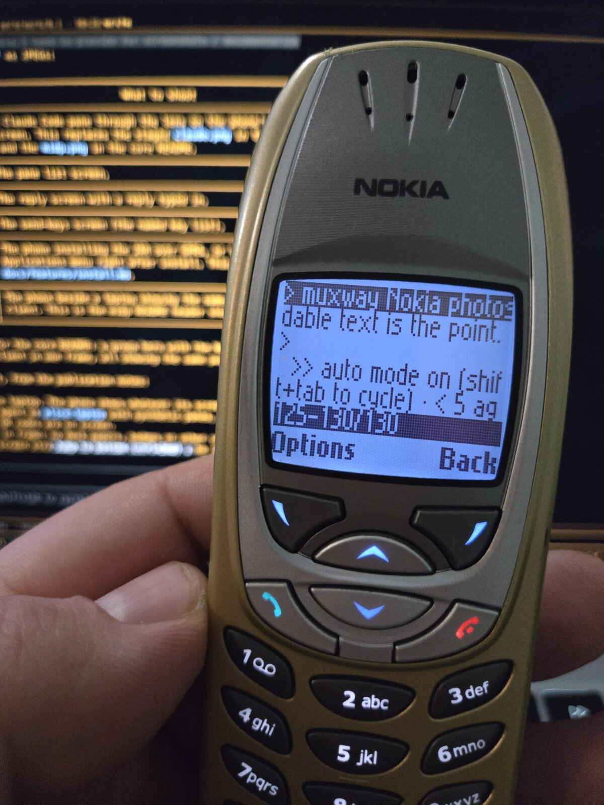
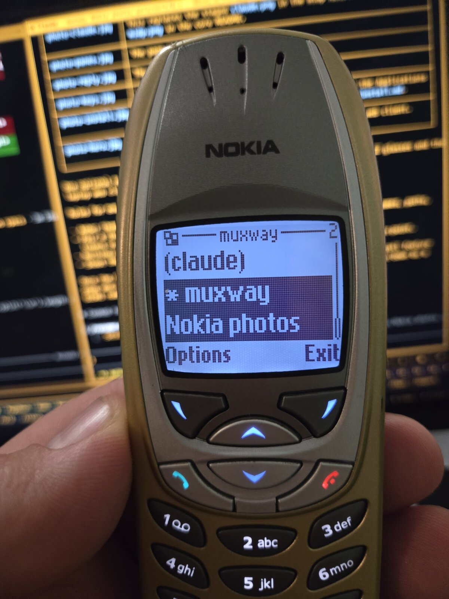
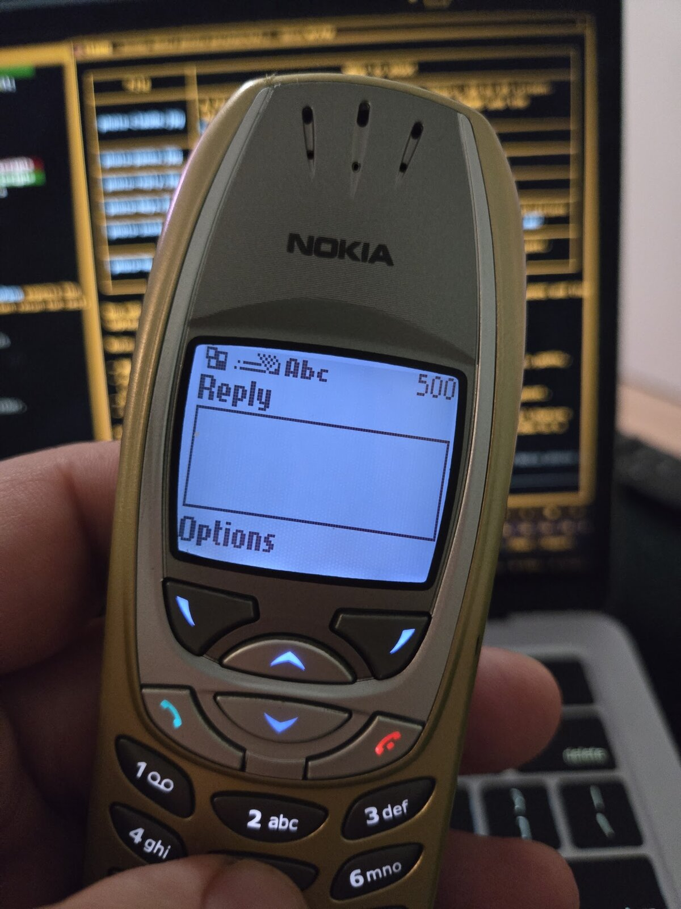
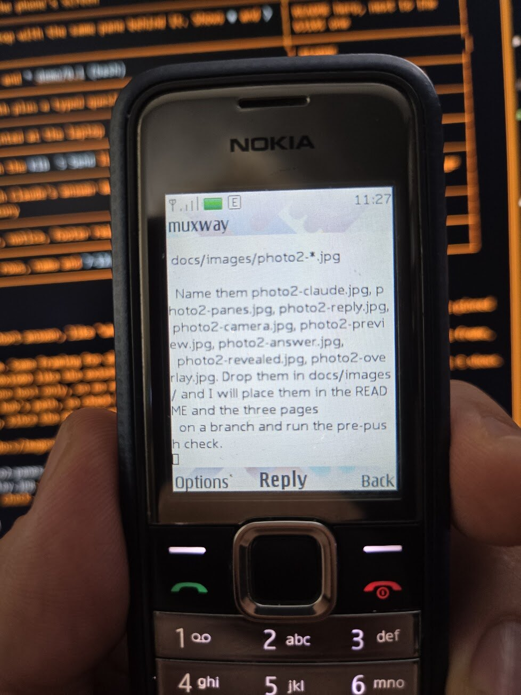
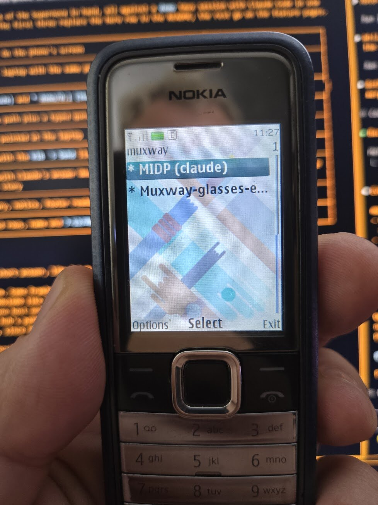
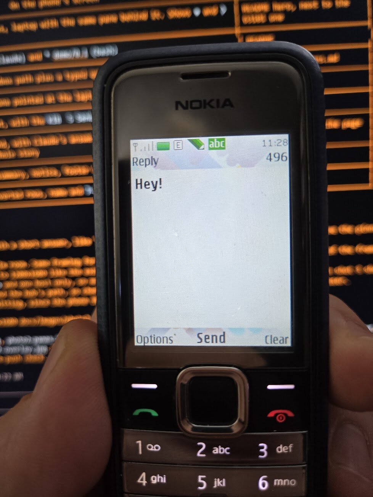
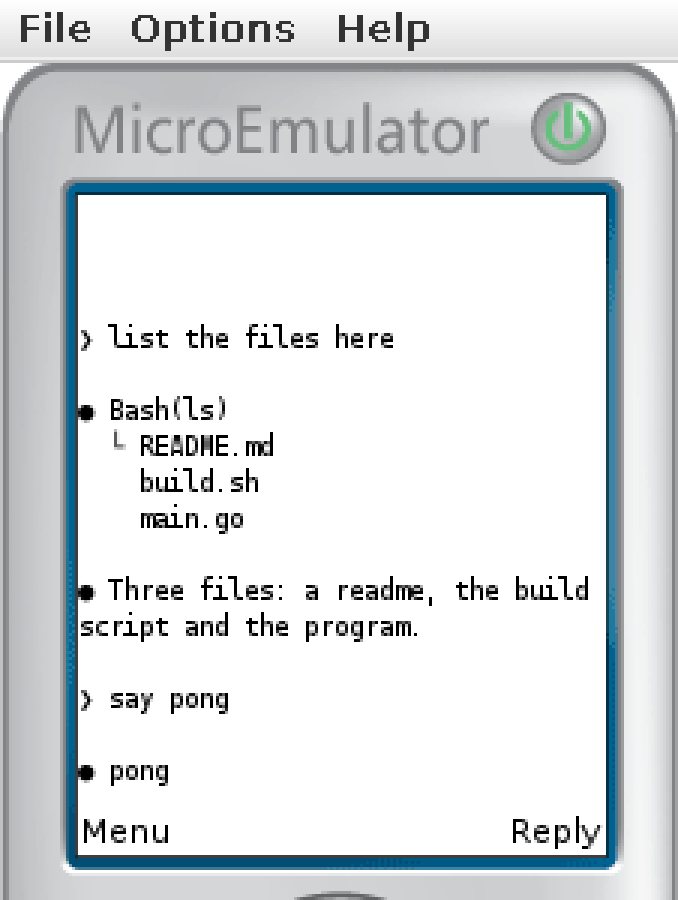
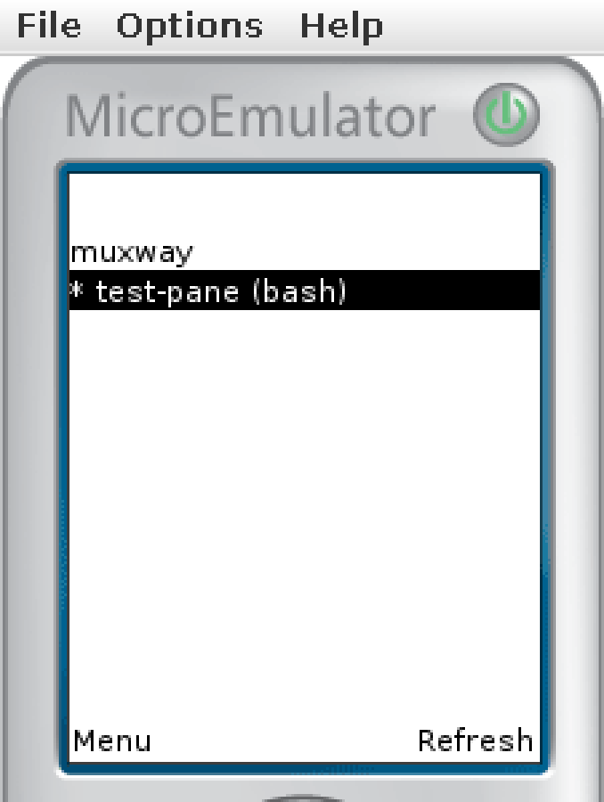
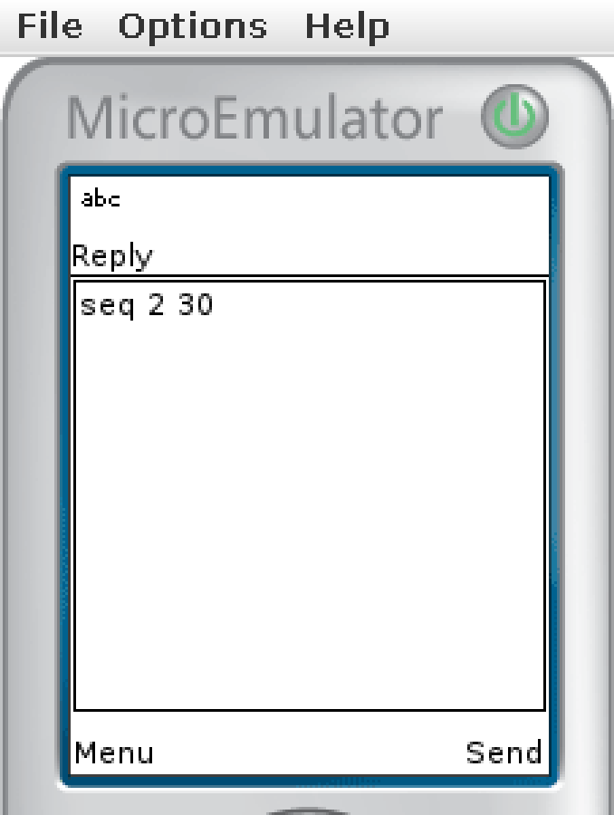

```
┌─ muxway-midp ─┐
```

Java ME client for [muxway](https://github.com/notmarkopadjen/muxway):
your tmux panes on a MIDP 1.0 or 2.0 phone. A 2002 Nokia reads Claude
Code and answers it.

<p>



</p>

> Works on a Nokia 6310i: list panes, read one, reply, send keys.

The MIDP 2.0 build on a Nokia 7310 Supernova: the same screens in
colour, with Unicode and a camera.

<p>



</p>

The screens as the test suite's emulator draws them, pixel for pixel:

<p>



</p>

## What it does

The screen is 96 by 65 pixels and the network is GPRS, so the app does
little, and does it on purpose:

- **List** every pane the token may see, named by what runs in it, or
  by the name its owner gave it (the alias, `* review (claude)`); `*`
  marks the ones you may type into, and `?` `!` `z` `v` after it what a
  pane waits for: a question, a permission, idle, done; a working pane
  is plain, as on every client. On the MIDP 2.0 build the folder a pane
  works in and, for a named pane, what the program says about itself
  follow the name (`review /muxway · fixing the build (claude)`), panes
  that talk to each other are framed one under the other (`[` `]` at
  the edge) and unread mail is counted after the name (`✉ 2`); a line
  per host heads its rows with the host's state, Claude and the other
  harnesses are named as every client names them (`Claude · fixing the
  build`), and *Auto* re-reads the list on a timer.
- **Read** a pane, wrapped to the whole screen, refreshed on a timer or
  with a key; the phone asks the hub for Latin-1 so a phone of that age
  can draw it.
- **Reply** with the keypad's text, **send keys** (Enter, Tab, Shift-Tab,
  Escape, arrows, Ctrl-C) from a menu, and scroll back. The pane's
  screen comes back with the key's own answer, so a key costs one round
  trip over GPRS, not two.
- **The Claude Code lens**: the first [lens](docs/features/lenses.md)
  reshapes Claude Code's screen for the phone, hiding the chrome and
  keeping the conversation and the prompt; `*` reveals everything.
  Only Claude Code has been tested so far; another AI coding agent
  needs a lens for its screen, and its own hooks calling `muxway
  notify` on the host.
- **Keypad first**: `5` replies, `0` opens the keys, `8` scrolls back,
  `1` refreshes. See [the pane view](docs/features/pane-view.md).
- **Reply with a photo** (MIDP 2.0 build): `3` takes one with the
  camera or picks one from the phone, sends it to the pane's host and
  puts its path in the reply for the agent to read. See
  [images](docs/features/images.md).
- **The inbox** (MIDP 2.0 build): what waits for you across hosts,
  oldest first, from the list's menu or `9`; a question asked with fixed
  choices (`muxway ask`) is answered from it with a pick, nothing typed.
  See [the inbox](docs/features/inbox.md).
- **Messages and mail** (MIDP 2.0 build): what panes said to panes,
  oldest first, from the list's menu or `7`; a pane's mail, what came in
  and what it sent; mail the pane, or mail back whoever wrote to it. See
  [messages](docs/features/messages.md).
- **New panes** (MIDP 2.0 build): `+ session` and `+ pane` on the
  list's menu, Close on a pane's, where the host allows them, each behind
  a box or a confirm list. See [new panes](docs/features/new-panes.md).
- **The pane view** (MIDP 2.0 build): left and right open the previous
  and the next pane, a Commands list sends a program's starters with
  Enter, the overlay says what the pane waits for and `read-only`, and
  Settings picks the theme, amber, green or paper.
- **Its own pane or nothing**: the pane view draws the rows of the pane
  it was opened for, or nothing; a late answer for another pane is
  dropped, a pane that is gone closes with a word and the list comes
  back, and while the view waits for its first rows the MIDP 2.0 build
  shows the tube warming up in the theme's ink. The MIDP 2.0 build
  knows its pane by id and follows it when the host renumbers, so a
  stranger's rows are never drawn under its title and a key reaches the
  pane the owner sees.
- **The desk** (MIDP 2.0 build): *Desk* on the list's menu opens the
  pane the owner's other clients are focused on, from the view the hub
  keeps for them; the phone reads it and never moves it. See
  [the desk](docs/features/desk.md).
- **Later**: a pane its owner parked shows `zz` in the list and the
  inbox on both builds; on the MIDP 2.0 build *Later* and *Wake* on the
  pane's menu park and wake it, opening a parked pane wakes it, and the
  overlay draws its name in italics while it is parked. See
  [later](docs/features/later.md).

Phones of that age cannot do current HTTPS, so the app talks to a hub
through a small [relay](docs/features/relay.md) that terminates TLS, with
a token scoped to the few panes the phone needs. The MIDP 1.0 JAR stays
under 30 KiB.

- [Install](docs/features/install.md)
- [The pane view and its keypad](docs/features/pane-view.md)
- [Lenses, and the Claude Code lens](docs/features/lenses.md)
- [Reply with an image](docs/features/images.md)
- [The inbox, and answers to a question](docs/features/inbox.md)
- [Later, a pane parked by its owner](docs/features/later.md)
- [The desk, the view every client shares](docs/features/desk.md)
- [Messages and mail](docs/features/messages.md)
- [New panes and sessions, and closing a pane](docs/features/new-panes.md)
- [Running a relay](docs/features/relay.md)
- [Architecture](docs/ARCHITECTURE.md)

The other clients, and the hub: [muxway](https://github.com/notmarkopadjen/muxway)
(web client, protocol),
[muxway-android](https://github.com/notmarkopadjen/muxway-android),
[muxway-glasses-even](https://github.com/notmarkopadjen/muxway-glasses-even).

## Download

The latest JARs and JADs are on the
[Releases page](https://github.com/notmarkopadjen/muxway-midp/releases/latest):
`muxway.jar` for MIDP 2.0 phones, `muxway1.jar` for MIDP 1.0, installed
the way [Install](docs/features/install.md) says.

## Build

Needs JDK 8 (`openjdk-8-jdk-headless`), `curl`, `unzip` and Python 3.

```sh
python3 tools/draw.py   # only after changing the pictures
scripts/build.sh        # out/muxway.jar (MIDP 2.0) and out/muxway1.jar (MIDP 1.0), with JADs
```

The build downloads the CLDC/MIDP stubs and ProGuard once into `lib/` and
verifies each by SHA-256. It then checks that the MIDP 1.0 JAR calls nothing
MIDP 1.0 lacks and stays under 30 KiB.

## Tests

```sh
MUXWAY_CORE=../muxway scripts/e2e.sh        # everything, both builds
scripts/e2e.sh S04 F08                      # chosen tests
```

The suite builds the hub and agent from a checkout of the core repository,
starts a throwaway tmux server, a relay that can misbehave on purpose, and
the app in the microemulator on a headless display (the MIDP 1.0 build on a
96x65 screen). It drives the app with clicks and key presses and writes
`test-runs/<id>/` with a summary, JUnit results, logs, a screenshot per step
and `report/index.html`. Needs tmux, Xvfb, xdotool, ImageMagick, Go,
Python 3 and JDK 8. The emulator screenshots above come from it; the
photos are of a Nokia 6310i running the MIDP 1.0 build and a Nokia 7310
Supernova running the MIDP 2.0 one.

Contributors and AI agents: read [AGENTS.md](AGENTS.md) first.
Security issues: see [SECURITY.md](SECURITY.md).

[Apache License 2.0](LICENSE), like the rest of muxway.
