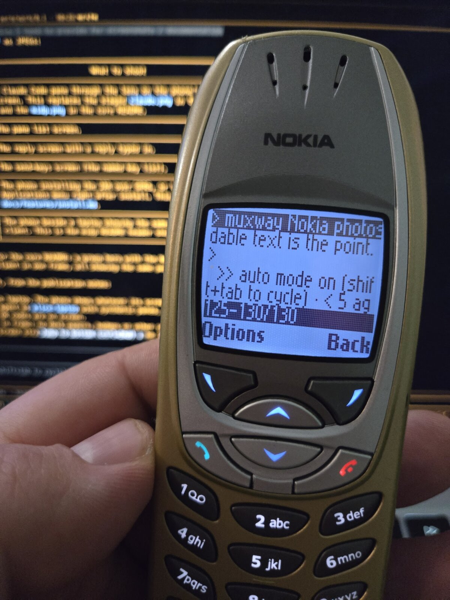
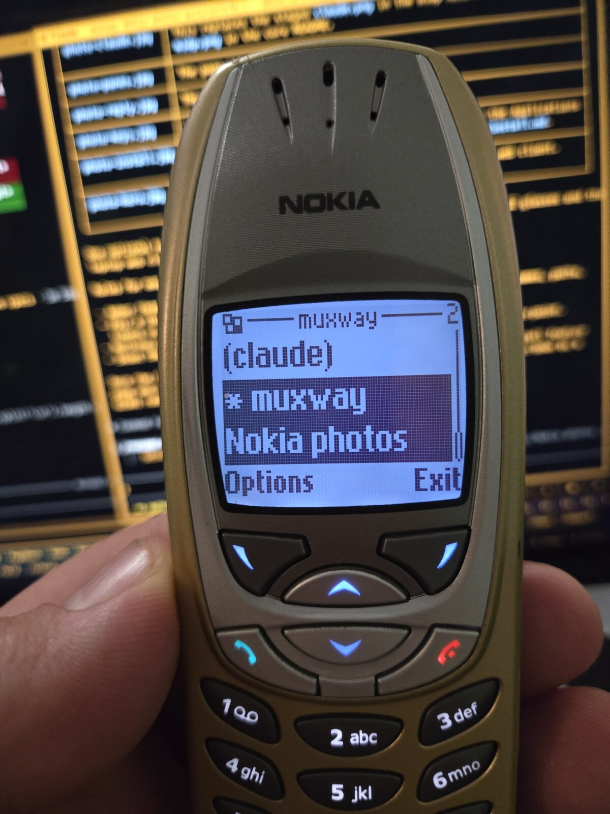
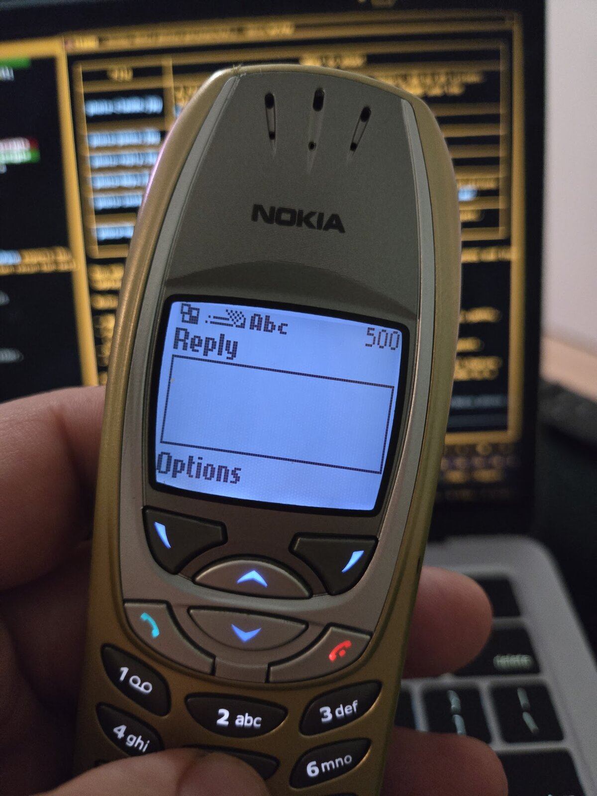
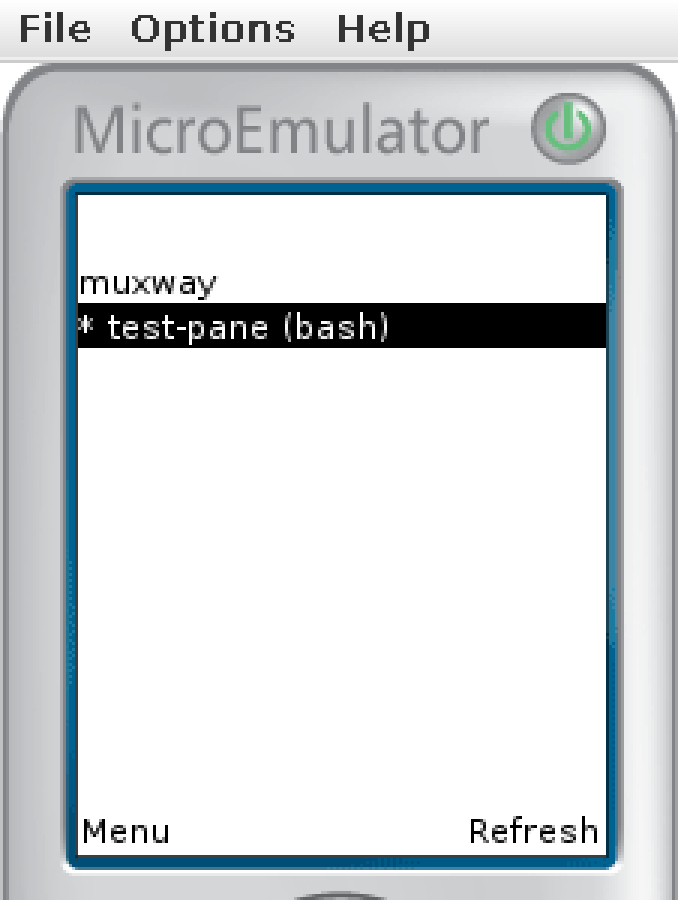
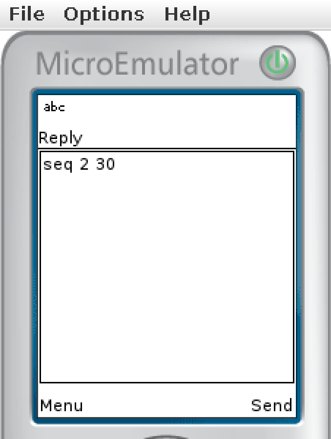

```
┌─ muxway-midp ─┐
```

Java ME client for [muxway](https://github.com/notmarkopadjen/muxway):
your tmux panes on a MIDP 1.0 or 2.0 phone. A 2002 Nokia reads Claude
Code and answers it.

<p>



</p>

> Works on a Nokia 6310i: list panes, read one, reply, send keys.

The screens as the test suite's emulator draws them, pixel for pixel:

<p>



</p>

## What it does

The screen is 96 by 65 pixels and the network is GPRS, so the app does
little, and does it on purpose:

- **List** every pane the token may see, named by what runs in it; `*`
  marks the ones you may type into.
- **Read** a pane, wrapped to the whole screen, refreshed on a timer or
  with a key; the phone asks the hub for Latin-1 so a phone of that age
  can draw it.
- **Reply** with the keypad's text, **send keys** (Enter, Tab, Shift-Tab,
  Escape, arrows, Ctrl-C) from a menu, and scroll back.
- **The Claude Code lens**: the first [lens](docs/features/lenses.md)
  reshapes Claude Code's screen for the phone, hiding the chrome and
  keeping the conversation and the prompt; `*` reveals everything.
  Only Claude Code has been tested so far; another AI coding agent
  needs a lens for its screen, and its own hooks calling `muxway
  notify` on the host.
- **Keypad first**: `5` replies, `0` opens the keys, `8` scrolls back,
  `1` refreshes. See [the pane view](docs/features/pane-view.md).

Phones of that age cannot do current HTTPS, so the app talks to a hub
through a small [relay](docs/features/relay.md) that terminates TLS, with
a token scoped to the few panes the phone needs. The MIDP 1.0 JAR stays
under 30 KiB.

- [Install](docs/features/install.md)
- [The pane view and its keypad](docs/features/pane-view.md)
- [Lenses, and the Claude Code lens](docs/features/lenses.md)
- [Running a relay](docs/features/relay.md)
- [Architecture](docs/ARCHITECTURE.md)

The other clients, and the hub: [muxway](https://github.com/notmarkopadjen/muxway)
(web client, protocol),
[muxway-android](https://github.com/notmarkopadjen/muxway-android),
[muxway-glasses-even](https://github.com/notmarkopadjen/muxway-glasses-even).

## Download

The latest JARs and JADs are on the
[Releases page](https://github.com/notmarkopadjen/muxway-midp/releases/latest):
`muxway.jar` for MIDP 2.0 phones, `muxway1.jar` for MIDP 1.0, installed
the way [Install](docs/features/install.md) says.

## Build

Needs JDK 8 (`openjdk-8-jdk-headless`), `curl`, `unzip` and Python 3.

```sh
python3 tools/draw.py   # only after changing the pictures
scripts/build.sh        # out/muxway.jar (MIDP 2.0) and out/muxway1.jar (MIDP 1.0), with JADs
```

The build downloads the CLDC/MIDP stubs and ProGuard once into `lib/` and
verifies each by SHA-256. It then checks that the MIDP 1.0 JAR calls nothing
MIDP 1.0 lacks and stays under 30 KiB.

## Tests

```sh
MUXWAY_CORE=../muxway scripts/e2e.sh        # everything, both builds
scripts/e2e.sh S04 F08                      # chosen tests
```

The suite builds the hub and agent from a checkout of the core repository,
starts a throwaway tmux server, a relay that can misbehave on purpose, and
the app in the microemulator on a headless display (the MIDP 1.0 build on a
96x65 screen). It drives the app with clicks and key presses and writes
`test-runs/<id>/` with a summary, JUnit results, logs, a screenshot per step
and `report/index.html`. Needs tmux, Xvfb, xdotool, ImageMagick, Go,
Python 3 and JDK 8. The emulator screenshots above come from it; the
photos are of a Nokia 6310i running the MIDP 1.0 build.

Contributors and AI agents: read [AGENTS.md](AGENTS.md) first.
Security issues: see [SECURITY.md](SECURITY.md).

[Apache License 2.0](LICENSE), like the rest of muxway.
