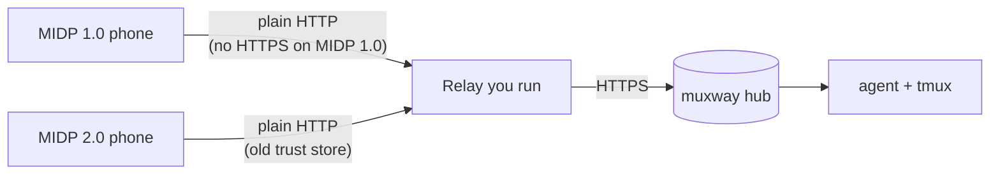
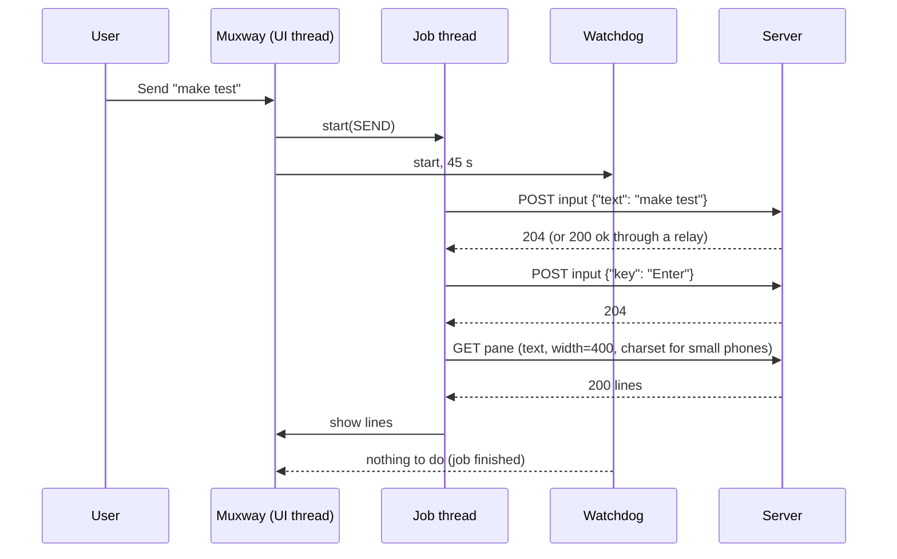

# Architecture

A muxway client for Java ME phones. It speaks the hub's
[protocol v1](https://github.com/notmarkopadjen/muxway/blob/main/docs/protocol/v1.md)
in text mode, nothing else.

## Where it sits

Phones of this age cannot reach a modern HTTPS server: MIDP 1.0 has no
HTTPS at all, and later phones' certificate stores have expired. A small
relay takes plain HTTP from the phone and forwards it to the hub over
HTTPS. See [the relay page](features/relay.md).

## Source layout

| Path | What |
|---|---|
| `src/muxway/Muxway.java` | the MIDlet: screens, commands, jobs, auto refresh |
| `src/muxway/PaneView.java` | the pane, drawn on a Canvas over the whole screen |
| `src/muxway/Lens.java`, `src/muxway/ClaudeCode.java` | lenses: per-program reshaping of a pane's rows ([lenses](features/lenses.md)) |
| `src/muxway/Api.java` | the protocol calls, limits, error messages |
| `src/muxway/Prefs.java` | settings, and each pane's view, in the record store |
| `src/muxway/Text.java` | string helpers CLDC 1.0 lacks, filters for screen and input |
| `src/muxway/Inbox.java`, `Talk.java`, `Mail.java`, `Hosts.java`, `Commands.java`, `Theme.java` | MIDP 2.0 only: the inbox, talk groups, messages and mail, the hosts and their flags, the command lists, the canvas colours; ProGuard drops them from the 1.0 JAR |
| `src/muxway/Trace.java` | test-only record of what reaches the screen |
| `profiles/midp1`, `profiles/midp2` | the few lines that differ per build, and `Files`: the camera and gallery screens on 2.0, nothing on 1.0 |
| `tools/draw.py` | draws the icon and the wait bar's frames |
| `scripts/build.sh`, `scripts/check-midp1.sh` | the build and its MIDP 1.0 check |
| `tests/` | unit tests (Java SE) and the end-to-end harness |

## Screens

```mermaid
stateDiagram-v2
    [*] --> Settings: nothing in the install file
    [*] --> Panes: server and token known
    Settings --> Panes: OK
    Panes --> Pane: select
    Pane --> Reply: Reply (writable panes)
    Reply --> Pane: Send = text + Enter / Type = text / Back
    Pane --> Keys: Keys (writable panes)
    Keys --> Pane: a key is sent
    Pane --> Panes: Back
    Panes --> Inbox: Inbox (MIDP 2.0)
    Pane --> Inbox: 9 (MIDP 2.0)
    Inbox --> Pane: select (a parked pane wakes)
    Inbox --> Answer: select a row with choices (a writable pane)
    Answer --> Inbox: a choice is sent
    Pane --> Pane: Later / Wake (writable, MIDP 2.0); left / right, the previous / next pane
    Panes --> Messages: Messages (MIDP 2.0)
    Pane --> Messages: 7 (MIDP 2.0)
    Messages --> Pane: select a typed row
    Messages --> Mail: select a mail row
    Pane --> Mail: Mail (MIDP 2.0)
    Mail --> MailBox: Mail pane, or mail back
    MailBox --> Mail: Send
    Pane --> Commands: Commands (writable, MIDP 2.0)
    Commands --> Pane: a pick is sent with Enter
    Panes --> Session: select a host line with + session (MIDP 2.0)
    Session --> Pane: Start, the first pane opens
    Pane --> Confirm: + pane, Close (writable, MIDP 2.0)
    Confirm --> Pane: Beside / Below, the new pane opens
    Confirm --> Panes: Close
    Panes --> Settings: Settings, or the token was refused
```

- **Panes** is a `List` of the panes the token can read, from
  `GET /v1/panes` in text mode, each by its alias where its owner gave
  one, else its title, and its program (`* review (claude)`, `* build
  (claude)`, or `work/0.1 (bash)` when the title says nothing; the MIDP
  2.0 build adds the pane's folder and a named pane's title,
  `* review /muxway · fixing the build (claude)`, and names a harness
  as every client does, `* Claude /muxway · fixing the build`); `*` marks
  writable ones, the character after it what the pane waits for (`?` `!`
  `z` `v`, `zz` for a pane parked for [later](features/later.md), `zz !`
  with what waits under it on the 2.0 build); on the 1.0 build offline
  hosts follow with `-`, on the 2.0 build a line per host with its state
  heads its rows and offers `+ session` where the host allows it, and
  *Auto* re-reads the list on the timer.
- **Inbox** (MIDP 2.0 build) is a `List` of every waiting pane from
  `GET /v1/inbox` in text mode, oldest first; a row with choices opens
  **Answer**, a `List` of them, and the pick goes to
  `POST /v1/panes/{address}/answer`. See [the inbox](features/inbox.md).
  Parked panes come last, and open woken (`POST
  /v1/panes/{address}/later`), as *Later* and *Wake* on the pane's menu
  park and wake it. See [later](features/later.md).
- **Messages** (MIDP 2.0 build) is a `List` of the feed, `GET /v1/talk`
  in text mode, and **Mail** one of a pane's mail, `GET
  /v1/panes/{address}/mail` merged with the feed's mail from it; a
  `TextBox` posts a mail to `POST /v1/panes/{address}/mail`. See
  [messages](features/messages.md). **Commands** lists a program's
  starters, sent as a reply with Enter. **Session** is a `TextBox` for a
  session's name, `POST /v1/hosts/{host}/sessions`; **Confirm** a
  `List` of two or three answers before `POST
  /v1/windows/{host}/{session}/{window}/panes` and `POST
  /v1/panes/{address}/close`. See [new panes](features/new-panes.md).
- **Pane** is a `Canvas`, not a `Form`: a MIDP 1.0 form opens at its top
  and cannot be scrolled from code, while a terminal must open at its
  bottom. The canvas fills the whole screen with the rows in a monospace
  font, bottom-aligned, measures how many columns fit (from the first full
  paint's clip, because `Canvas.getWidth` binds to `Displayable` in the
  MIDP 2.0 stubs and that method does not exist there on MIDP 1.0), asks
  the hub for the rows unwrapped (`width=400`) and wraps them itself. A
  lens may pin rows to the bottom. `2`/`8` scroll, `5` and `0` open Reply
  and Keys, `#` overlays title and position, `*` reveals what a lens hid,
  the green call key of Nokia phones sends Enter, left and right open
  the previous and the next pane. On the 2.0 build it is painted in the
  theme Settings chose, amber, green or paper. See
  [the pane view](features/pane-view.md).
- **Reply** is a `TextBox`; control characters are removed before sending.
  Send and Type return to the pane at once, where the wait mark runs
  until the hub has answered; a refusal is shown over the pane.
- **Keys** lists the protocol's named keys in plain words.
- **Settings** keeps the token in a password field and never shows it
  again; an empty field keeps the stored one.

## Requests

- One job at a time on its own thread; the UI thread never touches the
  network. A command during a job says "Still waiting for the last answer".
- MIDP has no request timeout. A watchdog gives up on a job after 45 s,
  says "No answer from the server", and the app is usable again; a late
  answer from the abandoned job is ignored.
- Every response is read before the connection is closed, also an empty
  one: some phones release their single HTTP connection only then.
- At most 32 KiB of an answer is read; control characters are dropped
  before anything is shown.
- The token goes in `X-Muxway-Token`: WAP 1.x stacks rewrite
  `Authorization: Bearer` into `Basic`.

## Protocol features used

What a relay has to pass, and all the app ever asks for:

- `GET /v1/hosts`, `GET /v1/panes`, `GET /v1/panes/{address}` and
  `POST /v1/panes/{address}/input`, under the server URL from Settings
  plus `/v1`; the MIDP 2.0 build also `GET` and `POST
  /v1/panes/{address}/files` for an [image](features/images.md), and
  `GET /v1/inbox` and `POST /v1/panes/{address}/answer` for
  [the inbox](features/inbox.md), `POST /v1/panes/{address}/later`
  for [later](features/later.md), `GET /v1/talk` and `GET` and `POST
  /v1/panes/{address}/mail` for [messages](features/messages.md), and
  `POST /v1/hosts/{host}/sessions`, `POST
  /v1/windows/{host}/{session}/{window}/panes` and `POST
  /v1/panes/{address}/close` for [new panes](features/new-panes.md).
  No other route: no `/v1/me`, no tree, no long-poll or events.
- Text mode only: `Accept: text/plain`, and the answers are read as
  `text/plain`. Of the pane listing's columns both builds read `alias`,
  the eighth, and the MIDP 2.0 build also `mail`, `talk`, `cwd` and
  `pending`, the sixth, seventh, ninth and tenth, where the hub writes
  them; rows without them list as before. The hosts listing's third
  column, the host's flags as words joined by `|`, says where `+
  session`, Close and Mail are offered (2.0 build); the inbox's sixth
  column is `pending`; the mail row's seventh is `replied`. Every reader
  ignores columns and words it does not know. The answers to a split
  and a session are JSON; the phone reads the pane's `address` from
  them and nothing else.
- Query parameters: `charset=latin1` or `charset=ascii` on `panes` and on a
  pane read when the Text setting is not Unicode; `lines=<n>` and
  `width=400` on a pane read.
- Headers: `X-Muxway-Token`, `Accept`, `User-Agent`, `If-None-Match` on
  auto refresh (and `ETag` from the answer), `Content-Type:
  application/json` and `Content-Length` on input, `Content-Type:
  multipart/form-data` on an image.
- Input is `{"text": "..."}` or `{"key": "<name>"}` with one of the
  protocol's named keys, an answer `{"choice": "..."}` with one of the
  choices the inbox row carried, a mail `{"text": "..."}`, a session
  `{"name": "..."}` checked against `[a-z0-9_-]{1,32}` on the phone, a
  split `{"direction": "h"}` or `"v"`, a close `{}`; control
  characters never leave the phone.
- Pane addresses come from the hub's list and are used only when they
  follow the protocol's grammar (`host/session/window.pane` or
  `host/@alias`); any other row is skipped. The server URL must be
  `http://` or `https://` with no `?`, `#`, `@` or whitespace.

## Builds

Both builds come from the same source. Class files target Java 1.1, ProGuard
preverifies them for CLDC, and `check-midp1.sh` lists every Java ME member
the MIDP 1.0 JAR references and fails on any MIDP 1.0 lacks, including
members that only moved to a superclass in MIDP 2.0, the media API and
the file API. The MIDP 1.0 JAR must stay under 30 KiB. The 2.0 build is
compiled against the media and file API stubs as well (two pinned jars
from the emulator's project); code the 1.0 build must not carry sits
behind the constant `Files.ANY`, false there, so that javac and ProGuard
leave it out.
