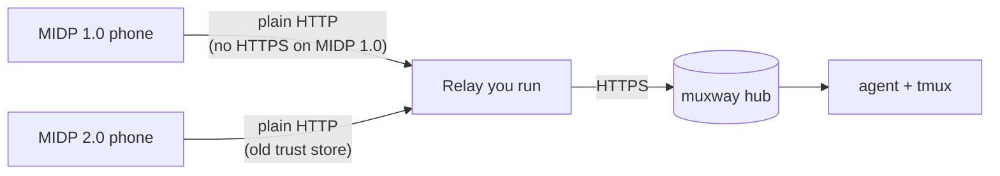
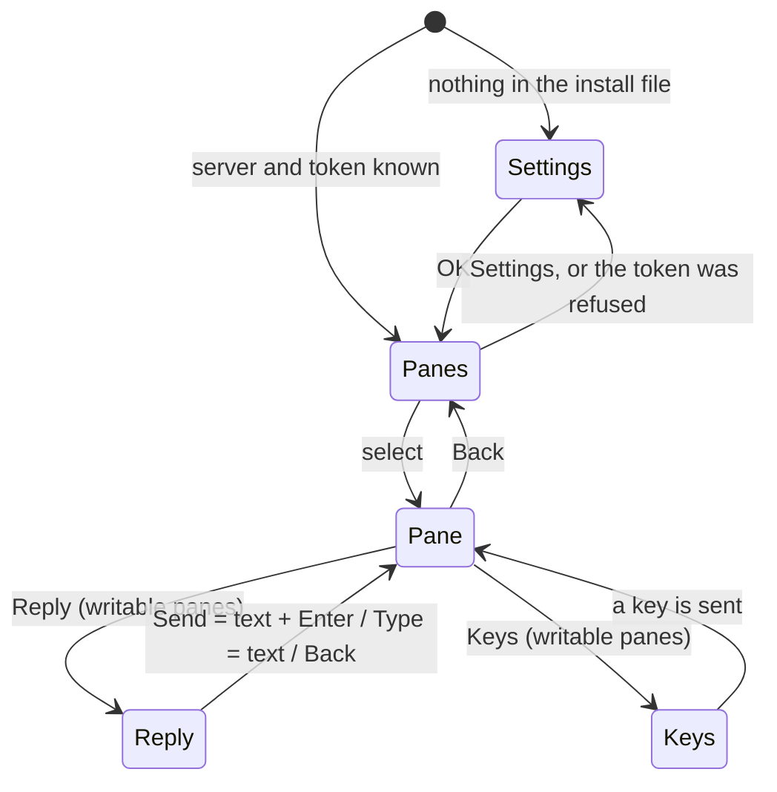
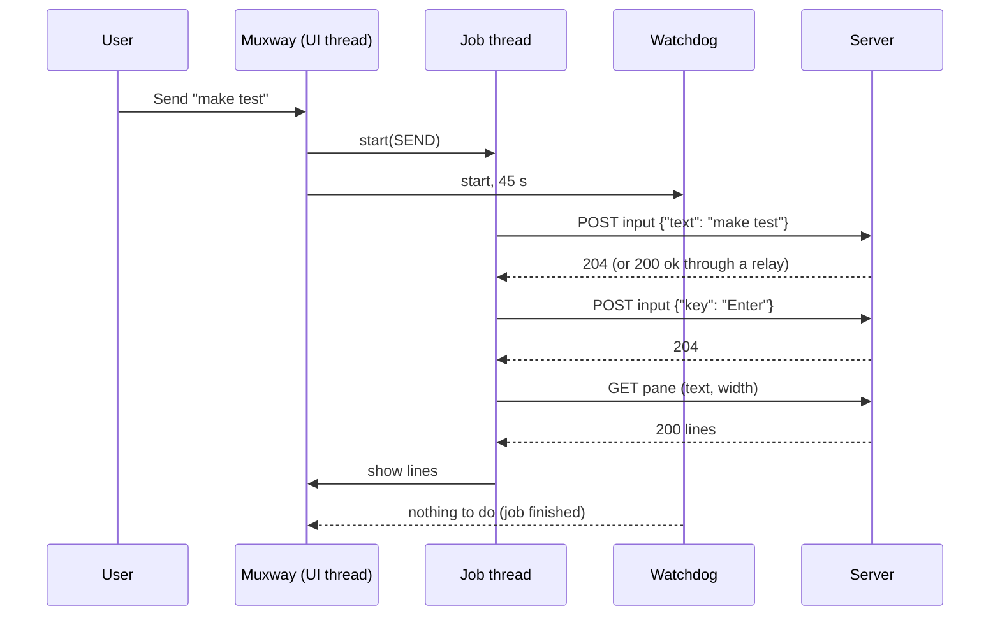

# Architecture

A muxway client for Java ME phones. It speaks the hub's
[protocol v1](https://github.com/notmarkopadjen/muxway/blob/main/docs/protocol/v1.md)
in text mode, nothing else.

## Where it sits

Phones of this age cannot reach a modern HTTPS server: MIDP 1.0 has no
HTTPS at all, and later phones' certificate stores have expired. A small
relay takes plain HTTP from the phone and forwards it to the hub over
HTTPS. See [the relay page](features/relay.md).

## Source layout

| Path | What |
|---|---|
| `src/muxway/Muxway.java` | the MIDlet: screens, commands, jobs, auto refresh |
| `src/muxway/PaneView.java` | the pane, drawn on a Canvas |
| `src/muxway/Api.java` | the four protocol calls, limits, error messages |
| `src/muxway/Prefs.java` | settings in the record store |
| `src/muxway/Text.java` | string helpers CLDC 1.0 lacks, filters for screen and input |
| `src/muxway/Trace.java` | test-only record of what reaches the screen |
| `profiles/midp1`, `profiles/midp2` | the few lines that differ per build |
| `tools/draw.py` | draws the icon and the wait bar's frames |
| `scripts/build.sh`, `scripts/check-midp1.sh` | the build and its MIDP 1.0 check |
| `tests/` | unit tests (Java SE) and the end-to-end harness |

## Screens

- **Panes** is a `List` of the panes the token can read, from
  `GET /v1/panes` in text mode; `*` marks writable ones, offline hosts
  follow with `-`.
- **Pane** is a `Canvas`, not a `Form`: a MIDP 1.0 form opens at its top
  and cannot be scrolled from code, while a terminal must open at its
  bottom. The canvas draws an inverted title bar and the lines in a
  monospace font, measures how many columns fit (from the first full
  paint's clip, because `Canvas.getWidth` binds to `Displayable` in the
  MIDP 2.0 stubs and that method does not exist there on MIDP 1.0), and
  asks the hub to wrap to that width. Up and Down scroll; the green call key
  of Nokia phones sends Enter.
- **Reply** is a `TextBox`; control characters are removed before sending.
- **Keys** lists the protocol's named keys in plain words.
- **Settings** keeps the token in a password field and never shows it
  again; an empty field keeps the stored one.

## Requests

- One job at a time on its own thread; the UI thread never touches the
  network. A command during a job says "Still waiting for the last answer".
- MIDP has no request timeout. A watchdog gives up on a job after 45 s,
  says "No answer from the server", and the app is usable again; a late
  answer from the abandoned job is ignored.
- Every response is read before the connection is closed, also an empty
  one: some phones release their single HTTP connection only then.
- At most 32 KiB of an answer is read; control characters are dropped
  before anything is shown.
- The token goes in `X-Muxway-Token`: WAP 1.x stacks rewrite
  `Authorization: Bearer` into `Basic`.

## Builds

Both builds come from the same source. Class files target Java 1.1, ProGuard
preverifies them for CLDC, and `check-midp1.sh` lists every Java ME member
the MIDP 1.0 JAR references and fails on any MIDP 1.0 lacks, including
members that only moved to a superclass in MIDP 2.0. The MIDP 1.0 JAR must
stay under 30 KiB.
