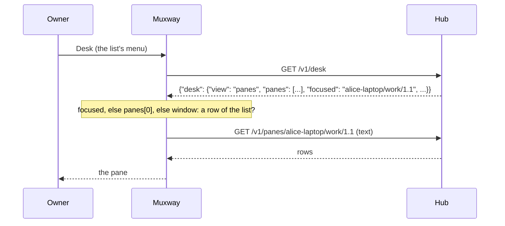

# The desk: the view every client shares

The hub keeps the **desk**: which panes the owner has open, the one
focused, their arrangement, the minimised ones, or the window the window
view shows (the core's
[desk](https://github.com/notmarkopadjen/muxway/blob/main/docs/features/desk.md)).
The web and Android write it as the view changes and open it when they
start. A keypad phone shows one pane at a time, so what it takes from
the desk is the one thing it can show: the pane the desk is focused on,
as the core's guideline says of the small clients (§1.1, the *desk*
row). The MIDP 2.0 build has it; the 1.0 build's JAR has no room for a
request and a reader more.

## Desk

**Desk**, the first entry of the pane list's menu, asks the hub for
`GET /v1/desk` and opens:

- the desk's **focused** pane;
- else the **first** of its panes;
- else, for a window desk, the first pane of that **window** in the
  list;
- a desk with none of these says *The desk is empty.*; a hub without
  the endpoint says *This hub has no desk.*

The pane opens as the list opens it: its row is selected, the view
reads it, a parked pane wakes as it opens. Only a pane of the list the
phone holds opens; a pick the list has not is looked for once more in
a fresh list, and after that the phone says *The desk's pane is not in
the list.*

The phone **reads the desk and never writes it**: opening a pane here
moves no tile on the web, and the focus the owner has at the desk is
not touched by the phone opening it.

The hub answers the desk in JSON whatever the phone asks for (the
endpoint has no text mode; the body is at most 8 KiB). The phone reads
three strings from it, `focused`, the first of `panes` and `window`,
with the same small reader that takes a new session's address, and
nothing else: the arrangement, the tree, the minimised row and the
order are the big clients' business.

## Security considerations

- One `GET`, under the token like every request; no `PUT` exists in the
  phone, so a token given to the phone cannot move the desk even if it
  carries a write grant. The relay forwards `GET /v1/desk` and nothing
  more on that path (see [the relay](relay.md)).
- The hub filters the desk to the panes the token may read before
  answering: a focus the token may not read is dropped, and so are the
  panes. The phone checks on its own side too: the pick is opened only
  when it is a row of the listing the phone holds from the same hub,
  by exact address (or, for a window, the first address under it). A
  desk forged by a relay in the way, naming a path up, a stranger's
  pane or three hundred letters with control characters, opens nothing
  and says the pane is not in the list; the row opened is always the
  list's, with the list's mode, so a forged desk cannot make a
  read-only pane writable. The suite's S31 forges it, S32 reads it with
  a token of one pane.
- The desk's JSON names addresses and the writer's name, never a secret;
  between the phone and the relay it travels in the clear like the
  listing, which names the same panes.
- Nothing is logged; the test build's trace names the address opened,
  as it does for every open.
