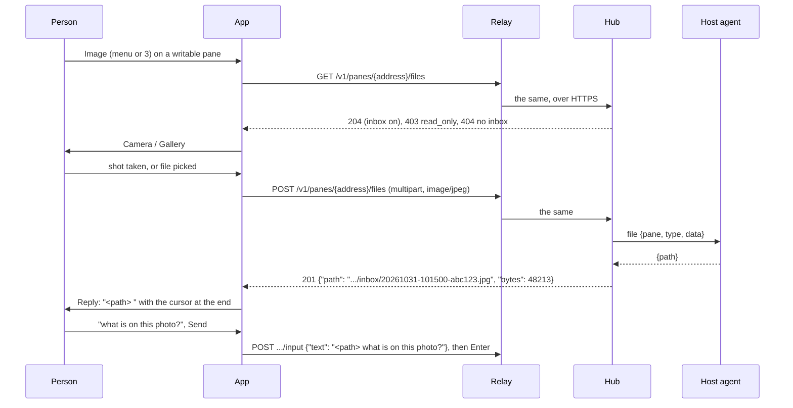
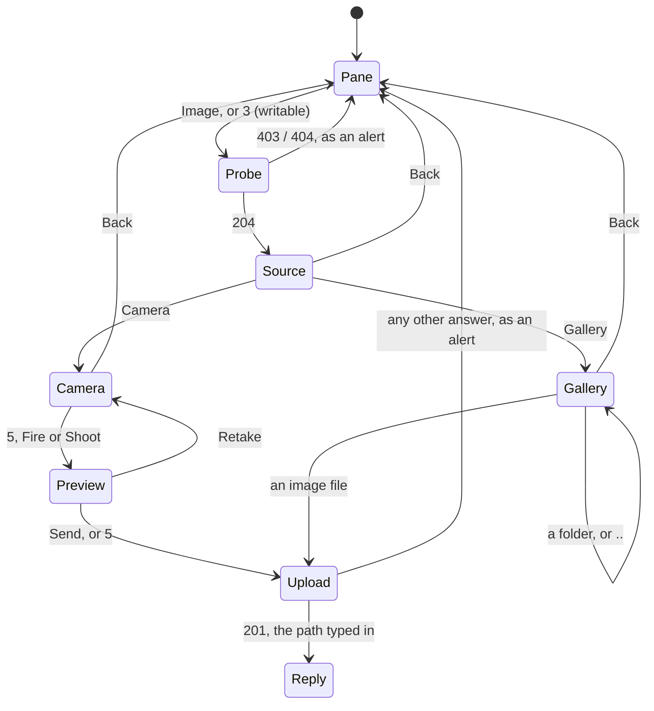

# Reply with an image

An AI coding agent reads a photo when its path is in the prompt. On the
MIDP 2.0 build a writable pane has **Image**: take a photo with the
phone's camera, or pick one from the phone's memory, and it goes to the
pane's host, into the inbox the core's
[attachments](https://github.com/notmarkopadjen/muxway/blob/main/docs/features/attachments.md)
feature keeps there. The app then opens Reply with the file's path
already typed and a space after it; finish the sentence on the keypad
and Send, as for any reply.

The MIDP 1.0 build has none of this: those phones have no camera and no
media API, and the WAP 1.x path cannot carry the request.

## Using it

On the host, once, the agent needs an inbox:

```sh
muxway agent run --inbox default
```

On the phone, on a writable pane: `3`, or Image in the menu. The app
asks the hub once per pane whether the host takes files, so no photo is
taken for one that does not; a host without an inbox answers "The host
takes no files: its agent needs --inbox", a pane the token may not write
"Read only." Then:

- **Camera**: the live picture fills the screen; `5`, the joystick or
  Shoot takes the shot, 640x480 JPEG where the phone allows it. The
  shot is shown with Send and Retake; `5` sends.
- **Gallery**: the phone's photo folder, or its memory roots when it
  names none; folders first, then `.jpg`, `.jpeg`, `.png` and `.gif`
  files, `..` at the top. Selecting a file sends it. A file over 1 MiB
  is refused before any request: over GPRS it would take minutes.

While the file goes up the pane shows its wait mark, as for any request,
with four minutes of patience instead of 45 seconds. Then Reply opens
with the path: `/home/alice/.config/muxway/agent/inbox/20261031-101500-abc123.jpg `.
Type the question and Send; the pane gets the path and the words, then
Enter.





Camera is listed only on a phone whose media API says it captures
(`supports.video.capture`); the test emulator has no camera and shows
Gallery alone.

## What is sent

`GET` and `POST /v1/panes/{address}/files` as [protocol
v1](https://github.com/notmarkopadjen/muxway/blob/main/docs/protocol/v1.md)
specifies them: one multipart part named `file`, its `Content-Type`
the image's, its file name always `file`. The phone's own name for the
file never leaves the phone. The answer's `path` is the only thing the
app reads from it.

A **relay** has to forward these two calls as well (see [running a
relay](relay.md)): the `Content-Type` header as it is, and a body of up
to 8 MiB on that path. A relay that does not makes Image answer "Not
found." and changes nothing else.

## Security considerations

- The hub requires the pane's write grant and a writable mark, and
  keeps its limits: 8 MiB a file, 500 files or 256 MiB in the inbox, one
  file every two seconds, a day's lifetime, the bytes sniffed against
  the type. A phone's token can put no more on a host than a browser
  with the same token.
- The path in the answer comes from the hub or a relay. The app reads it
  with a parser that accepts nothing but a JSON string, cuts it to 256
  characters, drops control characters, and puts it in the Reply box.
  The phone never opens it; on Send it travels as reply text, like any
  other. A malformed answer is "Unexpected answer." and the pane.
- A gallery file is bytes the phone reads from its own memory; its type
  comes from the extension and the hub checks the bytes against it
  (`415`). A camera shot's type comes from its first bytes.
- Through a plain-HTTP relay the photo travels unencrypted, as the token
  and the pane's text already do: a token per phone, the few panes it
  needs, short-lived, as [the relay page](relay.md) says.
- The camera is released the moment the shot is taken or the screen
  left. A gallery file is streamed in 4 KiB pieces, never held whole,
  and refused over 1 MiB before any request.
- The app's trace (test builds only) records the size and the status of
  an upload and the path, never the bytes. The hub and the agent audit
  who put what type and size where, as the core specifies.

The end-to-end suite covers a read-only token, a host without an inbox,
hostile answers to the upload, an oversized file, every refusal the hub
can give, and a file whose bytes are not what its name says (S11 to
S17); the gallery route end to end in the emulator (F22, F23); and that
the MIDP 1.0 build has nothing of it (F25). The camera route is tested
on a phone.
