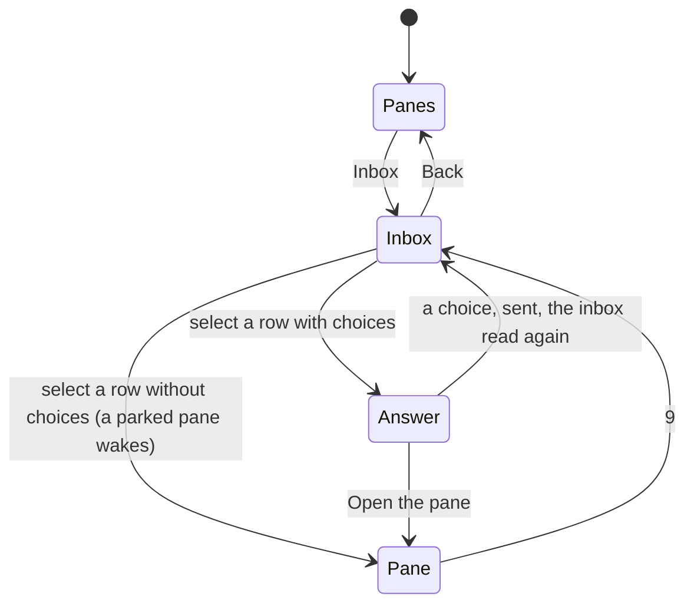

# The inbox: what waits, and a question's answer

A pane whose program needs its owner carries a kind in the hub's
listings: a `question`, a `permission`, `idle`, `done`. The pane list
shows it as the character after the writable mark, `*?build (claude)`
(see [the pane view](pane-view.md#the-list)). With a few agents on a few
hosts the question is which one waits, and since when: the hub's
[inbox](https://github.com/notmarkopadjen/muxway/blob/main/docs/features/inbox.md)
lists every waiting pane the token may read, oldest first, and this app
shows it on the MIDP 2.0 build. Who talks with whom, and who holds mail,
is on the pane list itself (see [the pane view](pane-view.md#the-list)).

## The screen

**Inbox** on the pane list's menu, or `9` on a pane, asks the hub for
`GET /v1/inbox` in text mode and lists one row per waiting pane: the
kind's mark, the pane as the list names it (its alias where its owner
gave one, see [the pane view](pane-view.md#the-list)), and the text the
program gave (`? build (claude): deploy to staging?`, `? review /muxway
· fixing the build (claude): deploy?`). Rows are cut at 64 characters; a
pane the list does not know is named by its address.
*Nothing waits.* when the inbox is empty. **Refresh** reads it again,
**Back** returns to where it was opened from.

After every waiting pane come the panes their owner parked for
[later](later.md), as the hub orders them, with `zz` for their mark and
the text and choices of whatever waits underneath, if anything, and
its mark after `zz` where the hub's row names it (the `pending` column):
`zz ! build (claude): run it?`. Selecting one opens the pane and wakes it, on a
writable pane (MIDP 2.0 build).

Select a row and its pane opens, as from the pane list. A row whose
question came with fixed choices (`muxway ask` on the host) opens the
**Answer** list first: the choices, then *Open the pane*. On a pane the
list marks read-only the choices are not offered and the row opens the
pane: an answer is a write, as every client's disabled buttons say. Pick a choice
and it goes to the process that asked, `POST /v1/panes/{address}/answer`;
nothing is typed into the pane. The inbox is read again after.

The hub's refusals are shown in words over the inbox: *Read only.* for a
token without a write grant on the pane, *No question now.* when the
question was answered elsewhere or timed out (the hub's `409`), *Not a
choice.* for an answer the question did not offer (`400`).

## The MIDP 1.0 build

The small build shows the kind in the pane list and nothing more: the
inbox is a screen, a job and a parser the 30 KiB JAR has no room for
(`Ui.INBOX` is false there, and ProGuard drops the class). `9` does
nothing on it.

## The relay

A relay forwards two more paths for this: `GET /v1/inbox` and `POST
/v1/panes/{address}/answer`. See [running a relay](relay.md).

## Security considerations

- An answer is a write: the hub checks the token's write grant and the
  pane's mark, and the host agent checks the choice against the list the
  question offered, so the phone can send nothing the process did not
  ask for. The phone sends the choice exactly as the inbox row carried
  it, escaped as reply text is.
- The choices column is split on `|`, capped at eight, each cut to 40
  characters, and control characters are dropped as from every answer,
  so a hostile relay cannot put endless text or a terminal sequence
  into a list.
- The inbox shows exactly what the token may read, as the pane list does.
- A read-only row offers no choices: the write mark is the list's, from
  the hub's mode column, so a relay that lies about it gets the hub's
  refusal in words (S16).
- Between the phone and the relay an answer travels in the clear like
  every input; the warning Settings shows once for a plain-HTTP server
  covers it.
- Nothing is logged on the phone; the trace of the test build prints the
  screens and the status codes, never the token.
