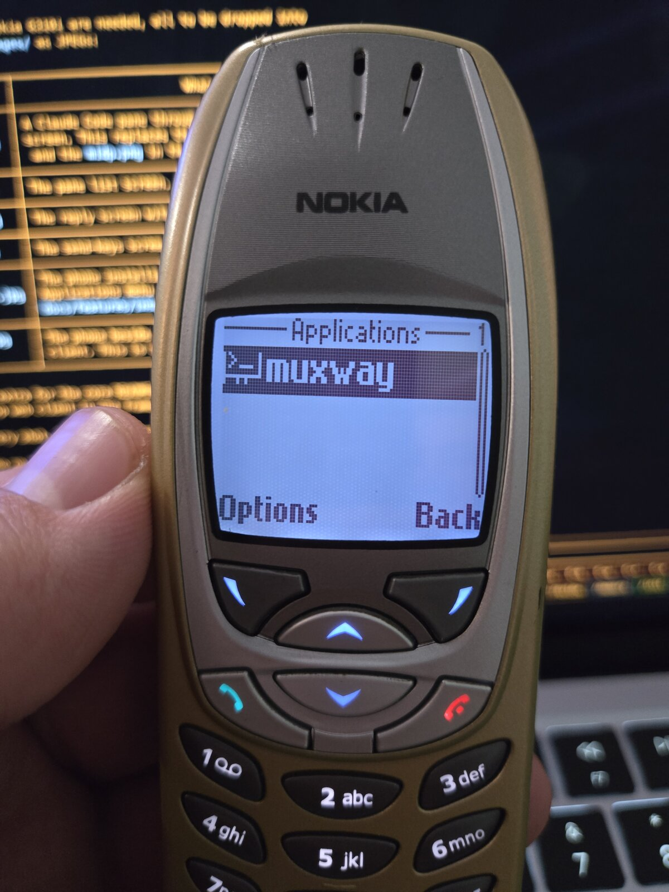
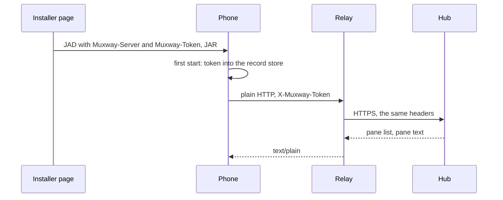

# Installing on a phone

## From the phone's browser

Open the `.jad` URL in the phone's browser; the phone fetches the JAR and
asks to install. `muxway1.jad` is the MIDP 1.0 build, for phones like the
Nokia 6310i; `muxway.jad` is the MIDP 2.0 build.

An installer page may add these attributes to the JAD, so that nothing has
to be typed on the keypad:

| Attribute | Meaning |
|---|---|
| `Muxway-Server` | base URL the app calls, e.g. `http://relay.example.com` (no `/v1`); `http://` or `https://`, with no `?`, `#`, `@` or spaces, else the app opens Settings and says so |
| `Muxway-Token` | the phone's token; stored on first start, never shown again. An install file with a different token replaces the saved settings once, so a reinstall with a new token needs no delete; Settings may be changed after it |
| `Muxway-Refresh` | seconds between automatic refreshes, 0 for off |
| `Muxway-Text` | how the hub spells what the phone cannot show: `unicode`, `latin1` or `ascii`; the MIDP 1.0 build defaults to `latin1`, the 2.0 build to `unicode` (see [lenses](lenses.md)) |

## Without a browser

Copy the JAR over Bluetooth, infrared or a memory card and install it from
the file manager. The app then opens Settings: server, token, width (0 lets
the app measure the screen) and the refresh interval.

## Network permission

The app is not signed (the code-signing roots on these phones expired
long ago), so the phone asks before it uses the network. On Series 40 set
the app's network access to "Ask first time" to be asked once per start.

## Updating

Installing a newer JAD replaces the app and keeps its settings.

## Security considerations

A JAD that carries a token is itself a secret: serve it once, to the right
phone, without caching. Whoever can make the phone install a JAD can make
it install any app, so letting a new JAD replace the saved token adds
nothing to what an installer could do already.

The JAD attributes stay in the phone's application store for as long as the
app is installed. The app forgets a token the hub refused, but that does
not remove it from the device; it also does not take the same install
file's token again, so after a refusal the token is typed in Settings or a
new JAD is installed. To remove a token from the phone, delete the app.

Between the phone and the relay the token travels in the clear (see
[the relay page](relay.md)). Settings says so once when a plain `http://`
server outside the phone's own network (loopback or a private address) is
saved. The MIDP 2.0 build may use `https://` directly where the phone trusts
the server's certificate; the MIDP 1.0 build has no HTTPS and always needs
the relay.
