# Later: a pane parked by its owner

Several agents call at once, and some of them can wait. **Later** is the
owner's decision on a pane, made from any client and kept by the host's
agent beside the pane's attention, so every client sees it: the pane
stops calling, the inbox lists it last, and it counts as done until the
owner opens it again or wakes it on purpose (the core's
[notifications](https://github.com/notmarkopadjen/muxway/blob/main/docs/features/notifications.md#later)).
The hub's text mode says so in the `kind` column of `GET /v1/panes` and
`GET /v1/inbox`, which reads `later` for a parked pane, and
`POST /v1/panes/{address}/later` with `{"later": true}` or
`{"later": false}` sets it under the write grant.

## The mark

The font has no moon, so a parked pane shows `zz` where the kind's
character goes, on both builds:

| Where | Parked |
|---|---|
| pane list | `*zz build (claude)`: the hub's order kept, a space after the two-letter mark |
| inbox | `zz build (claude): deploy?`: after every awake pane, as the hub orders it; the text and the choices are the attention's underneath, if any |
| pane view | plain; the `#` overlay's top row reads `> zz build (claude)`, the name in italics on the MIDP 2.0 build |

What waits underneath a parked pane (a question, a permission) is not
carried in text mode; the inbox row still shows its text and offers its
choices, and answering it wakes the pane on the host as any input does.

## The slant (MIDP 2.0 build)

The overlay's top row is this phone's header, and a parked pane's name
is drawn there in the phone's italic face, after `zz`, as the core's
guideline has it for every client's header: the mark and the slant are
the only signs, no inversion, no pulse. *Wake*, or the wake as the pane
opens, straightens it on the next paint. A phone whose font has no
italics draws the plain face, and the mark alone stays; the list row is
the phone's own `List` entry and keeps `zz` without a slant.

## The command (MIDP 2.0 build)

**Later** on a writable pane's menu parks it; **Wake** takes its place
while it is parked. Either posts one boolean to the hub and shows one
line, *Parked for later.* or *Awake.*, since nothing on the pane's own
screen changes. The list re-reads itself on *Back*, so the mark follows.

**Opening wakes.** A parked pane opened from the list or from the inbox
is woken as it opens, before its first read, when the token may write
it: the owner asked for the pane, which is the owner coming back, as a
tab click on the web and a tap on Android are. The hub's answer to that
wake is traced and not shown; a wake the hub refuses leaves the mark
where it was for the next listing to show. A reader opens a parked pane
as any pane, and nothing is posted.

```mermaid
stateDiagram-v2
    [*] --> Awake
    Awake --> Later: Later on the pane's menu (writable, MIDP 2.0)
    Later --> Awake: Wake on the menu
    Later --> Awake: the pane opened from the list or the inbox (writable, MIDP 2.0)
    Later --> Awake: input, an answer or mail from any client
    Later --> Later: a notification arrives; the mark stays, the kind waits underneath
    note right of Later: list *zz name, inbox zz name last, overlay > zz name
```



```mermaid
sequenceDiagram
    participant P as Phone (MIDP 2.0)
    participant R as Relay
    participant H as Hub
    P->>R: POST /v1/panes/alice-laptop/work/0.0/later {"later":true}
    R->>H: the same, Authorization: Bearer
    H-->>R: 204
    R-->>P: 200 ok
    Note over P: Wake replaces Later; "Parked for later."
    P->>R: GET /v1/panes
    R-->>P: alice-laptop/work/0.0 TAB write TAB claude TAB build TAB later TAB TAB
    Note over P: *zz build (claude)
    P->>R: GET /v1/inbox
    R-->>P: the awake panes, then alice-laptop/work/0.0 TAB later TAB 1767225600 TAB TAB
    Note over P: the row selected: open, and
    P->>R: POST /v1/panes/alice-laptop/work/0.0/later {"later":false}
    R-->>P: 200 ok
    P->>R: GET /v1/panes/alice-laptop/work/0.0?lines=120&width=400
```

The hub's refusals are shown in words over the pane: *Read only.* for a
token without the write grant, *This host does not park panes.* for a
host whose agent predates the feature (the hub's `404`), *Too many
tries* for the hub's rate limit.

## The MIDP 1.0 build

The small build shows the mark and nothing more: the command, the
wake and the slant are a job, two menu entries and a font the 30 KiB
JAR has no room for (`Ui.LATER` is false there). A pane parked elsewhere is listed with
`zz` and opens as any pane; it stays parked.

## The relay

A relay forwards one more path for this: `POST
/v1/panes/{address}/later`. See [running a relay](relay.md).

## Security considerations

- A park or a wake is a write: the hub checks the token's write grant
  and the pane's mark, and the host agent checks both again. The phone
  offers the command on a writable pane only and wakes on open only
  there; a relay that lies about the mode gets the hub's `403` in
  words, as for a reply.
- The body is a fixed string of the app's, one boolean; nothing the hub
  or a pane wrote goes into it. Nothing is typed into the pane and
  nothing is read beyond the listings the app read already.
- The `kind` column is read as before: anything but the five known
  words draws a space, so a forged column puts at most `zz` on a row
  and cannot make the phone post anything (S21).
- With the phone's token an attacker can park a pane, so its owner's
  clients stop calling for it; the same grant lets them type into it,
  which is more.
- The hub and the host audit a park and a wake with the actor, the pane
  and the value. Nothing is logged on the phone; the trace of the test
  build prints the status code, never the token.
- Between the phone and the relay the request travels in the clear like
  every input; the warning Settings shows once for a plain-HTTP server
  covers it.
