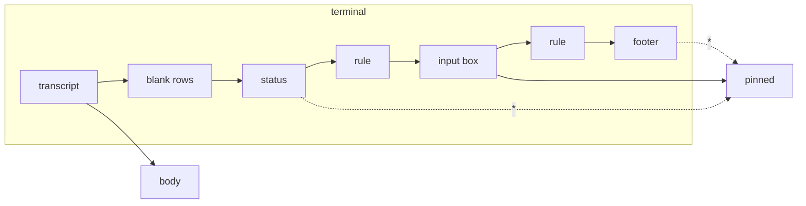

# Lenses

A lens reshapes the rows of one particular program for a tiny screen. It
is the client's plugin mechanism: one class, one method, nothing else in
the app knows what it looks for. The first lens is for Claude Code.

## How a lens works

```java
/** Reshapes the rows of one program's screen for a small display. */
interface Lens {
    /**
     * Returns {body, pinned}: rows that scroll and rows kept at the bottom.
     * Null when the rows are not this program's screen.
     */
    String[][] shape(String[] rows, boolean reveal);
}
```

`rows` are the terminal's rows as the hub returns them in text mode:
escape sequences and control characters removed, trailing blanks trimmed,
not yet wrapped. `reveal` is the state of the `*` key. The view asks each
lens in turn; the first that recognises the screen wins, and when none
does the rows are shown as they are. A lens that is not sure must answer
null: the plain view is always the safe answer.

The lenses are listed in one array in `Muxway`. Adding one is a new class
and a new entry. MIDP has no class loading at run time, so "plugin" means
separate, optional and documented, not loadable.

Settings has a `View` choice: **Auto** (lenses on, the default) and
**Plain** (every pane as it is). An install file may set it with
`Muxway-View: plain`.

## The Claude Code lens

Claude Code draws, from the bottom of the terminal up:

```
                                              ● high · /effort     status, right-aligned
────────────────────────────────────────────────────────────────   rule
❯ say only the word pong, nothing else                             input box
────────────────────────────────────────────────────────────────   rule
  ⏵⏵ auto mode on (shift+tab to cycle) · ← 5 agents                footer
```

On a sixteen-column phone each rule becomes five rows of `─`, the footer
three rows, the status line a row of blanks and two of text. The lens:

- finds the last two **rules** (rows of only `─`, `━` or `═`, three or
  more) and never shows them;
- **pins** the rows between them, the input box, to the bottom of the
  screen; up to half of the screen, longer boxes show their last rows;
  the transcript scrolls above it;
- hides the **footer** (everything after the second rule, including the
  "N agents" hint) and the **status** (the row right above the first rule,
  when it starts with eight spaces) until `*` reveals them, in Claude's own
  order: status (without its right alignment), box, footer;
- drops the **blank rows** between the transcript and the status, which
  Claude uses to fill a tall terminal, so a short transcript sits right
  above the box.



Without two rules the lens answers null: a plain shell, a pane Claude Code
has left, or a version with a different layout look like the plain view.
The lens therefore never hides a row of the transcript.

Claude Code's own `Shift+Tab` cycles its permission mode. The protocol's
key list has no Shift-Tab (`BTab`) yet; the Keys screen gains it once the
hub accepts it.

## Security

A server or relay can craft rows that look like Claude Code's chrome:
thousands of rules, a 400-column rule, a footer after a fake rule, control
characters in the box. The lens runs once over rows the app has already
stripped of control characters and capped at 32 KiB, and it can only hide
rows after the last rule and one row above the second-last one. `*` shows
everything it hid, and Settings can switch lenses off. The worst a crafted
screen does is hide its own last rows until the user presses `*`. The
end-to-end suite has this case (S06).
