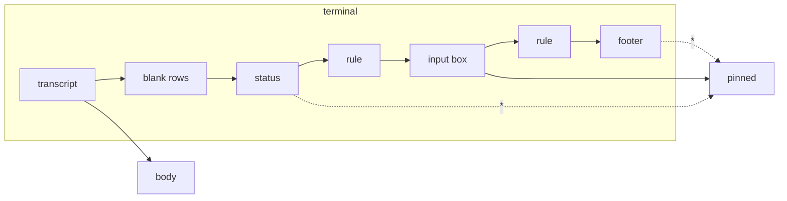

# Lenses

A lens reshapes the rows of one particular program for a tiny screen. It
is the client's plugin mechanism: one class, one method, nothing else in
the app knows what it looks for. The first lens is for Claude Code.

## How a lens works

```java
/** Reshapes the rows of one program's screen for a small display. */
interface Lens {
    /** The program's name, for the pane's View choice. */
    String name();

    /**
     * Returns {body, pinned}: rows that scroll and rows kept at the bottom.
     * Null when the rows are not this program's screen. Forced, the lens
     * does its best with any rows and answers null only when there is
     * nothing to pin.
     */
    String[][] shape(String[] rows, boolean reveal, boolean forced);
}
```

`rows` are the terminal's rows as the hub returns them in text mode:
escape sequences and control characters removed, trailing blanks trimmed,
not yet wrapped. `reveal` is the state of the `*` key. In a pane set to
**Auto** the view asks each lens in turn with `forced` false; the first
that recognises the screen wins, and when none does the rows are shown as
they are. A lens that is not sure must then answer null: the plain view
is always the safe answer. In a pane set to a lens by name the view asks
that lens alone, `forced` true, and it may guess.

The lenses are listed in one array in `Muxway`. Adding one is a new class
and a new entry; its name appears in every pane's `View` choice. MIDP has
no class loading at run time, so "plugin" means separate, optional and
documented, not loadable.

The view is a setting of the pane, not of the app: `Pane` in the pane's
menu offers **Auto**, **Plain** and each lens (see
[the pane view](pane-view.md)).

## Text: what the phone can show

The smallest phones have no glyphs for `─`, `❯` or `●`, and their Java
decodes bytes as Latin-1 unless told otherwise, so the hub's UTF-8 rules
arrived as rows of odd glyphs and the lens, which trusts only a row of
line characters, saw no rule. Settings has `Text`: **Unicode**,
**Latin-1** (the MIDP 1.0 build's default) or **ASCII**. For the last two
the app asks the hub for `charset=latin1` or `charset=ascii`, and the hub
spells lines as `-`, `|` and `+`, bullets as `*`, `❯` as `>`, and folds
letters the charset lacks (the core's text-mode page has the table). The
app decodes every answer by the charset in its `Content-Type`, so a hub
that does not know the parameter, and keeps answering UTF-8, still shows
as before. An install file may set it with `Muxway-Text`.

## The Claude Code lens

Claude Code draws, from the bottom of the terminal up:

```
                                              ● high · /effort     status, right-aligned
────────────────────────────────────────────────────────────────   rule
❯ say only the word pong, nothing else                             input box
────────────────────────────────────────────────────────────────   rule
  ⏵⏵ auto mode on (shift+tab to cycle) · ← 5 agents                footer
```

On a sixteen-column phone each rule becomes five rows of `─`, the footer
three rows, the status line a row of blanks and two of text. The lens:

- finds the last two **rules** (rows of only `─`, `━` or `═`, three or
  more, or of twenty or more `-` or `=` once the hub spelt them in ASCII)
  and never shows them;
- **pins** the rows between them, the input box, to the bottom of the
  screen; up to half of the screen, longer boxes show their last rows;
  the transcript scrolls above it;
- hides the **footer** (everything after the second rule, including the
  "N agents" hint) and the **status** (the row right above the first rule,
  when it starts with eight spaces) until `*` reveals them, in Claude's own
  order: status (without its right alignment), box, footer;
- drops the **blank rows** between the transcript and the status, which
  Claude uses to fill a tall terminal, so a short transcript sits right
  above the box.



In Auto, without two rules the lens answers null: a plain shell, a pane
Claude Code has left, or a version with a different layout look like the
plain view. The lens therefore never hides a row of the transcript.

Set to **Claude Code** by hand, the lens does the same when it finds the
rules and guesses when it does not: the last row among the final eight
that starts with `❯` or `> ` is the input box, pinned to the bottom, and
the rows after it are footer, hidden until `*`. Without such a row the
pane is shown plain.

Claude Code's own `Shift+Tab` cycles its permission mode, which is what
the hidden footer hints at. The Keys screen has it as `Shift-Tab`
(protocol key `BTab`); a hub older than that key answers `400`, which the
app reports as it does any refused input.

## Security

A server or relay can craft rows that look like Claude Code's chrome:
thousands of rules, a 400-column rule, a footer after a fake rule, control
characters in the box. The lens runs once over rows the app has already
stripped of control characters and capped at 32 KiB, and it can only hide
rows after the last rule and one row above the second-last one; forced,
at most the rows after the last prompt row among the final eight. `*`
shows everything it hid, and the pane's `View` can be set to Plain. The
worst a crafted screen does is hide its own last rows until the user
presses `*`. A relay that lies about the charset in `Content-Type` only
picks between Latin-1 and UTF-8 decoding, the two the app always had. The
end-to-end suite has these cases (S06, S08).
