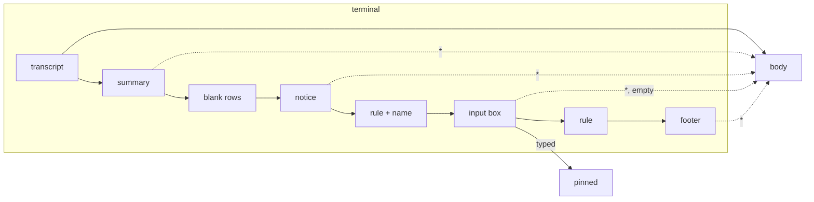

# Lenses

A lens reshapes the rows of one particular program, an AI coding agent
as a rule, for a tiny screen. It is the client's plugin mechanism: one
class, one method, nothing else in the app knows what it looks for. The
first lens is for Claude Code, the one tested so far.

## How a lens works

```java
/** Reshapes the rows of one program's screen for a small display. */
interface Lens {
    /** The program's name, for the pane's View choice. */
    String name();

    /** True when the program named by the hub (its command, e.g. "claude") is this lens's. */
    boolean runs(String command);

    /**
     * Returns {body, pinned}: rows that scroll and rows kept at the bottom.
     * Null when the rows are not this program's screen. Forced, the lens
     * does its best with any rows and answers null only when there is
     * nothing to pin.
     */
    String[][] shape(String[] rows, boolean reveal, boolean forced);
}
```

`rows` are the terminal's rows as the hub returns them in text mode:
escape sequences and control characters removed, trailing blanks trimmed,
not yet wrapped. `reveal` is the state of the `*` key. In a pane set to
**Auto** the view first asks each lens whether it `runs` the program the
hub named for the pane (the `command` column of the list); the first
that does shapes the rows `forced`, since what runs there is known. When
none does, each lens is asked with `forced` false; the first that
recognises the screen wins, and when none does the rows are shown as
they are. A lens that is not sure must then answer null: the plain view
is always the safe answer. In a pane set to a lens by name the view asks
that lens alone, `forced` true, and it may guess.

The lenses are listed in one array in `Muxway`. Adding one is a new class
and a new entry; its name appears in every pane's `View` choice. MIDP has
no class loading at run time, so "plugin" means separate, optional and
documented, not loadable.

The view is a setting of the pane, not of the app: `Pane` in the pane's
menu offers **Auto**, **Plain** and each lens (see
[the pane view](pane-view.md)).

## Text: what the phone can show

The smallest phones have no glyphs for `─`, `❯` or `●`, and their Java
decodes bytes as Latin-1 unless told otherwise, so the hub's UTF-8 rules
arrived as rows of odd glyphs and the lens, which trusts only a row of
line characters, saw no rule. Settings has `Text`: **Unicode**,
**Latin-1** (the MIDP 1.0 build's default) or **ASCII**. For the last two
the app asks the hub for `charset=latin1` or `charset=ascii`, and the hub
spells lines as `-`, `|` and `+`, bullets as `*`, `❯` as `>`, and folds
letters the charset lacks (the core's text-mode page has the table). The
app decodes every answer by the charset in its `Content-Type`, so a hub
that does not know the parameter, and keeps answering UTF-8, still shows
as before. A relay may label everything UTF-8 whatever the hub sent, and
some phones throw on bytes that are not UTF-8, so the app checks the
bytes first and reads anything that is not well-formed UTF-8 as Latin-1,
which can decode any byte. An install file may set it with
`Muxway-Text`.

## The Claude Code lens

Claude Code draws, from the bottom of the terminal up:

```
● pong                                                             transcript
✻ Crunched for 58s · done 8:36 AM                                  summary of the turn
                                                                   blank rows
                           ↓ Update installed · Restart to apply   notice, right-aligned
─────────────────────────────────────────────────── demo ─         rule, with the session name
❯ say only the word pong, nothing else                             input box
────────────────────────────────────────────────────────────────   rule
  ⏵⏵ auto mode on (shift+tab to cycle) · ← 5 agents                footer
```

On five rows of sixteen characters that chrome is the whole screen. The
lens shows the conversation and nothing else until `*`:

- finds the last two **rules**: rows of `─`, `━` or `═` (three or more)
  or of twenty or more `-` or `=` once the hub spelt them in ASCII. The
  bottom one is clean; the top one may carry the session name, text up
  to half as long as the line. Rules are never shown;
- hides the **footer** (everything after the bottom rule), the
  **notices** (blank rows and rows starting with eight spaces right
  above the top rule) and the **summary** (the one row above those that
  starts with a spinner mark, `✻ ✽ ✶ ✢ ·` or `*` once folded, and names
  a duration such as `58s` or `5m 27s`);
- hides the **input box** (the rows between the rules) when it holds
  nothing but the prompt mark or Claude's own hint (`Try "..."`), and
  **pins** it to the bottom when
  someone typed into it at the terminal; up to half of the screen,
  longer boxes show their last rows; the transcript scrolls above it;
- drops the **blank rows** between the transcript and the chrome, which
  Claude uses to fill a tall terminal, so the last message sits at the
  bottom.

`*` puts everything back in place, in Claude's order and without the
rules or the blank rows: summary, notice (without its right alignment),
box, footer, scrollable with the rest. `*` again hides them.



In Auto on a pane whose program is not `claude`, without two rules the
lens answers null: a plain shell, a pane Claude Code has left, or a
version with a different layout look like the plain view. The lens
therefore never hides a row of the transcript.

On a pane the hub says runs `claude`, or set to **Claude Code** by hand,
the lens does the same when it finds the rules and guesses when it does
not: the last row among the final eight that starts with `❯` or `> ` is
the input box, hidden when empty and pinned when typed into, and the rows
after it are footer, hidden until `*`. Without such a row the pane is
shown plain.

Claude Code's own `Shift+Tab` cycles its permission mode, which is what
the hidden footer hints at. The Keys screen has it as `Shift-Tab`
(protocol key `BTab`); a hub older than that key answers `400`, which the
app reports as it does any refused input.

## Security

A server or relay can craft rows that look like Claude Code's chrome:
thousands of rules, a 400-column rule, a footer after a fake rule, control
characters in the box. The lens runs once over rows the app has already
stripped of control characters and capped at 32 KiB, and it can only hide
rows after the last rule, the empty box between the rules, the blank and
right-aligned rows above the top rule and one summary row above those;
forced, at most the rows after the last prompt row among the final eight.
`*` shows everything it hid, and the pane's `View` can be set to Plain.
The worst a crafted screen does is hide its own last rows until the user
presses `*`. A relay that lies about the program (`claude` for a shell)
only gets the lens applied forced, which hides nothing without a prompt
row (S10). A relay that lies about the charset in `Content-Type` only
picks between Latin-1 and UTF-8 decoding, the two the app always had. The
end-to-end suite has these cases (S06, S08).
