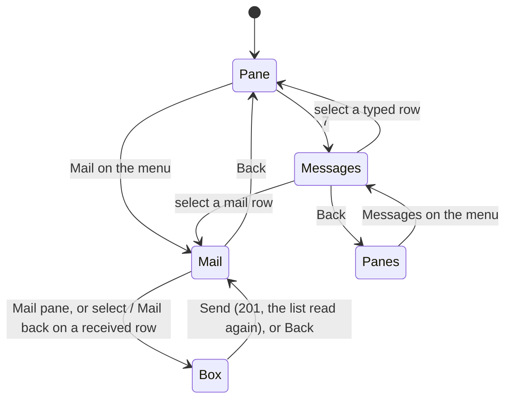

# Messages and mail

Panes talk to panes: a harness in one pane types into another, or
leaves it a mail its process reads when it likes (the core's
[talk](https://github.com/notmarkopadjen/muxway/blob/main/docs/features/talk.md)
and [mail](https://github.com/notmarkopadjen/muxway/blob/main/docs/features/mail.md)).
The pane list shows the groups and the counts (see
[the pane view](pane-view.md#the-list)); on the MIDP 2.0 build the
phone also shows what was said, lists one pane's mail, and mails a pane.

## Messages

**Messages** on the pane list's menu, or `7` on a pane, asks the hub
for `GET /v1/talk?limit=100` in text mode and lists the entries oldest
at the top, one row each, the text running on under the first line:

```
test-pane (bash) → review 12:03: run the tests
review → test-pane (bash) 12:05: ✉ done, two failures
client → review 12:06: ✉ look at the log
```

Who and whom are the panes as the list names them (the alias where
the owner gave one), a pane the list does not hold by its place after
the host, and `client` for a mail from a client that is not a pane. The
time is the phone's. A typed line shows its text, a key its name, an
answer the choice, a mail its text behind `✉` (`M` on the Latin-1 and
ASCII settings, whose fonts have no envelope). Rows are cut at 240
characters; the hub sends the first 200 of a text.

Select a typed row and the pane it was said to opens; select a mail
row and that pane's mail opens. A row whose pane the list does not
hold does nothing. **Refresh** reads the feed again, **Back** returns
to where it was opened from. *Nothing said.* when there is none.

The phone keeps no count of messages not looked at: it polls nothing
it is not looking at, so there is nothing to clear when the screen
opens.

## The mail list

**Mail** on a pane's menu lists that pane's mail: what came in, from
`GET /v1/panes/{address}/mail`, and what it sent, the mail entries of
the feed whose sender it is, merged by time, oldest at the top:

```
< review 12:03 unread: run the tests on the branch
> review 12:05: done, two failures
< phone 12:06 replied: look at the log
```

`<` is a mail the pane holds, with its sender (a pane by the list's
name, else the actor's name), `unread` until the process read it and
`replied` once the pane answered it (where the hub's row says so);
`>` is a mail the pane sent, with its recipient. Reading the list takes
nothing from the process: the hub marks nothing read for a client.
*No mail.* when there is none. **Refresh** reads again, **Back**
returns to the pane, or to Messages when it was opened from there.

*Mail* is on the menu of every pane the token reads whose host holds
mail, as the hosts' flags say; on a hub older than the flags it is
offered and the hub's `404` says *This host holds no mail.*

## Mail the pane, mail back

**Mail pane** on the mail list's menu, on a writable pane, opens a
text box titled with the pane's name; **Send** posts the text to
`POST /v1/panes/{address}/mail` as `{"text": "..."}`, control
characters dropped as from Reply. Select a received row whose sender
is a pane the token may write, or **Mail back** on it, and the box is
aimed at the sender instead. The phone is a client, not a pane: it
sends no origin, so what it sends is a mail and never a reply, and a
received row from a client, or from a pane the token cannot write,
has no one to mail back (*No sender to mail back.*).

*Mailed.* and the list read again on the hub's `201`; *This host
holds no mail.* on `404`; *The mailbox is full.* on `409`; *Read
only.* on `403`.

```mermaid
sequenceDiagram
    participant P as Phone (MIDP 2.0)
    participant R as Relay
    participant H as Hub
    P->>R: GET /v1/panes/alice-laptop/work/0.0/mail (X-Muxway-Token, Accept: text/plain)
    R->>H: the same, Authorization: Bearer
    H-->>R: 7 TAB 1767225600 TAB alice-laptop/work/1.0 TAB reviewer TAB 0 TAB run the tests
    R-->>P: 200 text/plain
    P->>R: GET /v1/talk?limit=100
    R-->>P: the entries; the mail from work/0.0 is kept
    Note over P: "< review 12:03 unread: run the tests"
    P->>R: POST /v1/panes/alice-laptop/work/1.0/mail {"text":"done"}
    R->>H: the same
    H-->>R: 201 {"mail": {"id": 8, "at": 1767225660}}
    R-->>P: 201
    Note over P: "Mailed.", the list read again: "> review 12:05: done"
```



## The text rows

The feed's row is `seq TAB at TAB from TAB to TAB kind TAB text`,
closed by `next TAB seq`; the mail row `id TAB at TAB from TAB actor
TAB read_at TAB text`, and a seventh column `replied` where the hub
writes one (the core's text-mode parity issue). A row is
read when its first column is a number, its addresses pass the
protocol's grammar and its kind is `text`, `key`, `answer` or `mail`;
anything else is skipped.

## The MIDP 1.0 build

The small build shows the groups and nothing more: two screens and
their parsers are far over its 30 KiB (`Ui.MAIL` is false there, and
ProGuard drops the class). `7` does nothing on it.

## The relay

A relay forwards three more paths for this: `GET /v1/talk`, `GET` and
`POST /v1/panes/{address}/mail`. See [running a relay](relay.md).

## Security considerations

- Reading is the token's reading: the hub lists a feed entry only
  where the token may read both panes, and a mailbox only for a pane
  it may read. The phone asks for nothing beyond those two calls.
- A mail is a write: the hub checks the token's write grant and the
  pane's mark, and the host agent checks them again. The phone offers
  *Mail pane* on writable panes only and *mail back* only toward a
  sender the list marks writable, and takes the hub's refusal in
  words otherwise. It sends no origin, so it can claim to be no pane.
- Rows from a relay are split on TAB and read by index; an address
  column must pass the grammar and the kind be one of four words, or
  the row is skipped; text is cut at 240 characters, control
  characters having gone from every body already. A name that is not
  the list's is shown as text and never requested, and nothing is
  posted toward an address the list does not hold.
- The box's text is the owner's: 1 to 1000 characters, control
  characters dropped, escaped as reply text is.
- Between the phone and the relay a mail travels in the clear like
  every input; the warning Settings shows once for a plain-HTTP server
  covers it.
- Nothing is logged on the phone; the trace of the test build prints
  the screens and the status codes, never the token. The hub and the
  host audit every mail.
