# New panes and sessions, and closing a pane

Where a host's owner allowed it, a client can start a session and
split a window, and close a pane, as the core's
[new panes](https://github.com/notmarkopadjen/muxway/blob/main/docs/features/new-panes.md)
page says. The MIDP 2.0 build offers each where the hub's hosts
listing says the host allows it: in text mode the hosts call carries a
third column, the host's flags as words joined by `|` (`sessions`,
`close`, `mail`, `later`, `ask`, ...), proposed in the core's text-mode
parity issue; a hub without the column offers none of this.

## + session

**+ session** is on the pane list's menu while some host's agent runs
with `--allow-sessions`; it acts on the host of the row under the
cursor, a pane's row or the host's line (see [the pane
view](pane-view.md#the-list)), and says *This host does not start
sessions.* where that host's flags lack it. A box asks for the session's
name, `a-z`, `0-9`, `-` and `_`, up to 32, checked on the phone before
anything is asked; **Start** posts `{"name": "..."}` to
`POST /v1/hosts/{host}/sessions`. On `201` the list is read again and
the session's first pane opens. *That name exists.* and *Too many
sessions.* are the hub's `409`s, *This host does not start sessions.*
its `404`, *Read only.* a grant that does not cover the name.

## + pane

**+ pane** is on the pane list's menu while the list holds a writable
pane; on a writable row under the cursor it asks *New pane beside
<name>?* with **Beside**, **Below** and **Cancel** (the phone cannot see
the window's shape, so the owner picks the split), on a host line or a
read-only row *Pick a writable pane first.* The pick posts
`{"direction": "h"}` or `"v"` to
`POST /v1/windows/{host}/{session}/{window}/panes`, the path from the
pane's address; on `201` the list is read again and the new pane
opens. *The window is full.* is the hub's `409`.

## Close

**Close** on a writable pane's menu, on a host whose agent runs with
`--allow-close`, asks *Close the pane on <host>? What runs in it ends;
a session ends with its last pane.* with **Close** and **Keep**.
*Close* posts to `POST /v1/panes/{address}/close`; on `204` the phone
returns to the list and reads it again. *This host does not close
panes.* is the hub's `404`.

```mermaid
sequenceDiagram
    participant P as Phone (MIDP 2.0)
    participant R as Relay
    participant H as Hub
    P->>R: GET /v1/hosts
    R-->>P: alice-laptop TAB online TAB sessions|close|mail|later|ask
    Note over P: + session and + pane on the list's menu; Close on the pane's
    P->>R: POST /v1/hosts/alice-laptop/sessions {"name":"scratch"}
    R->>H: the same, Authorization: Bearer
    H-->>R: 201 {"pane": {"address": "alice-laptop/scratch/0.0", ...}}
    R-->>P: 201
    P->>R: GET /v1/hosts, GET /v1/panes
    Note over P: the new pane opened
    P->>R: POST /v1/windows/alice-laptop/scratch/0/panes {"direction":"v"}
    R-->>P: 201 {"pane": {"address": "alice-laptop/scratch/0.1", ...}}
    P->>R: POST /v1/panes/alice-laptop/scratch/0.1/close {}
    R-->>P: 204 (200 ok through a WAP relay)
    P->>R: GET /v1/hosts, GET /v1/panes
    Note over P: the list, without it
```

```mermaid
stateDiagram-v2
    [*] --> Panes
    Panes --> Session: + session on the menu, the host of the row under the cursor
    Session --> Pane: Start, 201, the list read again, the first pane opened
    Session --> Panes: Back, or a name refused on the phone
    Panes --> Confirm: + pane on the menu, a writable row under the cursor
    Pane --> Confirm: Close
    Confirm --> Pane: Beside or Below, 201, the new pane opened
    Confirm --> Panes: Cancel; Close, 204, the list read again; Keep back to the pane
```



## The MIDP 1.0 build

None of this: the small build reads the hosts call for the offline
hosts only and ignores any further column (`Ui.HOSTS` is false there).

## The relay

A relay forwards three more paths for this: `POST
/v1/hosts/{host}/sessions`, `POST
/v1/windows/{host}/{session}/{window}/panes` and `POST
/v1/panes/{address}/close`. See [running a relay](relay.md).

## Security considerations

- A new pane is a shell, a new session a shell where nothing was
  exposed, and a close ends what runs in a pane. Each needs the
  token's write grant and, on the host, the owner's `--allow-sessions`
  or `--allow-close`; the hub checks the grant against the new pane's
  address and closes a pane the grant does not cover. The phone offers
  each only where the flags say so and the pane is writable, and takes
  the hub's refusal in words otherwise.
- The hosts' flags come through the relay: words matched exactly,
  unknown ones ignored. A relay that claims `sessions` or `close` only
  makes the phone offer the action; the hub's `404` or `403` is shown.
  A relay that hides a flag hides an action.
- A session name is checked on the phone against `[a-z0-9_-]{1,32}`
  and by the hub again. The host of a session and the window of a
  split come from the list's own rows, which passed the address
  grammar; the answer's address is used only when it passes the
  grammar and the re-read list holds it.
- Each is behind a confirm list or a box; nothing happens on one key.
  The menu offers `+ session` and `+ pane` while any host or row allows
  them; the pick is checked against the row under the cursor, and the
  hub checks again.
- The hub rate-limits creations and closes to one per two seconds per
  principal; the phone shows *Too many tries.*
- The hub and the host audit every one; nothing is logged on the
  phone.
