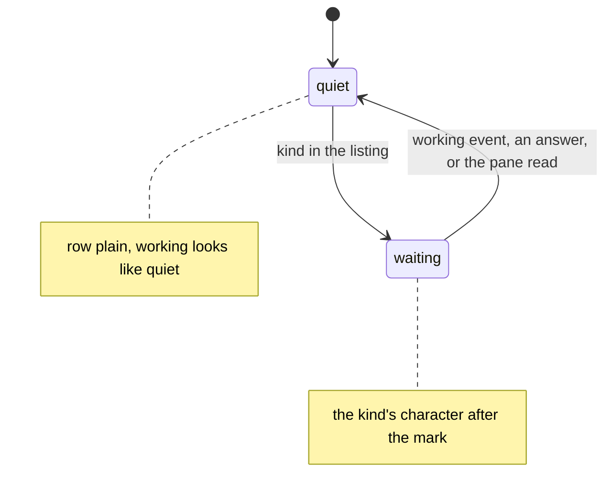
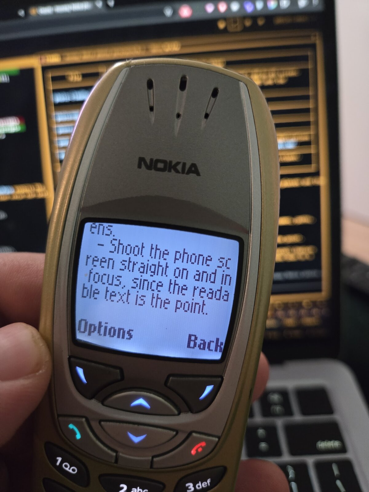
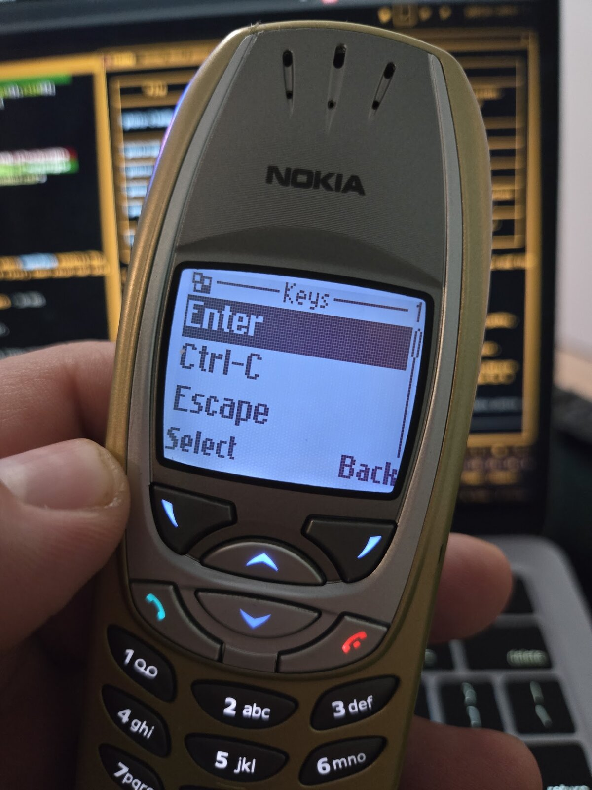
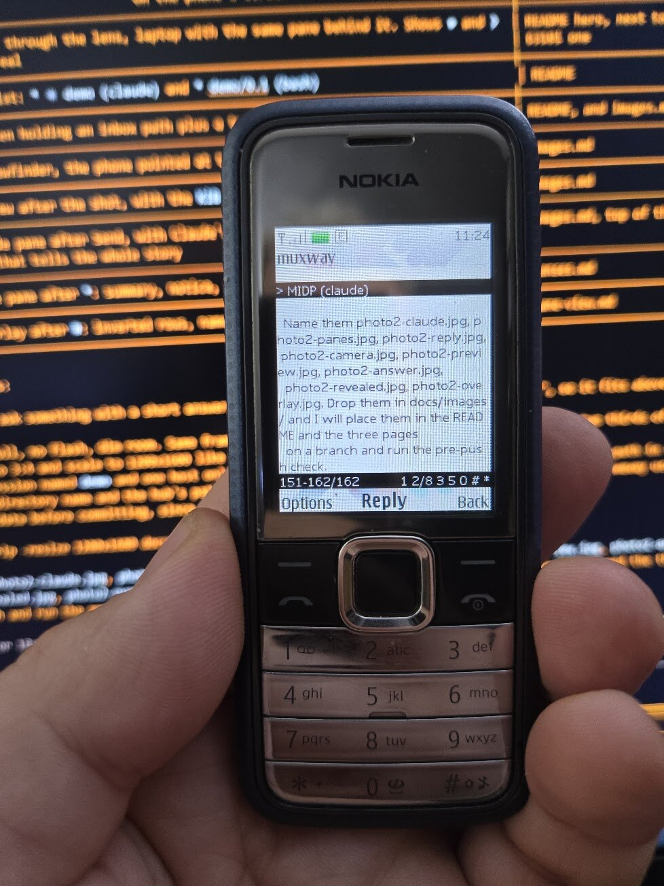
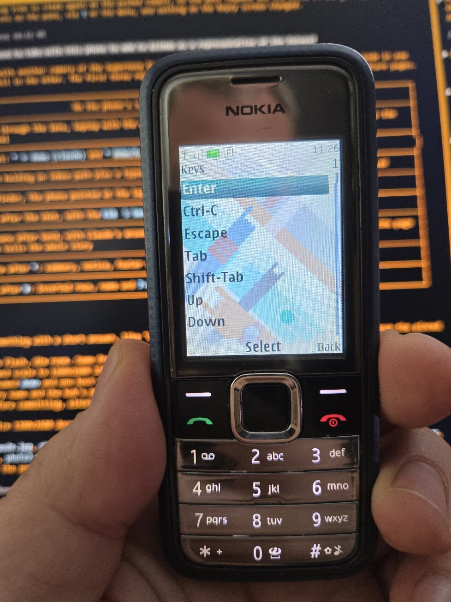
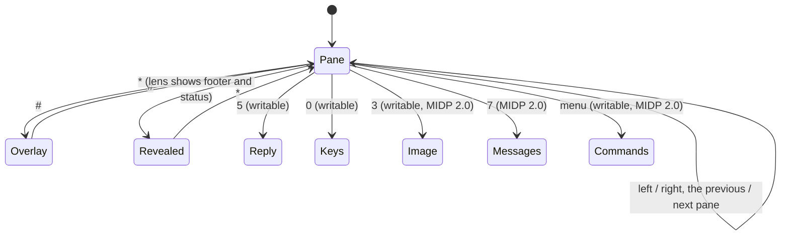
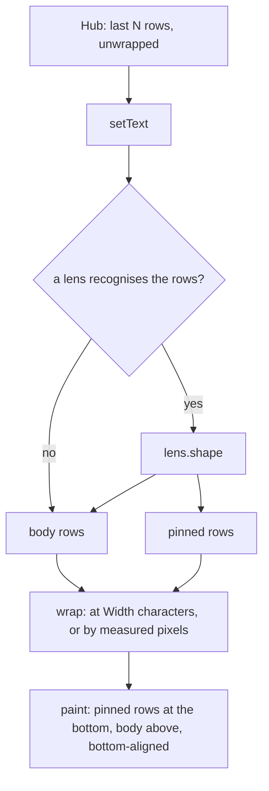

# The pane view

## The list

Panes are listed by what runs in them, not by number: the pane's title,
which a program sets for itself (Claude Code calls its terminal `✳ <session
name>`), and the program in brackets, `* muxway android (claude)`. A
pane its owner named (the alias, `muxway expose --name review` on the
host or a rename on the web or Android; the core's
[pane names](https://github.com/notmarkopadjen/muxway/blob/main/docs/plans/2026-11-03-pane-names.md))
goes by that name instead, on both builds: `* review (claude)`, the
title stepping back. `*`
marks a pane the token may write to, taken from the hub's `mode` column
and never from the title; the character after it says what the pane
waits for, from the hub's `kind` column: `?` a question, `!` a
permission, `z` idle, `v` done, a space for nothing (`*?build (claude)`),
and `zz` with a space after it for a pane its owner parked for
[later](later.md) (`*zz build (claude)`; on the 2.0 build what waits
underneath follows, from the listing's `pending` column, `*zz ! build`);
a mark leading the title (`✳`, or `*` once folded) is dropped, it is
decoration. A title that says nothing, because it is empty,
the program's name, or the host's name (tmux's default until a program
sets one, and a host is usually named after its machine) gives way to the
pane's place: `work/0.1 (bash)`. When the list holds panes of several
hosts each entry starts with its host. Entries are cut at 64 characters;
the phone scrolls long ones. On the MIDP 1.0 build the list is asked for
in Latin-1 like the content (see [lenses](lenses.md)), so `✳` arrives as
`*`.

On the MIDP 2.0 build a **line per host** heads its rows, `= alice-laptop
online`, with the host's state from the hosts call and the rows the
listing holds: `online` for a host with panes, `nothing exposed` for an
online host without, `offline`; the `host/` prefix and the trailing
offline rows of the small build go, and the cursor starts on the first
pane, not the line; `+ session` and `+ pane` on the list's menu act on
the row under the cursor (see [new panes](new-panes.md)). **Auto** on the list's
menu re-reads it every interval of the Settings value (10 s without
one) while the list is the screen shown, quietly, the cursor kept on
its row; *Back* from a pane leaves it on, Settings turns it off.

An AI coding **harness** is named as every client names it, on the 2.0
build: a pane whose command is `claude`, or whose title leads with
Claude's spark, is `Claude`, and what it writes into its title (the
codename) follows as the status: `* Claude /muxway · fixing the build`.
Codex, Gemini, Antigravity (`agy`), OpenCode, Copilot, aider, goose, Amp
and Cursor (`cursor-agent`) the same, by their command. With an alias
the alias leads and the harness is the status's first word, `* review
/muxway · Claude · fixing the build`; the program in brackets is left
off, the name says it. A harness that names itself and nothing more
reads `* Claude`. Any other program is listed as before.

On the MIDP 2.0 build two things follow the name, from the listing's
last columns, where the row has the room the smallest screen has not:
the **folder** the pane works in, its last segment after a slash
(`cwd`, which the hub gives a writer of the pane under one of the host's
preview roots, and nobody else), so two Claude panes on the same subject
in two checkouts read apart, `* fixing the build /muxway (claude)` and
`* fixing the build /muxway-midp (claude)`; and, for a named pane, the
**status**, the title the alias replaced, after a middle dot (a dash on
the ASCII setting): `* review /muxway · fixing the build (claude)`. A
title that says nothing adds no status. The folder is shown as text
and never asked for: the phone has no directory listing.

The list also shows who talks with whom and who
has mail, from two more columns of the hub's text listing (`mail`, the
unread count, and `talk`, the partners' addresses). Panes that wrote or
mailed to each other in the last ten minutes, partners of partners
included, form a group, as on the web (the core's
[talk](https://github.com/notmarkopadjen/muxway/blob/main/docs/features/talk.md)):
the group's rows are kept together, pulled up behind the group's first
row, and framed by an edge at the row's left, `[` on the first row, `|`
between, `]` on the last, a space on every other row; the column is
there only while the list holds a group. A pane whose process has unread
[mail](https://github.com/notmarkopadjen/muxway/blob/main/docs/features/mail.md)
shows the count after its name, `✉ 2`, or `M 2` when the Text setting is
Latin-1 or ASCII; the name gives way so the count stays within the cut.
Nothing pops up for a message. A partner the list does not hold, a count
that is not one to three digits, and the column of a hub that does not
write them yet, change nothing.

```
= alice-laptop online
[* Claude /muxway · build ✉ 2
]* review (claude)
 * work/0.1 (bash)
= bob-desktop offline
```

A group's rows are kept together within their host: a group across two
hosts is framed under each, a row whose partners are all on another
host wearing `[` alone.

```mermaid
flowchart LR
    R["address TAB mode TAB command TAB title TAB kind TAB mail TAB talk TAB alias TAB cwd TAB pending"] --> L{alias?}
    L -- yes --> N1["alias"]
    L -- no --> A{a harness?<br/>(MIDP 2.0)}
    A -- yes --> N4["Claude, Codex, ..."]
    A -- no --> T{title empty,<br/>= command<br/>or = host?}
    T -- no --> N2["title"]
    T -- yes --> N3["session/window.pane"]
    N1 --> F["+ /folder (MIDP 2.0, cwd given)"]
    N4 --> F
    N2 --> F
    N3 --> F
    F --> S["+ · harness (an alias on a harness) + · title (MIDP 2.0, where the title says something)"]
    S --> C["+ (command), unless a harness"]
    C --> M["mark from mode: '*' or ' ', then from kind: '? ! z v', 'zz ' for later (+ what waits under it, MIDP 2.0), or ' '"]
```

### The states

Every client paints a pane with the same three states of the lens (the
core's [guideline](https://github.com/notmarkopadjen/muxway/blob/main/docs/ui-guideline.md),
§1.2): **waiting** inverted and pulsing, **working** plain with a
turning ring and the word (the owner dropped the dim paint on
2026-11-02), **quiet** plain. The keypad has no paint of its own: the
list is the phone's own `List`, its labels in the phone's type and
colours, and the selection is the phone's highlight, so selection is
never a colour here by construction. What the keypad shows of each
state:

| State | List row | Pane view |
|---|---|---|
| waiting | the kind's character after the write mark, `?` `!` `z` `v`; the [inbox](inbox.md) says what for | drawn as it is; `9` opens the inbox |
| working | plain: no glyph, no word. The hub's `working` event clears the pane's attention and the listing's `kind` column is empty, and the screen moves | plain |
| quiet | plain | plain |
| [later](later.md) | `zz` where the kind's character goes, the hub's order kept; what waits underneath after it on the 2.0 build (`zz !`) | plain; the overlay reads `> zz name`, the name in italics (MIDP 2.0); *Later* and *Wake* on the menu (MIDP 2.0) |

A working row therefore looks like a quiet one; the pane's own screen
tells them apart. A mark for working would need the listing to carry
the state, which it does not, and a word would cost six of sixteen
columns: the owner left it out (plan of 2026-11-03).



## The screen






The pane fills the whole screen. There is no title bar and no scroll
marker: the pane's rows are drawn in the phone's small font from the left
edge, bottom-aligned, so the last row is always a full one and the spare
pixels sit at the top. On a 96x65 screen that is five rows of some twenty
characters.

### Its own pane or nothing

The view shows the rows of the pane it was opened for, or nothing, as
every client's tile does (the core's
[guideline](https://github.com/notmarkopadjen/muxway/blob/main/docs/ui-guideline.md),
§1.4 *tiles*). A canvas is made afresh for every pane opened, so no
rows of the pane before are ever kept; and an answer that comes late,
for a read the phone gave up on (45 s) while the owner went on to
another pane, is dropped, not drawn: the rows are set on the view they
were asked for, and only while it is still the one open.

While the view has nothing of its own and a request runs, the MIDP 2.0
build draws the tube coming on in the theme's ink: a line at mid-height
that widens from the centre to the whole width, opens into a band and
settles to a line, 150 ms a step with the wait mark, until the first
rows come. Never a borrowed screen, never a spinner in the box. The
smallest screen stays blank, with the wait mark in its corner as for
every request.

### The key's echo

A key, a typed text and the Enter after a sent text ask the hub for the
pane's screen with their own answer (`?read=1`, with the read's own
`lines`, `width` and `charset`): the hub lets the program echo for 30 ms,
captures the pane and answers `200` with the rows as a text read gives
them, `ETag` and `Muxway-Pane` with them. The rows take the path a
read's take, filtered, wrapped and checked the same, and are drawn at
once; no read follows, and the refresh timer goes on unchanged. A sent
text is two requests, its text and the Enter: the text goes without the
screen, since the Enter's answer follows at once and a screen is
seconds of bytes over GPRS; the Enter's answer is the one shown. A hub
or a host older than this answers `204`, and so does a token that may
write the pane and not read it: the phone then waits a moment and reads
the pane as before. A relay for WAP phones stands `200 ok` in for a
`204` ([relay](relay.md)); the phone tells it from the hub's screen by
the `ETag` the hub always sends and the stand-in never has, and reads
as before; the `ok` is never drawn. Both builds take the echo.

```mermaid
sequenceDiagram
    participant U as Owner
    participant M as Muxway
    participant H as Hub
    U->>M: Send "make test"
    M->>H: POST /v1/panes/host/work/0.0/input {"text": "make test"}
    H-->>M: 204
    M->>H: POST …/input?read=1&lines=120&width=400 {"key": "Enter"}
    Note over H: the keys land; 30 ms; capture
    H-->>M: 200 the rows, ETag, Muxway-Pane: %3
    M-->>U: the rows at once
    Note over M: an older hub: 204, then GET the pane as before
```

A pane that is gone, because its program ended or its owner closed it,
answers `404` to a read or a key; the view says *This pane is gone.*,
leaves, and the list is read again before the word is shown, so the
word's dismissal lands on a fresh list. Nothing is drawn under the dead
pane's address again: the host renumbers panes when one closes, and the
rows at that address may be another pane's.

On the MIDP 2.0 build the view **knows its pane by id**: the hub's
listing ends every row in the pane's id (`%3`), and every read answers
with the id of the pane that answered (`Muxway-Pane`), on a `304` too.
The view keeps the id of the pane it was opened for and checks each
answer against it. When another pane answers at its address (the host
renumbered), none of those rows is drawn or traced as the view's; the
list is read again, quietly, and the view **follows** its pane to the
address the list names, title, name and marks with it, and reads it
there, so the next key reaches the pane the owner sees. A pane the list
names nowhere is gone, with the word above. A second stranger at the
new address is taken as gone too, so a hub or a relay that never agrees
cannot send the phone round in a circle. A hub without the column or
the header leaves the view knowing its pane by address, as before. The
inbox opens a pane by the id its row carries, so a row read after a
renumber opens the right pane even while the phone's list is older. The
1.0 build keeps the address-only rule: the id needs bytes its JAR has
not (see the [plan](../plans/2026-11-07-pane-id.md)).

```mermaid
stateDiagram-v2
    [*] --> Opening: the view made, its pane's id from the list
    Opening --> Rows: its own answer (Muxway-Pane is its id, or unknown)
    Opening --> Opening: a late answer for another pane: dropped
    Rows --> Rows: refresh, auto refresh, a key with the screen in its answer
    Rows --> Rows: a key answered 204 (an older hub), then the read
    Rows --> Moved: a stranger answers a read or a key (another id; 2.0)
    Opening --> Moved: a stranger answers (2.0)
    Moved --> Rows: the list names the id at an address, the read there is its own
    Moved --> Gone: the id is listed nowhere, or a stranger answers again
    Rows --> Gone: 404
    Gone --> [*]: "This pane is gone.", the list again
    note right of Opening: 2.0: the warm-up while a request runs; 1.0: blank
```

```mermaid
sequenceDiagram
    participant U as Owner
    participant M as Muxway
    participant H as Hub
    U->>M: open work/0.1 (%3 from the list)
    M->>H: GET /v1/panes/host/work/0.1
    H-->>M: rows, Muxway-Pane: %3
    Note over H: work/0.0 closes; the host renumbers: %3 is work/0.0, %7 is work/0.1
    U->>M: 1 (refresh)
    M->>H: GET /v1/panes/host/work/0.1
    H-->>M: %7's rows, Muxway-Pane: %7
    Note over M: a stranger: nothing drawn
    M->>H: GET /v1/panes
    H-->>M: … %3 at work/0.0, … %7 at work/0.1
    Note over M: Follow %3 work/0.1 work/0.0
    M->>H: GET /v1/panes/host/work/0.0
    H-->>M: rows, Muxway-Pane: %3
    M-->>U: its own rows under its own title
```

## Keypad

| Key | Does |
|---|---|
| `1` | refresh the pane |
| `2` / `8`, or the joystick | scroll one row up / down; hold to repeat |
| `3` | Image (writable panes, MIDP 2.0 build): see [images](images.md) |
| `5` | Reply (writable panes) |
| `7` | Messages (MIDP 2.0 build): see [messages](messages.md) |
| `9` | Inbox (MIDP 2.0 build): see [the inbox](inbox.md) |
| `0` | Keys (writable panes) |
| `#` | show or hide the title and scroll position |
| `*` | show or hide what a [lens](lenses.md) hid (footer, status) |
| joystick left / right | the previous / the next pane of the list, round at either end; a parked pane opens and wakes as from the list |
| green call key | send Enter (writable panes) |

The same list is printed at the bottom of Settings. The left soft key menu
still offers Reply, Keys, Image (MIDP 2.0), Refresh, Auto, Mail (MIDP
2.0, see [messages](messages.md)), Pane, Later or Wake (writable panes,
MIDP 2.0, see [later](later.md)), Commands (below), Back, Settings, and
on the 2.0 build Close (a writable pane on a host that closes, see [new
panes](new-panes.md)).

## Commands

**Commands** on a writable pane's menu (MIDP 2.0 build) lists the
command row of the other clients for the program in the pane: Claude
Code's slash commands (`/clear`, `/exit`, `/compact`, `/rename`,
`/model`, `/resume` and the rest, when the hub names the program
`claude` or the pane's view is set to the Claude Code lens) or a
shell's starters (`exit`, `htop`, `claude`, `codex`, `git status`,
`make test`, `ls -la`, ...). A pick is sent with Enter, as Reply's
*Send* sends; `/rename` opens Reply with it typed and waits for the
name. Any other program has no entry on the menu. The phone keeps no
lines sent before.

## Theme

Settings has **Theme** on the MIDP 2.0 build: **Amber** (the default),
**Green** or **Paper**, the guideline's tokens for the pane's canvas:
amber ink on a near-black ground, phosphor green on black, dark ink on
paper. The overlay's bars are inverted in the same two colours, and
the wait mark is a ring turning in the ink. The phone's own lists and
forms keep the phone's look. The MIDP 1.0 build is black on white: its
screen is monochrome.

## Pane

`Pane` in the menu opens the pane's own view, kept per pane address, as
a list: **Auto** (every [lens](lenses.md) may recognise the program),
**Plain** (the rows as they are) and one entry per lens, today **Claude
Code**, which uses that lens whether or not it is sure of the screen.
Selecting one saves it and redraws. The app remembers the last 32 panes
that were given a view; the others are Auto.



## Overlay

`#` draws two inverted rows over the pane: the top one with `>` for a
writable pane, then on the MIDP 2.0 build what the pane waits for as the
list marked it (`?` `!` `z` `v`, `zz` for a pane parked for
[later](later.md), `zz !` with what waits under it), and the pane's
name as the list showed it (in the phone's italic face while the pane is
parked, on the MIDP 2.0 build), with `read-only` at the row's right end
on a pane the token cannot write when it fits (MIDP 2.0); the bottom one
with the rows on screen out of the rows the app holds (`7-12/40`) and,
when it fits next to that, the key hints. The mark is the list's: it
changes with the next listing, and *Later* and *Wake* move it. `#` again removes them. While a request is out a small wait
bar runs in the top right corner, overlay or not (a turning ring in the
ink on the 2.0 build).

## Wrapping

The app asks the hub for the pane's rows as they are on the terminal
(`width=400`, the protocol's maximum) and wraps them itself. Rows longer
than the screen are cut into pieces; nothing scrolls sideways. The `Width`
setting still means what it did: any value other than `0` wraps at that
many characters.

With `Width` at `0` the app wraps by measured pixels, character by
character. Nokia phones have no monospace font: asking for one gives the
proportional system font, whose letters are mostly narrower than `M`, so
counting columns by `M` left three or four characters of room at the end
of every row. The app measures each character once and cuts a row where
the next one would not fit. The lens sees the rows before wrapping either
way.

Wrapping on the phone is what lets a lens see a whole row: a rule of eighty
`─`, or a status line pushed to the right edge, is not recognisable once
the hub has cut it into pieces of sixteen.



## Security

The view changes how rows are drawn and adds keypad routes to screens that
exist already. `5`, `0` and `3` do nothing on a pane the token cannot
write; the hub refuses a write anyway if a relay lied about that. No key sends
anything but Enter; left and right open panes the list holds and nothing
else. The screen that comes back with a key's answer is taken by the
code that takes a read's: 32 KiB at most, control characters dropped,
decoded by the `Content-Type` or the bytes, `Muxway-Pane` checked (2.0),
so a relay that answers a key itself can do no more than it can to a
read: a forged id costs one listing and one read and none of its rows
is drawn (S35). The hub gives the screen only to a token that may read
the pane. A `200` without an `ETag` is a relay's stand-in for `204` and
is never drawn. A Commands pick is the JAR's own string, sent as a reply is. Wrapping allocates one string per wrapped row, at most
32 KiB / 8 columns of them (by pixels, one character per row at the
worst), within the smallest target's heap. The pane records in the
settings store hold only addresses the hub listed, at most 32, and a line
that does not parse is dropped on read. The pane's content is traced only
in test builds, as before.

A program in a pane chooses its own title, and a writer of the pane
its alias, so the list shows text an attacker on that host controls.
The hub refuses titles with control characters or over 256 bytes and
keeps an alias to `[a-z0-9-]{1,32}`, so neither can add a row or a
column to the list; the app splits on TAB and takes the fourth and
eighth fields, caps the entry, strips control characters from every
body, and takes the writable mark from the hub. A title or an alias made
to look like another pane (`work/0.0 (claude)` on a shell, `bob/work/0.0`
as a name) misleads the eye only: the program in brackets is the hub's,
the pane a row opens is its first column's (or, on the 2.0 build, the
pane with the id in its last column), and the hub decides what
the token may write on every input. The id column and the
`Muxway-Pane` header are taken as `%` and one to nine digits and
nothing else; a header that is no id is unknown, one that names another
pane makes the phone list once and read once more, then stop with the
word, so a relay that forges it can hide a pane from the phone and no
more, and the phone writes nothing it did not write before. The owner exposed that pane; a
program there already holds a shell. The harness name comes from the
command the hub gives, or the spark Claude Code puts first in its title:
a program that puts the spark there is listed as Claude, and nothing more
follows from it. The folder is a path on the host:
the hub gives it to a writer of the pane under a preview root the owner
named and to nobody else, the phone shows its last segment as text and
never asks for the directory. The end-to-end suite has these cases
(S09, S22, S23).
