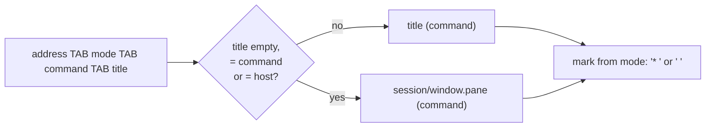
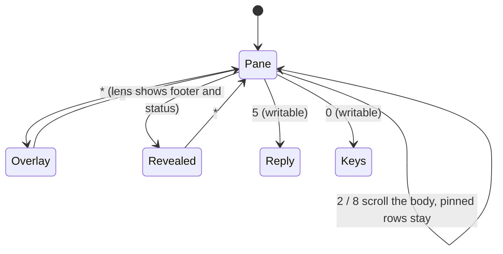
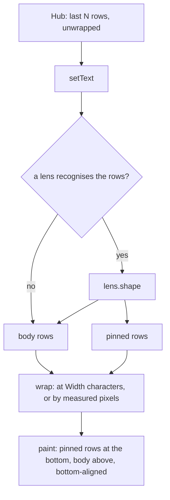

# The pane view

## The list

Panes are listed by what runs in them, not by number: the pane's title,
which a program sets for itself (Claude Code calls its terminal `✳ <session
name>`), and the program in brackets, `* muxway android (claude)`. `*`
marks a pane the token may write to, taken from the hub's `mode` column
and never from the title; a mark leading the title (`✳`, or `*` once
folded) is dropped, it is decoration. A title that says nothing, because it is empty,
the program's name, or the host's name (tmux's default until a program
sets one, and a host is usually named after its machine) gives way to the
pane's place: `work/0.1 (bash)`. When the list holds panes of several
hosts each entry starts with its host. Entries are cut at 64 characters;
the phone scrolls long ones. On the MIDP 1.0 build the list is asked for
in Latin-1 like the content (see [lenses](lenses.md)), so `✳` arrives as
`*`.

## The screen

The pane fills the whole screen. There is no title bar and no scroll
marker: the pane's rows are drawn in the phone's small font from the left
edge, bottom-aligned, so the last row is always a full one and the spare
pixels sit at the top. On a 96x65 screen that is five rows of some twenty
characters.

## Keypad

| Key | Does |
|---|---|
| `2` / `8`, or the joystick | scroll one row up / down; hold to repeat |
| `5` | Reply (writable panes) |
| `0` | Keys (writable panes) |
| `#` | show or hide the title and scroll position |
| `*` | show or hide what a [lens](lenses.md) hid (footer, status) |
| green call key | send Enter (writable panes) |

The same list is printed at the bottom of Settings. The left soft key menu
still offers Reply, Keys, Refresh, Auto, Pane, Back and Settings.

## Pane

`Pane` in the menu opens the pane's own view, kept per pane address, as
a list: **Auto** (every [lens](lenses.md) may recognise the program),
**Plain** (the rows as they are) and one entry per lens, today **Claude
Code**, which uses that lens whether or not it is sure of the screen.
Selecting one saves it and redraws. The app remembers the last 32 panes
that were given a view; the others are Auto.

## Overlay

`#` draws two inverted rows over the pane: the top one with `>` for a
writable pane and the pane's name as the list showed it, the bottom one with the rows on screen
out of the rows the app holds (`7-12/40`) and, when it fits next to that,
the key hints. `#` again removes them. While a request is out a small wait
bar runs in the top right corner, overlay or not.

## Wrapping

The app asks the hub for the pane's rows as they are on the terminal
(`width=400`, the protocol's maximum) and wraps them itself. Rows longer
than the screen are cut into pieces; nothing scrolls sideways. The `Width`
setting still means what it did: any value other than `0` wraps at that
many characters.

With `Width` at `0` the app wraps by measured pixels, character by
character. Nokia phones have no monospace font: asking for one gives the
proportional system font, whose letters are mostly narrower than `M`, so
counting columns by `M` left three or four characters of room at the end
of every row. The app measures each character once and cuts a row where
the next one would not fit. The lens sees the rows before wrapping either
way.

Wrapping on the phone is what lets a lens see a whole row: a rule of eighty
`─`, or a status line pushed to the right edge, is not recognisable once
the hub has cut it into pieces of sixteen.

## Security

The view changes how rows are drawn and adds keypad routes to screens that
exist already. `5` and `0` do nothing on a pane the token cannot write;
the hub refuses a write anyway if a relay lied about that. No key sends
anything but Enter. Wrapping allocates one string per wrapped row, at most
32 KiB / 8 columns of them (by pixels, one character per row at the
worst), within the smallest target's heap. The pane records in the
settings store hold only addresses the hub listed, at most 32, and a line
that does not parse is dropped on read. The pane's content is traced only
in test builds, as before.

A program in a pane chooses its own title, so the list shows text an
attacker on that host controls. The hub refuses titles with control
characters or over 256 bytes, so a title cannot add a row or a column to
the list; the app splits on TAB and takes the fourth field, caps the
entry, and takes the writable mark from the hub. A title made to look
like another pane (`work/0.0 (claude)` on a shell) misleads the eye only:
the program in brackets is the hub's, and the hub decides what the token
may write on every input. The owner exposed that pane; a program there
already holds a shell. The end-to-end suite has these cases (S09).
