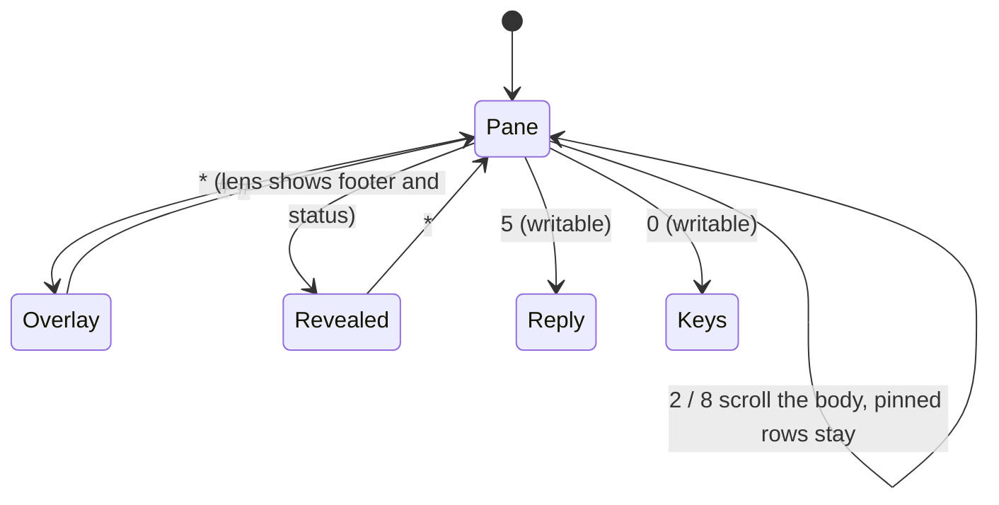
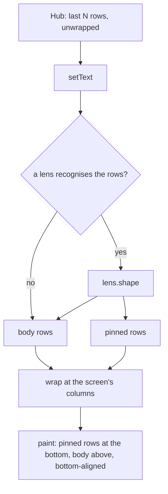

# The pane view

The pane fills the whole screen. There is no title bar and no scroll
marker: the pane's rows are drawn in a monospace font from the left edge,
bottom-aligned, so the last row is always a full one and the spare pixels
sit at the top. On a 96x65 screen that is six rows of sixteen to nineteen
characters.

## Keypad

| Key | Does |
|---|---|
| `2` / `8`, or the joystick | scroll one row up / down; hold to repeat |
| `5` | Reply (writable panes) |
| `0` | Keys (writable panes) |
| `#` | show or hide the title and scroll position |
| `*` | show or hide what a [lens](lenses.md) hid (footer, status) |
| green call key | send Enter (writable panes) |

The same list is printed at the bottom of Settings. The left soft key menu
still offers Reply, Keys, Refresh, Auto, Back and Settings.

## Overlay

`#` draws two inverted rows over the pane: the top one with `>` for a
writable pane and the pane's title, the bottom one with the rows on screen
out of the rows the app holds (`7-12/40`) and, when it fits next to that,
the key hints. `#` again removes them. While a request is out a small wait
bar runs in the top right corner, overlay or not.

## Wrapping

The app asks the hub for the pane's rows as they are on the terminal
(`width=400`, the protocol's maximum) and wraps them itself at the columns
the screen fits. Rows longer than that are cut into pieces; nothing scrolls
sideways. The `Width` setting still means what it did: `0` fits the screen,
any other value wraps at that many columns.

Wrapping on the phone is what lets a lens see a whole row: a rule of eighty
`─`, or a status line pushed to the right edge, is not recognisable once
the hub has cut it into pieces of sixteen.

## Security

The view changes how rows are drawn and adds keypad routes to screens that
exist already. `5` and `0` do nothing on a pane the token cannot write;
the hub refuses a write anyway if a relay lied about that. No key sends
anything but Enter. Wrapping allocates one string per wrapped row, at most
32 KiB / 8 columns of them, within the smallest target's heap. The pane's
content is traced only in test builds, as before.
