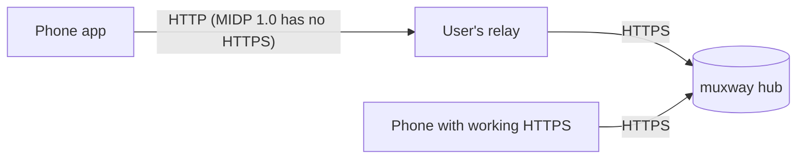
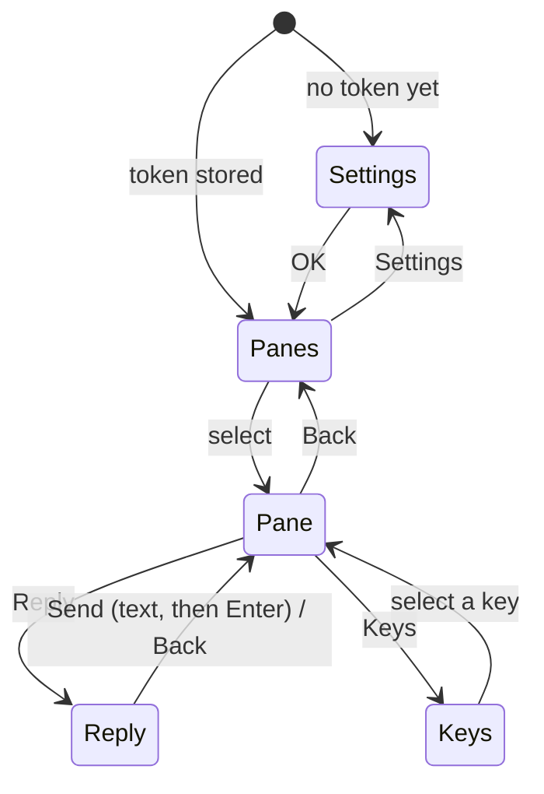

# Feature: the first Java ME client

> Status: implemented 2026-10-23.

## 1. Goal

A muxway client for Java ME phones: pick a pane, read it, reply to it,
send a key. Built twice from one source, MIDP 2.0 / CLDC 1.1 and MIDP 1.0 /
CLDC 1.0, so it runs on phones from 2002 (96x65, monochrome, GPRS) to the
last Series 40 models. It speaks only the hub's published protocol in
**text mode** and works through any plain-HTTP relay a user runs in front
of a hub.

Out of scope: notifications (needs the hub's events feature), several
servers at once, pane layouts side by side, colour.

## 2. Design

**Screens**

- **Panes**: one line per pane the token can read, from
  `GET /v1/panes` in text mode: alias if it has one, else
  `session/window.pane`, then the command. A `*` marks writable panes.
  Hosts that are offline are listed at the end, greyed by a `-` prefix.
- **Pane**: the title is the alias or address. The body is the pane's last
  lines from `GET /v1/panes/{address}` in text mode, at the width the phone
  can show (measured from its font; settable). Commands: **Reply** first,
  then **Keys**, **Refresh**, **Auto** (refresh every N seconds while the
  screen is open, using `If-None-Match` so an unchanged pane costs a few
  bytes), **Back**, **Settings**, **Exit**. Reply and Keys appear only on
  writable panes.
- **Reply**: a text box. **Send** posts the text and then `Enter`; **Type**
  posts the text without `Enter`; **Back** returns. Newlines and other
  control characters are removed before sending, since the hub refuses
  them.
- **Keys**: a list of the protocol's named keys in plain words: Enter,
  Ctrl-C, Escape, Tab, Up, Down, Left, Right, Page up, Page down, Ctrl-D,
  Ctrl-L. Selecting one sends it at once.
- **Settings**: server URL, token (a password field), width, auto-refresh
  seconds. Values can arrive in the JAD (`Muxway-Server`, `Muxway-Token`),
  so an installer page can fill them in; the token is then stored on the
  phone and never shown again.
- **Waiting**: a boxed bar with a running block, drawn as one-bit frames,
  while a request is out.
- **Look**: retro by nature. Monospace where the phone has it, box-drawing
  separators, `>` before what the user typed when the pane echoes it.

**HTTP layer.** One request at a time, on its own thread. Accepts 200, 204
and 304; maps 401, 403, 404, 429 and 503 to short messages ("Token
refused", "Read only", "Not found", "Locked out, wait", "Host offline").
Responses are read up to 32 KiB and the rest discarded, so a hostile or
broken server cannot exhaust the heap. Text is decoded as UTF-8, with the
phone's default charset as fallback.

**Authentication header.** The protocol uses `Authorization: Bearer`. A
WAP 1.x gateway re-encodes headers in binary form and may not pass an
unknown authorisation scheme. If the spike (step 1) shows it does not,
the hub's protocol gains `X-Muxway-Token` as an equivalent header for such
clients (a compatible v1 addition, made in the core repository), and the
app sends both.

**Spike result (2026-10-23).** On a MIDP 1.0 phone through a WAP 1.x
gateway, `X-Muxway-Token` arrived intact on GET and POST, while
`Authorization: Bearer <token>` arrived as `Basic` with the whole Bearer
value base64-encoded as the user name and a password appended by the
phone. The core now accepts `X-Muxway-Token`; the app sends only that
header, since sending a mangled `Authorization` next to it would be
refused as a mismatch.

**Builds.** As the other MIDP projects of this kind: JDK 8 targeting class
files of Java 1.1, CLDC/MIDP stubs, ProGuard as preverifier, one shared
source tree plus a small per-profile `Ui` class. After every build the
MIDP 1.0 JAR's calls are checked against the MIDP 1.0 API. The JAR stays
under 30 KiB, the limit of the smallest phones.

## 3. Protocol and API changes

None in the app's own terms: it uses `GET /v1/hosts`, `GET /v1/panes`,
`GET /v1/panes/{address}` and `POST /v1/panes/{address}/input`, text mode.
Possibly `X-Muxway-Token` in the core, see above; that would be its own
small change in the muxway repository with its own tests.

## 4. Security analysis

- **The phone holds a token** that can type into a shell. It lives in the
  phone's record store, readable by anyone holding the unlocked phone.
  Advice in the docs: a token per phone, scoped to the panes it needs,
  short-lived, read-only unless writing is the point; revoke on loss.
- **Plain HTTP to the relay** exposes the token and the pane contents to
  the mobile network and anything between phone and relay. MIDP 1.0 cannot
  do better. The docs say so plainly, and the relay feature page shows how
  to restrict a relay to known tokens.
- **The token never goes in a URL**, never into the screen after it is
  saved (password field), and never into the app's error messages.
- **Untrusted server content**: text mode is already stripped by the hub;
  the app still drops control characters before showing anything and caps
  the response size.
- **Typing**: the app only sends what the user typed or a key from the
  fixed list. Control characters are removed before sending.
- **Unsigned app**: phones ask before each network use; the docs show how
  to set "ask once per session".

## 5. Privacy check

Examples use `hub.example.com`, `relay.example.com`, `alice-laptop` and
synthetic pane content. Screenshots in docs and test runs come from the
emulator against the test hub only.

## 6. Test plan

End-to-end in the microemulator (headless display), driving the app with
synthetic key presses, against a test hub, agent and tmux server built from
the core repository, with a small plain-HTTP relay in the test harness.
Every step of a UI test takes a screenshot; each run also writes an
`report/index.html` showing the steps and screenshots in order.

| # | Test | Kind | Expected |
|---|------|------|----------|
| 1 | Wrong or revoked token | e2e-security | "Token refused", back to Settings, token field empty |
| 2 | Token never in any URL: relay and hub logs searched | e2e-security | not found |
| 3 | Token not shown after saving, not in any message on screen (screenshots OCR-free: the app's own log of displayed strings is searched) | e2e-security | not found |
| 4 | Read-only token: Reply and Keys absent, direct POST answered 403 shown as "Read only" | e2e-security | as stated |
| 5 | Server answers 1 MiB, or bytes that are not UTF-8, or control characters | e2e-security | app shows the first 32 KiB cleanly, does not crash |
| 6 | Text with a newline or ESC typed into Reply | e2e-security | stripped before sending; pane shows only printable text |
| 7 | Pane list, open a pane, read at the phone's width | e2e UI | lines fit the screen; screenshots |
| 8 | Reply "echo hi" | e2e UI | `hi` appears in the pane after refresh |
| 9 | Keys: Ctrl-C stops `sleep 100` | e2e UI | the pane's command returns to the shell |
| 10 | Auto-refresh with an unchanged pane | e2e | 304 answers, no redraw |
| 11 | Host offline, hub down | e2e UI | "Host offline" / connection message, app recovers when back |
| 12 | MIDP 1.0 build | build check | only MIDP 1.0 / CLDC 1.0 calls; JAR under 30 KiB |
| 13 | Settings from the JAD | e2e | server and token taken from the JAD on first start |

Both builds run every UI test, the 1.0 build on a 96x65 skin.

## 7. Documentation

- `README.md`: what it is, install from a JAD URL or the JAR, first start.
- `docs/ARCHITECTURE.md`: screens, HTTP layer, builds, with the diagrams.
- `docs/features/relay.md`: why old phones need a relay, what it must do
  (forward `/v1/` paths to the hub over HTTPS, pass the headers through,
  nothing else), its risks, and a minimal example configuration for a
  common reverse proxy.
- `docs/features/install.md`: unsigned apps, network permission settings.

## 8. Implementation steps

1. Spike: one request with `Authorization: Bearer` from the 6310i through
   a WAP gateway to a test endpoint; decide on `X-Muxway-Token`.
2. Build scripts, profile `Ui` classes, the MIDP 1.0 API check.
3. HTTP layer with the limits above, settings storage.
4. Panes, Pane, Reply, Keys, Settings screens; wait frames.
5. Test harness: core binaries, relay, emulator driver, screenshots,
   HTML report, `scripts/e2e.sh`.
6. Security tests, then the UI tests.
7. Docs.

## Decisions

- 2026-10-23: plan approved. Until the owner says otherwise: the phone's
  token stays writable, client tests run locally only while the core
  repository is private, auto-refresh starts off.
- 2026-10-23: the app authenticates with `X-Muxway-Token` only (spike above).

## Review

Done against the plan, the security rules and the privacy rules.

Deviations:

- **The pane view is a Canvas**, not a Form: a terminal has to open at its
  bottom, and a MIDP 1.0 form can neither do that nor be measured. The
  column count comes from the first full paint, because `Canvas.getWidth`
  compiles to a MIDP 2.0-only method.
- **The token travels in `X-Muxway-Token` only**, after the spike.
- **Robustness found on the real phone**, now in the app: every response is
  read before closing; a watchdog gives up on a request after 45 s; a
  command during a request says so instead of being dropped; input
  accepts `200` as well as `204`. The relay side of the same findings (no
  JSON, no empty answers for WAP phones) is documented in the relay page.
- **Found by the tests:** reading the body of an error answer throws on
  some HTTP stacks, which the app had reported as "No connection"; the
  status code now decides the message. CLDC 1.0 has no `Boolean.TRUE`.
- Test 6 (control characters typed into Reply) is a Java SE unit test: an
  emulator cannot type control characters, and the filter is a pure
  function. Test 12 (the build check) runs in `scripts/e2e.sh` and writes
  `build-check.txt`.

Known limits: the emulator drops the second of two identical characters
typed in a row, so test texts avoid doubled characters; and after a text
box it may ignore the select key on a list, so one test restarts the phone
instead of navigating back.

## Test run

33 tests: 10 unit, 11 end-to-end on each build (MIDP 1.0 on a 96x65
screen, MIDP 2.0 on the default one), and the final search of every log
for tokens and keys. All passing in two consecutive full runs; 78
screenshots and an HTML report per run. CI skips the suite until it can
read the core repository.
