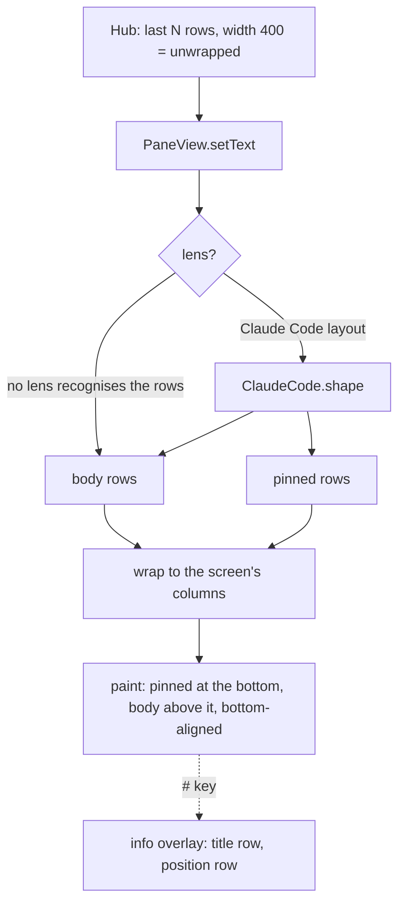
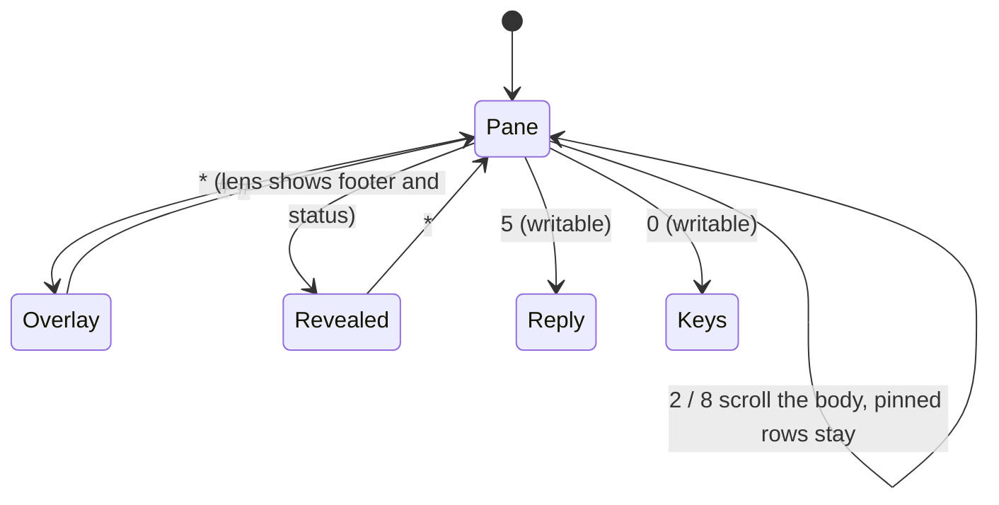

# Feature: full-screen pane view, keypad shortcuts, and a Claude Code lens

> Status: implemented 2026-10-23.

## 1. Goal

Make the most of a 96x65 screen. Today the pane view spends a title bar,
a scroll marker column and a partial row at the bottom on things the user
rarely needs; the pane itself gets five rows of fourteen characters. After
this change the pane fills the whole screen, and the title, scroll position
and key hints appear only when asked for, drawn over the pane.

Keypad shortcuts replace menu trips for the things done most: scroll, reply,
keys, info.

The second half is a **lens**: a small, self-contained filter that reshapes
the rows of one particular program for a tiny screen. The first lens is for
Claude Code, which the owner uses most. It drops the box-drawing rules
around Claude's input box (a rule of 80 `─` becomes five rows of nothing on
a phone), hides the footer and status line unless a key reveals them, and
pins the input box, the "offered reply", to the bottom of the screen while
the transcript above it scrolls. A lens recognises its program from the
rows themselves and leaves every other screen alone, so people who do not
use Claude Code see a plain terminal without touching a setting.

Out of scope: colour, horizontal scrolling, Claude Code's agent side panel
(a wide layout no 16-column screen can show; its "N agents" hint is part of
the footer and is hidden with it), and sending Shift-Tab (the protocol's
key list has no `BTab`; adding it is a compatible change in the core
repository, listed under Decisions).

## 2. Design

### The view



- **Whole screen.** No title bar, no `^`/`v` markers. Columns are
  `width / charWidth`, text starts at x = 0, rows are `height / lineHeight`
  and the text is bottom-aligned, so the spare pixels are at the top and the
  last row is always full. On the 96x65 build this is 6 rows x 16 to 19
  columns instead of 5 x 14.
- **Info overlay** (`#`): an inverted top row with `>` for writable panes and
  the title, and an inverted bottom row with the scroll position
  (`12-17/40`) and the key hints. Drawn over the pane; `#` again hides it.
  While a request is out, the wait mark is drawn in the top right corner,
  overlay or not.
- **Keypad.** `2`/`8` scroll one row (next to the joystick, which still
  works), `5` opens Reply, `0` opens Keys, `#` toggles the overlay, `*`
  reveals what the lens hid, the green call key sends Enter. Keypad codes
  are checked first, then the game actions, so a phone that maps `2` to UP
  does not scroll twice.
- **Wrapping moves to the phone.** The app asks the hub for `width=400`,
  the protocol's maximum, which returns the terminal's rows as they are
  (trailing blanks trimmed), and wraps them itself at the screen's columns.
  A lens can then work on whole rows, which is the only way to recognise a
  rule or a right-aligned status line. The `Width` setting keeps its
  meaning (0 = fit, else wrap at N columns). Bytes on the air are the same
  characters; only the newlines move.
- **Settings** gains a `View` choice (Auto, Plain) and a short text with
  the keypad shortcuts. Auto, the default, lets every lens look at the rows
  and the first one that recognises its program shapes them; Plain switches
  lenses off. The JAD may preset it with `Muxway-View: plain`, like the
  other install attributes. Stored as a sixth field of the existing record;
  an old record without it reads as Auto.



### Lenses

A lens is one class implementing one method. Nothing else in the app knows
what a lens looks for.

```java
/** Reshapes the rows of one program's screen for a small display. */
interface Lens {
    /**
     * Returns {body, pinned}: rows that scroll and rows kept at the bottom.
     * Null when the rows are not this program's screen.
     */
    String[][] shape(String[] rows, boolean reveal);
}
```

The registry is one array in `Muxway`; the view asks each lens in turn and
the first that answers wins, else the rows are shown as they are. Adding a
lens is one class and one array entry. MIDP has no class loading at run
time, so "plugin" means separate, optional and documented, not loadable.

**Claude Code lens.** Claude Code draws, from the bottom of the terminal:

```
                                              ● high · /effort     status, right-aligned
────────────────────────────────────────────────────────────────   rule
❯ say only the word pong, nothing else                             input box
────────────────────────────────────────────────────────────────   rule
  ⏵⏵ auto mode on (shift+tab to cycle) · ← 5 agents                footer
```

The lens finds the last two rules (rows of only `─`, `━` or `═`, at least
three long). Rows between them are the input box, pinned to the bottom (at
most half of the screen; longer boxes show their last rows). Rows after
the second rule are the footer; the row right above the first rule is the
status if it starts with eight or more spaces. Footer and status are
dropped unless `*` reveals them, in which case the pinned area shows
status, box and footer in Claude's own order. Everything before the status
is the transcript and scrolls. The rules themselves are never shown.

Blank rows between the transcript and the status (Claude fills the empty
part of a tall terminal with them) are dropped, so a short transcript sits
right above the box instead of one screen up.

If there are not two rules, the lens answers null and the rows are shown as
they are: a plain shell, a pane where Claude Code has exited, or a Claude
Code version with a different layout all look like the plain view. The lens
therefore never hides a row of the transcript.

## 3. Protocol and API changes

None. The app keeps using `GET /v1/panes/{address}` in text mode; only its
`width` parameter changes to 400. Protocol version pinned as before.

One new JAD attribute, `Muxway-View` (`auto` or `plain`), documented on
the install page.

## 4. Security analysis

- **What an attacker gains.** Nothing new reaches the host: the feature
  changes how rows are drawn and adds keypad routes to screens that
  already exist (Reply and Keys are still offered only when the token can
  write; `5` and `0` do nothing on a read-only pane). The green key already
  sent Enter.
- **Hostile content through a lens.** A server (or a relay) can craft rows
  that look like Claude Code's chrome: thousands of rule rows, a 400-column
  rule, a "footer" after a fake rule, control characters in the box. The
  lens is linear in the number of rows, works on rows the app has already
  stripped of control characters and capped at 32 KiB, and can only hide
  rows after the last rule and one row above the second-last one; `*`
  shows everything it hid. The worst a crafted screen can do is hide its
  own last lines until the user presses `*`; Settings can switch lenses
  off altogether. Documented on the feature page.
- **Wrapping on the phone** allocates one string per wrapped row: at most
  32 KiB / 8 columns = 4096 rows of 8 characters, within the heap of the
  smallest target (the body cap was chosen for this). Rows longer than the
  wrap width are cut, never kept whole.
- **Keypad.** Only the fixed set above is mapped; every other key is
  ignored. No key sends anything but Enter, and only on a writable pane.
- **Logging.** The trace (test builds only) gains the rows as drawn, so the
  tests can see the layout; it already carried the pane's content, and the
  token never passes through PaneView.
- **No new dependencies.**
- **MIDP 1.0 through a relay:** unchanged path, same requests apart from
  the `width` value; the token travels as before.

## 5. Privacy check

Fixtures are synthetic: a Claude Code screen for user `alice` in
`/home/alice/demo` with a transcript of `say pong` / `pong`. The real
capture used to learn the layout was taken in a throwaway tmux server in
the session's scratch directory and is not committed. Screenshots come
from the emulator against the test hub and the test relay only.

## 6. Test plan

| # | Test | Kind | Expected |
|---|------|------|----------|
| S06 | Hostile Claude-like screen: a thousand rule rows, a 400-column rule, a fake footer, control characters in the box | e2e-security | app shows the transcript and the box cleanly, no exception, `*` reveals the fake footer |
| S07 | Read-only pane: `5` and `0` do nothing | e2e-security | no Reply or Keys screen, no request sent |
| U14 | `ClaudeCode.shape` on the synthetic screen: rules gone, footer and status hidden, box pinned; with reveal the footer is back; a plain shell is unchanged; a box longer than the cap keeps its last rows | unit | as stated |
| U15 | `Text.wrap`: exact fit, cut, empty rows kept, multi-byte characters counted as one column | unit | as stated |
| U16 | `Prefs` with a five-field record reads as Auto | unit | `view == 0` |
| F14 | Claude Code view through the relay's `claude` mode, nothing set: no rules, no footer, `❯` row is the last row; `2` twice scrolls the transcript, `❯` row still last; `*` shows the footer; `#` shows title and position | e2e-ui | screenshots `claude`, `scrolled`, `revealed`, `info` |
| F15 | Keypad: `5` opens Reply, text sent reaches the pane; `0` opens Keys; `8` scrolls back down | e2e-ui | screenshots `reply-by-5`, `keys-by-0` |
| F07 | Updated: the request carries `width=400`, the trace reports the columns and rows the screen fits (12 to 20 x 5 to 7 on 96x65; 25 to 40 x 10 to 20 on the default) | e2e-ui | as stated |
| 12 | Build check | build | MIDP 1.0 members only; `muxway1.jar` under 30 KiB |

Existing tests S01 to S05, F08 to F11 and J13 keep passing; menu indexes
do not change since the pane view gains no commands.

## 7. Documentation

- `docs/features/pane-view.md`: the screen, overlay, keypad, wrapping, with
  the state diagram.
- `docs/features/lenses.md`: what a lens is, how to add one, the Claude
  Code lens and its security notes.
- `docs/features/install.md`: `Muxway-View`.
- `docs/ARCHITECTURE.md`: source layout (`Lens.java`, `ClaudeCode.java`),
  the Pane screen, the `width=400` request.
- `README.md`: one line each for the full-screen view and the Claude Code
  lens.

## 8. Implementation steps

1. `Text.wrap`; `PaneView` full screen, bottom-aligned, keypad, overlay,
   pinned rows; `Muxway` asks `width=400`. Unit tests for wrap.
2. `Lens`, `ClaudeCode`; `Prefs.view`; Settings choice and hint text;
   `Muxway-View`. Unit tests for the lens and the record.
3. Harness: relay mode `claude` serving the synthetic fixture, keypad
   buttons in the skin table, `Rows:` trace. Tests S06, S07, F14, F15,
   F07 update.
4. Docs.
5. Full run on both builds, recorded.

## Decisions

- 2026-10-23: plan approved. The view is Auto by default: lenses recognise
  their program from the rows; Plain in Settings (or `Muxway-View: plain`)
  switches them off. Keypad layout as in section 2.
- Open: Shift-Tab for Claude Code's mode cycling needs `BTab` in the core
  protocol's key list (compatible v1 addition); the Keys list here gains
  `Shift-Tab` once the core has it. Not part of this change.

---

## Review (after implementation)

- [x] Diff matches the plan, deviations explained here
- [x] Security rules (AGENTS.md section 2) hold
- [x] Privacy check passed: `scripts/prepush-check.sh` clean and diff read
- [x] Docs and diagrams updated

Deviations:

- **Pinned rows may take half the screen**, not a third: the 96x65 build
  has five rows, and a third rounds to one, which cut a two-row input box
  down to its tail (found by S06 and F14 on the small screen).
- **The revealed status loses its right alignment**: sixty leading blanks
  wrap into three empty rows on a phone (seen on the F14 screenshots).
- **The trace gains `Rows:`**, the rows as drawn, and `Reply` / `Keys` /
  `Info` lines, so the tests can see the layout and the keypad routes.
  Test builds only, as before.
- The hostile screen in S06 has a thousand short rules, not two thousand,
  to stay under the 32 KiB body cap so its box and footer still arrive.
- `showSetupLater` and `showSetup` were folded into one `fillSetup`.

## Test run

58 tests: 27 unit, 15 end-to-end on each build (MIDP 1.0 on a 96x65
screen, MIDP 2.0 on the default one), and the final search of every log
for tokens and keys. All passing in three consecutive full runs on
2026-10-23, 108 screenshots and an HTML report per run; the MIDP 1.0 JAR
is 23.6 KiB. The run at this commit is recorded as its `test-run` issue.
