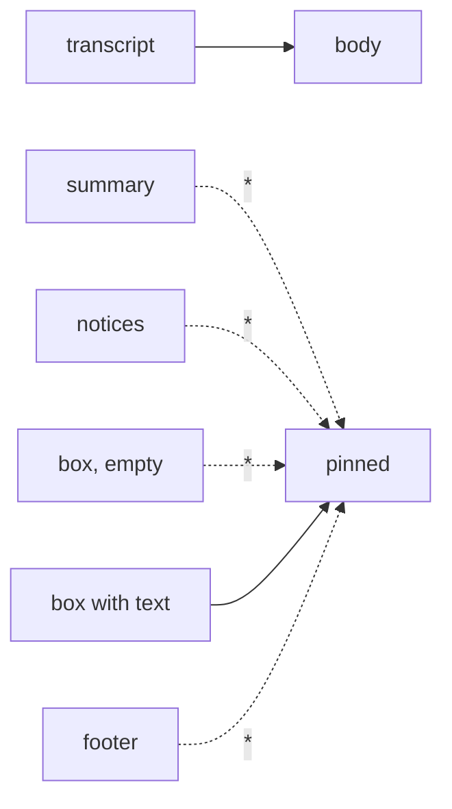

# Feature: the Claude Code lens, second pass

> Status: implemented 2026-10-24.

## 1. Goal

Three things the owner saw with 0.3.3 on the phone:

1. **Two stars.** A Claude pane lists as `* * muxway android (claude)`:
   the writable mark, then Claude Code's own `✳` spelt for a Latin-1
   phone. The title's leading mark is decoration and goes.
2. **A Claude pane should open as one.** The hub says what runs in the
   pane (`claude`), so Auto need not guess from the rows: a lens that
   owns the program shapes the pane whether or not it recognises the
   screen.
3. **Only the conversation.** Claude Code's current layout, as the hub
   returns it, ends in

   ```
   ✻ Churned for 5m 27s · done 8:54 AM          summary of the last turn
                                                 blank
                        ↓ Update installed · Restart to apply   notice, right-aligned
   ──────────────────────────────── muxway android ─   rule, now with the session name
   ❯                                                input box
   ────────────────────────────────                rule
     ⏵⏵ auto mode on (shift+tab to cycle) · ← 5 agents   footer
   ```

   On five rows of sixteen characters all of that is the screen. The
   lens is to hide everything but the transcript until `*`, including
   the empty input box, the summary row and the notices, and to cope
   with the rule that now carries the session name. The font is already
   the phone's smallest; the gain is in rows.

Out of scope: colours; lenses for other programs; the hub's layout.

## 2. Design

**The list.** `Text.label` drops a leading `✳ ` or `* ` from the title
before anything else. `* muxway android (claude)`.

**Lens by program.** `Lens` gains `boolean runs(String command)`;
`ClaudeCode` answers true for `claude`. The pane view keeps the pane's
`command` from the list. In Auto the view first asks each lens `runs`;
the first that owns the program shapes the rows forced, and only when
none does are the lenses asked to recognise the screen as today. Plain
and a lens picked by hand are unchanged.

**The compact view.** From the bottom of the rows up, the lens finds:

- the **footer**: rows after the last rule;
- the **rules**: a row whose non-blank characters are line characters
  (`─ ━ ═`, three or more) or ASCII dashes (`-`/`=`, twenty or more), with
  text up to half as long as the line allowed, which lets the top rule
  carry the session name on narrow terminals too; the bottom rule must
  still be clean;
- the **box**: rows between the rules. Empty (`❯`, `>` or `> ` alone, or
  with Claude's placeholder) it is hidden; with text it is pinned at the
  bottom as today, so what someone types at the terminal is seen;
- the **notices**: rows above the top rule that are blank or start with
  eight spaces (`● high · /effort`, `↓ Update installed · Restart to
  apply`);
- the **summary**: the one row above the notices that starts with a
  spinner mark (`✻ ✽ ✶ ✢ ·`, or `*` once the hub folded it) and names a
  duration (`58s`, `5m 27s`, `(37s ·`): `✻ Churned for 5m 27s · done
  8:54 AM`, `* Puttering... (37s · ↓ 1.6k tokens)`. A transcript bullet
  (`● pong`) has no duration and stays.

Hidden rows return under `*`, pinned in Claude's order: summary, notices
(trimmed), box, footer. Forced without rules (a layout the lens does not
know): the last prompt row among the final eight is the box, hidden when
empty, and what follows it is footer, as today.



**The hub.** The fold table learns the rest of Claude Code's marks:
`✻ ✽ ✶ ✢ ✦ ✧` become `*` and the tool-result connector `⎿` becomes `+`.
Today `✻` arrives as `?`.

## 3. Protocol and API changes

None on the wire beyond the fold table (compatible). The lens interface
gains `runs`; the view gains `command`.

## 4. Security analysis

- The lens hides more rows than before, all still in the chrome below
  the transcript: at most the rows after the last prompt row, one summary
  row, and the blank and right-aligned rows between it and the rule. A
  crafted screen can hide at most its own last rows, as before, and `*`
  shows them. The hostile cases (S06) still pass.
- Choosing the lens by the hub's `command` column trusts the hub, which
  already decides what the pane shows; a relay that lies about the
  program gets the lens applied to a shell, which hides nothing a lens
  would not hide forced today, and Plain is one menu away.
- Nothing new is logged, no new grant, no dependency.

## 5. Privacy check

The fixture is a synthetic Claude screen with `alice`'s files; the
session name in the rule is `demo`. No real transcript.

## 6. Test plan

| # | Test | Kind | Expected |
|---|------|------|----------|
| 1 | S06 (existing) hostile screen under the new rule definition | e2e-security | box survives, footer hidden, `*` reveals |
| 2 | S10 relay lies that a shell runs `claude`: the pane opens with the lens, rows all shown (no prompt row), Plain works | e2e-security | nothing of the shell hidden |
| 3 | F14 updated: new layout fixture; summary, notice, both rules, footer hidden; box with text pinned; `*` reveals all in order | e2e-ui | screenshots `claude`, `revealed` |
| 4 | F21 a pane whose program is `claude` (relay mode) without rules opens shaped in Auto; the empty box is hidden; `*` shows it | e2e-ui | screenshot `auto-claude` |
| 5 | F20 (existing) list: one star before the title | e2e-ui | `* muxway android (claude)` style label |
| 6 | Unit: rule with text, clean rule, markdown rule in a transcript not a rule (too much text); summary detection; empty-box forms; label strips the mark | unit | |
| 7 | Core fold unit: the new marks | unit | |

## 7. Documentation

`docs/features/lenses.md` (lens by program, compact view, the new
layout), `docs/features/pane-view.md` (list label), core
`docs/features/text-mode.md` (fold table).

## 8. Implementation steps

1. Core: fold entries, test, doc row; commit, run, record.
2. Client: `Text.label` mark; `Lens.runs`; `PaneView.command` and Auto
   by program; `ClaudeCode` compact view; unit tests.
3. Fixture and tests S10, F14, F21; docs; run, record, release 0.3.4,
   deploy, service message.

---

## Review (after implementation)

- [x] Diff matches the plan. Deviation: under `*` the hidden rows go
  back into the body, in place and scrollable, instead of being pinned;
  pinned rows are capped at half the screen, which on five rows would
  have shown two of them and no way to reach the rest.
- [x] Security rules (AGENTS.md section 2) hold: the lens hides only
  chrome below the transcript; a lied program gets the forced lens, which
  hides nothing of a shell (S10).
- [x] Privacy check passed: `scripts/prepush-check.sh` clean and diff read
- [x] Docs and diagrams updated

## Test run

Run `20261024-092857-696e5d7` at commit `696e5d7`: passed, 132 tests,
recorded as [issue #9](https://github.com/notmarkopadjen/muxway-midp/issues/9).
The run before it, at `760ecab`, failed S09 on a stale expectation (the
forged title's leading star is dropped as decoration now) and is
recorded as issue #8. The hub side, the fold table, ran in the core
repository as issue #39 there.
