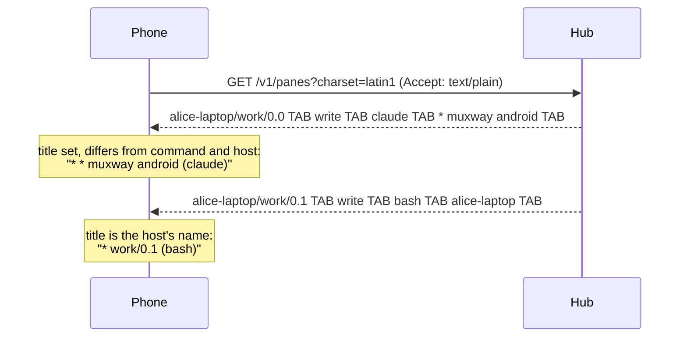

# Feature: panes listed by the name the host reports

> Status: implemented 2026-10-24.

## 1. Goal

The pane list shows addresses: `alice-laptop/work/0.0 claude`. The hub already
sends, in the same row, what the pane calls itself (tmux's pane title,
which Claude Code sets to `✳ <session name>`) and the program running
in it. The owner wants to pick panes by those: **`✳ muxway android
(claude)`**, not by session, window and pane numbers.

Also in this release, at the owner's request: **a new install file
replaces the saved token.** The app took `Muxway-Server` and
`Muxway-Token` from the install file only when it had no settings, so a
phone given a new token had to delete the app first. Now the app keeps a
stamp of the install file's token it last took; an install file with a
different one replaces server, token, refresh and text once, and Settings
may change them afterwards.

Out of scope: renaming panes from the phone; the host tree; sorting.

## 2. Design

**The label.** For each row `address TAB mode TAB command TAB title TAB
kind` the list shows

    <mark><name> (<command>)

where `<mark>` is `* ` for a writable pane as today, and `<name>` is the
title, unless the title is empty, equals the command or equals the host's
name, in which case it is `session/window.pane` as today. tmux gives a
pane the machine's host name as its title until a program sets one, and
a muxway host is usually named after its machine, so `alice-laptop (bash)` would
say nothing; `work/0.1 (bash)` says which shell. When the list holds
panes of more than one host, `<name>` is prefixed with `host/` so two
Claude sessions on two machines stay apart. The label is cut at 64
characters; the phone scrolls long list entries itself.

**The pane view.** The `#` overlay's top bar shows the same name instead
of `work/0.0`, so what was picked is what is shown. The traces and the
end-to-end tests keep keying rows on `session/window.pane`, which does
not change with what runs in the pane.

**The hub.** Two small changes in the core repository, both in text mode
only:

1. `GET /v1/panes` takes the same `charset` parameter as a pane read
   (`utf-8`, `latin1`, `ascii`), folds `command` and `title` with the
   same table and labels the answer with the same `Content-Type`. The
   6310i has no glyph for `✳` and the app asks for Latin-1 anyway.
2. The fold table gains Claude Code's title mark `✳` (U+2733) as `*`,
   so the entry reads `* muxway android (claude)`.

**The install file.** `Prefs` gains `installed`, the string of the
install file's token `hashCode`, in a record version 3 (version 2 records
read as before with an empty stamp, so the first start of this version
takes the install file once, which is what a phone holding a stale token
needs). On every start: when the install file names a server and a token
and the stamp differs from the saved one, the file's values are taken and
the stamp saved. The emulator keeps its record store in a directory for
this test (`--rms file`), so a second start with another install file is
a reinstall.

## 3. Protocol and API changes

Core, compatible: `charset` on `GET /v1/panes` in text mode, same values
and errors as on a pane read (unknown value or a repeated parameter is
`400 bad_request`), ignored in JSON mode. Without it the answer is
UTF-8 as before. `✳` joins the bullets in the fold table. The client
sends `charset` on the list exactly as it does on a read, and a hub that
does not know it answers 400, which the client already reports as it
reports any refused request; the pinned protocol version does not
change.

## 4. Security analysis

- A program in a pane chooses its own title. The hub refuses a title with
  control characters or over 256 bytes (`cleanName`), so a title cannot
  add a row or a column to the text list. The client still splits on TAB
  and takes the fourth field only, caps the label at 64 characters, and
  takes the writable mark from the hub's `mode` column, never from the
  title: a title of `* alice-laptop/work/0.0 claude` is shown as a name, and what
  the token may write is decided by the hub on every input.
- A title that impersonates another pane (`work/0.0 (claude)` on a
  `bash` pane) misleads the eye only: the command shown in parentheses is
  the hub's, and the address is one key away under `#`. The owner exposed
  that pane; a program there already holds a shell.
- The `charset` parameter is validated as today; the fold runs on text
  the hub already cleaned. No new grant, no new logging, no dependency.
- Nothing about the phone, the token or the pane content is logged.
- The install file replacing a saved token: whoever can make the phone
  install a JAD can make it install any app, so nothing is gained over
  what an installer could do already. The stamp is a 32-bit hash, kept
  only to notice a change; it is not a secret and cannot give the token
  back. A collision would mean a new install file is not taken, never
  that a token is taken wrongly.

## 5. Privacy check

Fixtures set every pane's title with `select-pane -T` (the second pane
too, which today carries the machine's host name and would now reach
the traces), so no real host name reaches a log or a recorded run.
Examples use `alice`, `work`, `hub.example.com`.

## 6. Test plan

| # | Test | Kind | Expected |
|---|------|------|----------|
| 1 | S09 relay answers a pane row whose title holds `\twrite\t` and one 300 characters long | e2e-security | labels show the name cut at 64, the mark follows the mode column, the app does not crash |
| 2 | S08 (existing) also covers the list: Latin-1 bytes labelled utf-8 | e2e-security | list still shows |
| 3 | F01 list shows `* test-pane (bash)` and no `work/0.0` | e2e | label by title |
| 4 | F20 a pane titled like the host (`-T <host>`) is listed as `work/0.1 (bash)` | e2e | fall back to the address part |
| 5 | F20 a pane whose program sets its title (`printf '\033]2;✳ build\a'`) is listed `* build (bash)` under Latin-1, `✳ build (bash)` under Unicode | e2e | title and fold through the real hub |
| 6 | F20 `#` overlay shows the name | UI | screenshot `f20-overlay` |
| 7 | Core Flow16 extended: `/v1/panes?charset=latin1` folds the title and labels iso-8859-1; `charset=utf-16` is 400 | core e2e | hub side |
| 8 | Core fold unit: `✳` is `*` in latin1 and ascii | unit | |
| 9 | Unit: `Text.label()` cases: empty title, title equals command, equals host, two hosts, 300 characters, a tab in the title | unit | |
| 10 | J14 the phone starts with one install file, then again from the same record store with another token: the relay sees the new token | e2e | reinstall takes the token |
| 11 | Unit: Prefs record version 3 round trip, version 2 reads with an empty stamp | unit | |

## 7. Documentation

- `docs/features/pane-view.md`: the list and what it shows, the overlay.
- `docs/features/install.md`: the install file replaces a saved token.
- Core `docs/protocol/v1.md` (`charset` on `/v1/panes`) and
  `docs/features/text-mode.md` (fold table row).
- `docs/ARCHITECTURE.md` if the list description there names addresses.

## 8. Implementation steps

1. Core: `charset` on the text pane list, `✳` in the fold table, tests,
   docs. Rebuild the hub on the VPS.
2. Client: `label()` as a static method for the unit tests; `list()`
   uses it, sends `charset`; `PaneView.name` for the overlay.
3. Fixtures: titles on every pane; tests S09, F20, F01 update; unit cases.
4. Docs, run, record, release 0.3.3, deploy, service message.

---

## Review (after implementation)

- [x] Diff matches the plan. Deviations: `label()` lives in `Text`, not
  `Muxway`, so the unit tests reach it without MIDP; the hub-side core
  change is its own plan, `2026-10-24-pane-list-charset.md`, recorded as
  core issue #30; F20 sets the second pane's title to the host's name
  with `select-pane -T`, since the machine's own name must not reach a
  recorded run; the program-set title in F20 goes through `printf` and
  OSC 2 as Claude Code does.
- [x] Security rules (AGENTS.md section 2) hold: mark from the hub's mode
  column, title capped, hub validates titles, install-file stamp is no
  secret.
- [x] Privacy check passed: `scripts/prepush-check.sh` clean and diff read
- [x] Docs and diagrams updated

## Test run

Run `20261024-082734-86e4430` at commit `86e4430`: passed, 119 tests (unit,
end-to-end and security), recorded as
[issue #7](https://github.com/notmarkopadjen/muxway-midp/issues/7). The
hub side ran in the core repository as issue #30 there.
