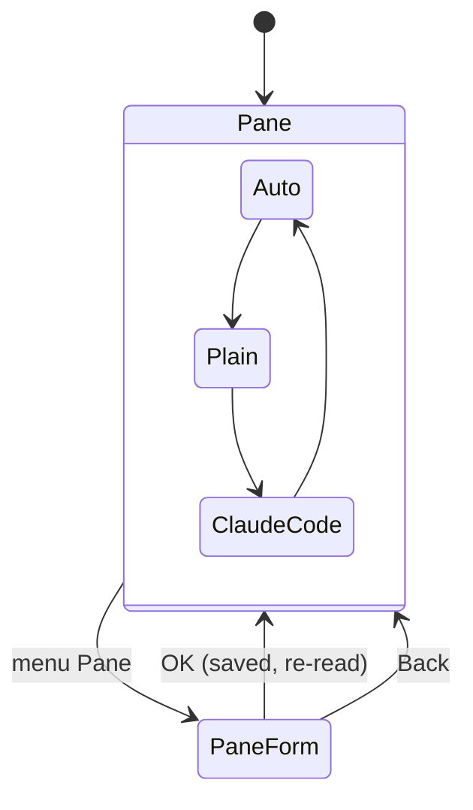

# Feature: settings per pane, a forced Claude Code view, and plain text

> Status: implemented 2026-10-24.

## 1. Goal

Three things the owner found using 0.2.0 on the phone:

1. **View belongs to the pane.** Whether a pane is shown plain or through
   a lens is a property of what runs in that pane, not of the app. The
   `View` choice moves from Settings to a small form per pane.
2. **A third view: Claude Code.** Auto asks every lens; Plain asks none;
   **Claude Code** uses that lens whether or not it is sure. When the two
   rules are not found it still pins the last prompt row (`❯` or `>`) to
   the bottom and hides what follows it.
3. **The lens did not recognise Claude Code on the 6310i.** The phone has
   no glyphs for `─` and decodes the hub's UTF-8 as Latin-1, so a rule
   arrived as rows of odd glyphs and the lens, which only trusts a row of
   line characters, answered null. The hub gains a `charset` parameter
   (core plan `2026-10-24-text-mode-charsets.md`); the app asks for
   Latin-1 on the MIDP 1.0 build and decodes what the hub says it sent,
   and the lens accepts the ASCII rules `---` and `===` as well.

4. **Rows end three or four characters early.** The app counts the
   columns that fit by the width of `M`. Nokia phones have no monospace
   font: `FACE_MONOSPACE` gives the proportional system font, whose
   letters are mostly narrower than `M`, so every row leaves pixels
   unused. With `Width` at `0` the app now wraps by measured pixel width,
   character by character, so each row holds as much as fits.

Out of scope: colours; lenses for other programs; a keypad shortcut for
the pane form (the menu has it); width per pane.

## 2. Design

**Pane form.** The pane view's menu gains `Pane`. It opens a form titled
with the pane's address with one choice, `View`: Auto, Plain, Claude
Code. `OK` saves and re-reads the pane. Settings loses `View`, and the
JAD attribute `Muxway-View` goes, since there is no app-wide view any
more.

**Storage.** `Prefs` keeps a list of pane records after the app fields,
one line each: `address<TAB>view`. At most 32 panes are kept;
saving a new one drops the oldest. An address comes from the hub's pane
list and cannot carry a tab or a newline (the protocol strips control
characters), and `read` ignores a line that does not parse.



**Forced lens.** `Lens.shape` gains a `forced` flag. The Claude Code lens
with `forced`: if it finds two rules it does what it does today;
otherwise it takes the last row within the final eight that starts with
`❯ ` or `> ` as the box, the rows before it as the body (trailing blanks
dropped) and hides the rows after it until `*`. Without a prompt row it
shows the rows plain. In Auto the flag is false and nothing changes.

**Text.** Settings gains `Text`: Unicode, Latin-1, ASCII. The default is
Latin-1 on the MIDP 1.0 build and Unicode on 2.0; the JAD may set
`Muxway-Text: ascii`. Reads add `&charset=latin1` or `&charset=ascii`
(nothing for Unicode). The app decodes the body by the `charset` in the
answer's `Content-Type`: `iso-8859-1` as Latin-1, `us-ascii` as Latin-1
too, anything else as UTF-8. A hub without the parameter keeps sending
UTF-8, and the app then shows it as before.

**Pixel wrapping.** `Text.wrap` gains a form that takes a table of
character widths (the font's width of each character below 256, measured
once; wider characters count as `M`) and the screen width in pixels, and
cuts a row where the next character would not fit. `PaneView` uses it
when `Width` is `0`; a `Width` other than `0` still wraps at that many
characters. The lens sees the rows before either wrapping, as today. The
emulator's font happens to be monospace, so there the result equals the
old one; the gain is on the phone.

**Lens and ASCII.** `rule()` accepts rows of `-` or `=` (three or more,
spaces allowed) next to the line characters. The status row test (eight
leading spaces) and the rest are unchanged; `❯` arrives as `>` and the
forced lens looks for both.

```mermaid
sequenceDiagram
    participant P as Phone (MIDP 1.0)
    participant H as Hub
    P->>H: GET panes/{address}?lines=40&width=400&charset=latin1
    H-->>P: text/plain; charset=iso-8859-1, rules as ---, ❯ as >
    P->>P: decode Latin-1, lens sees the rules, pins the box
```

## 3. Protocol and API changes

None in this repository. It uses the `charset` parameter the core adds.

## 4. Security analysis

- Nothing new leaves the phone: one more query parameter with a fixed
  value. Reads and writes need the same grants as before.
- The pane list is the only input the new storage trusts, and it is
  already validated by the hub and stripped of control characters by the
  protocol; a line that does not parse is dropped on read. The record
  stays bounded (32 panes, addresses up to the protocol's lengths).
- The `Content-Type` charset is a string from the relay or hub. It is
  compared against two fixed values; anything else means UTF-8, the
  decoder the app always had, so a hostile header cannot pick a decoder.
- The forced lens hides rows after a prompt row. A hostile screen can
  hide at most the rows after its last `> ` within the final eight, and
  `*` shows them. The user chose the forced view for that pane.
- Through the plain-HTTP relay the request and answer are as exposed as
  before; the charset adds nothing an eavesdropper did not have.

## 5. Privacy check

Fixtures stay synthetic (`alice`, `/home/alice/demo`); screenshots from
the emulator only.

## 6. Test plan

| # | Test | Kind | Expected |
|---|------|------|----------|
| S08 | hostile `Content-Type` charsets (`utf-7`, `../`, 300 chars) and a pane list with 40 panes | e2e-security | decoded as UTF-8, no exception, record capped at 32 |
| U17 | Prefs: pane records round trip, cap, unparsable line dropped, old record still reads | unit | as stated |
| U18 | lens: ASCII rules recognised; forced mode with and without rules; Auto unchanged | unit | as stated |
| U19 | charset from `Content-Type` picks the decoder | unit | three cases |
| F17 | Pane form: set Plain on the Claude pane, rules visible; reopen, still Plain; another pane still Auto | e2e-ui | screenshots `pane-form`, `plain` |
| F18 | Pane form: Claude Code on a screen without rules pins the `> ` row | e2e-ui | screenshot `forced` |
| F19 | MIDP 1.0 asks `charset=latin1`, MIDP 2.0 asks none; relay in `claude` mode answers Latin-1 ASCII art and the lens pins the box | e2e | request query checked, `Rows:` trace |
| U20 | pixel wrap with a synthetic width table: narrow letters fill the row, wide ones wrap earlier, a row is never cut to nothing | unit | as stated |
| F20 | `Width` 0 on the 96x65 screen still shows 19-character rows, `Width` 12 shows 12 | e2e | `Rows:` trace |

The test relay transliterates the Claude fixture the way the hub will
when `charset` is asked for, so the fixture stays one file.

## 7. Documentation

`docs/features/pane-view.md` (the pane form, pixel wrapping),
`docs/features/lenses.md` (Claude Code view, ASCII rules, text setting),
`docs/features/install.md` (`Muxway-Text` replaces `Muxway-View`),
`README.md`, `docs/ARCHITECTURE.md` (Prefs, request).

## 8. Implementation steps

1. Prefs pane records and `Text`; unit tests.
2. Pane form and the wiring in `Muxway`; drop the app-wide view.
3. Lens: `forced`, ASCII rules; unit tests.
4. Api: charset in the request and the decoder; unit test.
5. Pixel wrapping; unit test.
6. Test relay, fixtures, e2e tests S08, F17 to F20; docs; version 0.3.0.
7. Run the suite on both builds, record the run, install on the phone.

## Decisions

- 2026-10-24: both plans approved by the owner in the console. The owner's
  remark on width was about the unused room at the end of each row, not
  about a width per pane; that became point 4.

---

## Review (after implementation)

- [x] Diff matches the plan, with these deviations:
  - The pane's view is picked from a list, not a form with a choice group:
    one key press applies it, and MIDP 1.0 cannot retitle a screen, so a
    fresh list is made per pane.
  - Test F20 was dropped: the emulator's font is monospace, so a run there
    cannot show the gain; U20 tests the pixel wrap and F07 keeps checking
    that rows fit. S08 tests the lying charsets alone; the pane cap is U17.
  - Found by F14 while testing: the first paint and the first read raced,
    and measuring 256 character widths on the paint thread made the paint
    side lose, leaving an empty screen. Shaping, scrolling and the first
    read now hold the view's lock, the font is measured on the paint
    thread only (the emulator measures nothing on other threads), and the
    first read waits for that measurement.
- [x] Security rules (AGENTS.md section 2) hold: one fixed query value,
      bounded pane records from hub-listed addresses, a decoder picked from
      two the app always had
- [x] Privacy check passed: `scripts/prepush-check.sh` clean and diff read
- [x] Docs and diagrams updated: pane view, lenses, install, architecture

## Test run

(after the run)
