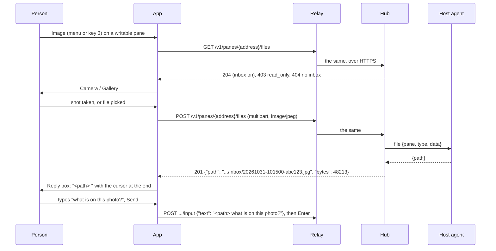
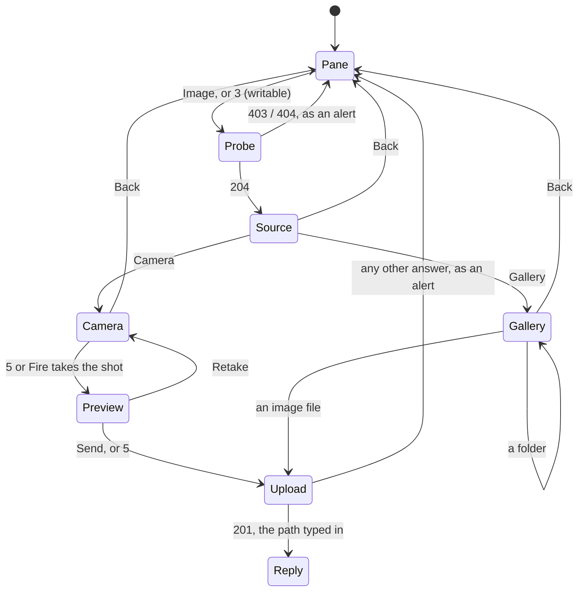

# Feature: reply with an image

> Status: proposed 2026-10-31.

## 1. Goal

An AI coding agent reads a photo when its path is in the prompt. The hub
and the host agent already carry a file from a client into an **inbox**
on the host and hand back its path (the core's attachments feature);
the web and Android clients use it. The phone cannot: its only writes
are the Reply text and the named keys.

On the MIDP 2.0 build a writable pane gets **Image**: take a photo with
the phone's camera, or pick one from the phone's memory, send it to the
pane's host, and land on the Reply screen with the file's path already
typed, a space after it, so the question is finished on the keypad and
sent as any reply.

Out of scope: the MIDP 1.0 build (no camera, no media API, and the WAP
1.x path cannot carry a multipart body), showing an inbox image back
on the phone, files that are not images, choosing the photo size
(fixed at 640x480 when the camera offers it).

## 2. Design

Two new screens and one new API call, all in the MIDP 2.0 build. The
MIDP 1.0 build gets a `Files` class that says it has nothing, and
ProGuard drops the rest.

### The flow



The probe (`GET .../files`) runs once per pane view, the first time
Image is chosen, so a photo is never taken for a host that cannot take
it. Its answer decides what the person sees: Camera and Gallery, "Read
only." or "The host takes no files: its agent needs --inbox."

### Screens



- **Source** is a `List`: Camera, Gallery. A phone whose media API has
  no camera (`Manager.createPlayer("capture://image")` and
  `"capture://video"` both fail) shows Gallery alone.
- **Camera** is a `Canvas` with the viewfinder
  (`VideoControl.initDisplayMode(USE_DIRECT_VIDEO, canvas)`, full
  screen). `5`, the joystick's Fire or the Shoot command take the shot:
  `getSnapshot("encoding=jpeg&width=640&height=480")`, then
  `"encoding=jpeg"` when the phone refuses the size. The player is
  closed as soon as the shot is taken or the screen left.
- **Preview** shows the shot scaled to the screen with Send and Retake.
- **Gallery** is a `List` of one folder: folders first, then files
  ending in `.jpg`, `.jpeg`, `.png`, `.gif`, with `..` at the top. It
  opens at the phone's photo folder (`fileconn.dir.photos`), or at the
  list of roots when the phone names none. A file over 1 MiB is shown
  but refused with "Too big for the phone's link (1 MiB at most)."
  before any request.
- **Upload** is the pane with its wait mark, as every other request; the
  watchdog gives it 240 s instead of 45, since 1 MiB over EDGE takes a
  minute and over GPRS three.
- **Reply** is the existing text box, prefilled with the path and a
  space, cursor at the end.

### Code

| Where | What |
|---|---|
| `src/muxway/Api.java` | `upload(path, type, in, length)`: multipart POST with one part `file`, the body streamed in 4 KiB pieces (a gallery file is never held whole); `Content-Length` computed from the part's headers and the file's size. `problem()` learns 415 and 507. |
| `src/muxway/Text.java` | `jsonString(body, key)`: the value of one string key from a small JSON object, `\"`, `\\`, `\/` and `\uXXXX` unescaped, anything else gives null. `imageType(name)`: the type for the extension, or null. |
| `profiles/midp2/muxway/Files.java` | the camera and gallery screens, the media and file API calls; the only class that imports `javax.microedition.media` or `javax.microedition.io.file`. |
| `profiles/midp1/muxway/Files.java` | `static final boolean ANY = false` and no screens; the Image command is never added. |
| `src/muxway/Muxway.java` | `imageCmd` on a writable pane after Keys; jobs `PROBE` and `UPLOAD`; `3` from the pane view; the Reply prefill; the longer watchdog for `UPLOAD`. |
| `src/muxway/PaneView.java` | `KEY_NUM3` → `app.shortcut(IMAGE)` on a writable pane; the overlay hint and the Settings help name the key. |
| `manifest/midp2.in` | `MIDlet-Permissions-Opt` for the snapshot and file read, so a phone that honours it asks once. |
| `scripts/build.sh` | the MIDP 2.0 build compiles against two more stub jars (section 4); the 1.0 build does not see them. |
| `scripts/check-midp1.sh` | `javax/microedition/io/file/` joins the forbidden list. |

## 3. Protocol and API changes

None to the protocol: the app uses `GET` and `POST
/v1/panes/{address}/files` as [protocol v1](https://github.com/notmarkopadjen/muxway/blob/main/docs/protocol/v1.md)
specifies them, pinned at the version it already speaks.

```http
POST /v1/panes/alice-laptop/work/0.0/files HTTP/1.1
X-Muxway-Token: <token>
Accept: text/plain
Content-Type: multipart/form-data; boundary=muxway-midp-7f3a
Content-Length: 48421

--muxway-midp-7f3a
Content-Disposition: form-data; name="file"; filename="file"
Content-Type: image/jpeg

<the JPEG's bytes>
--muxway-midp-7f3a--
```

```http
HTTP/1.1 201 Created
Content-Type: application/json

{"path":"/home/alice/.config/muxway/agent/inbox/20261031-101500-abc123.jpg","bytes":48213}
```

The answer is JSON whatever `Accept` says; the app reads the one key it
needs and ignores the rest. A relay that relabels it `text/plain` changes
nothing.

**Relays** (`docs/features/relay.md`): the list of paths a relay
forwards grows by `GET` and `POST /v1/panes/{address}/files`, with the
`Content-Type` header passed as it is and a body cap of 8 MiB on that
path alone; the other paths keep their 16 KiB. A relay that does not
forward it makes Image answer "Not found." and nothing else changes.
The owner's own relay gets this change as part of the release.

## 4. Security analysis

- **What an attacker gains.** A phone's token with a write grant can
  put bytes on the host, in one directory the owner opened with
  `--inbox`, under the hub's limits (8 MiB a file, 500 files or 256
  MiB, one file every two seconds, a day's lifetime, type sniffed).
  Nothing a browser with the same token cannot do already. The MIDP 1.0
  build cannot do it at all.
- **Grants.** The hub requires the pane's write grant and a writable
  mark; the probe shows `403` and `404` as what they are and the app
  sends no file after them. A relay that lies about the probe (`204`
  for a read-only pane) only gets the upload refused by the hub.
- **Input across a boundary.** The answer's `path` comes from the hub
  or a relay: it is unescaped by a parser that rejects everything but a
  JSON string, cut to 256 characters, passed through `Text.printable`
  and put in a text box the person edits; the phone never opens it,
  and on Send it travels as reply text like any other, control
  characters removed. A malformed or missing path is "Unexpected
  answer" and the pane. The gallery file is bytes the phone reads from
  its own memory: the type comes from the extension only and the hub
  sniffs the bytes; the phone's file name is never sent (`filename="file"`).
  The hub refuses a type and bytes that disagree with `415`.
- **Transport.** Through a plain-HTTP relay the photo travels unencrypted,
  as the token and the pane's text already do; the feature page says so
  next to the relay page's advice (a token per phone, the few panes it
  needs, short-lived). The 2.0 build may use `https://` directly where
  the phone trusts the certificate.
- **Resources on the phone.** The camera player is closed on every exit
  of the screen; a snapshot is one byte array of the phone's choosing
  (640x480 JPEG, tens of KiB); a gallery file is streamed in 4 KiB pieces
  and refused over 1 MiB before any request, so neither the heap nor
  the 240 s watchdog is at the mercy of a large file.
- **Logging.** The app's trace (test builds only) records "Image: 48213
  bytes -> 201" and the path, never the bytes; the hub and agent audit
  who put what type and size where, as the core specifies. The token
  stays in its header.
- **Dependencies.** Two jars join `lib/` for the build and the emulator
  only, downloaded by `scripts/build.sh` and pinned by SHA-256 like the
  others: `microemu-jsr-135-2.0.4.jar` (media API) and
  `microemu-jsr-75-2.0.4.jar` (file API), from Maven Central, the
  published builds of the emulator the tests already run. They are on
  the MIDP 2.0 build's boot class path and nothing of them is in the
  JAR; the MIDP 1.0 build never sees them and `check-midp1.sh` refuses
  both packages.

## 5. Privacy check

The fixture image is made by the test (`convert -size 64x48 xc:gray`),
paths in docs are `alice`'s, screenshots come from the emulator, photos
for the docs from the phone against the test environment. No relay
address, number or key of the owner's appears; the relay change is
described for any relay.

## 6. Test plan

The test agent runs with `--inbox <dir under the run's tmp>`; the
emulator loads the two extension jars (`--impl`) and the test puts the
fixture under the emulator's file root. Security first:

| # | Test | Kind | Expected |
|---|------|------|----------|
| S11 | Read-only token: Image is not in the menu and `3` does nothing | e2e-security, both builds | no `/files` request reaches the relay |
| S12 | Writable pane, agent without `--inbox`: Image | e2e-security, midp2 | `GET /files` → 404, alert "The host takes no files…", no camera, no POST |
| S13 | Relay answers the upload with a path of 2000 characters, one with control characters, one that is not a JSON string | e2e-security, midp2 | Reply box holds at most 256 printable characters, or "Unexpected answer" and the pane; the app stays up |
| S14 | Gallery file of 1 MiB + 1 byte | e2e-security, midp2 | refused on the phone, no request |
| S15 | Hub answers 429, 413, 415, 507 (relay modes) | e2e-security, midp2 | each its message, back on the pane |
| S16 | Token never in the multipart body or any log | e2e-security, midp2 | `secrets_in_logs` extended to the relay's recorded bodies |
| S17 | Wrong bytes: a `.jpg` that is a PNG | e2e-security, midp2 | hub 415 "Not an image the host takes." |
| F22 | Gallery: pick the fixture, upload, prefilled Reply, type `ok`, Send; screenshots `source`, `gallery`, `reply`, `pane` | e2e-ui, midp2 | the file in the agent's inbox equals the fixture; the pane shows the path and `ok` |
| F23 | Camera in the emulator (no camera there) | e2e-ui, midp2 | Source shows Gallery alone; screenshot `source` |
| F24 | `3` opens Image on a writable pane; the overlay hint names it | e2e-ui, midp2 | `GET /files` reaches the relay |
| F25 | MIDP 1.0 build: no Image in the menu, JAR still under 30 KiB, `check-midp1.sh` passes | e2e, midp1 | |
| U | `Api.multipart` headers and length; `Text.jsonString` on escapes, a missing key, nested quotes; `Text.imageType` | unit | |
| D | On the phone: a camera shot and a gallery photo both end in the pane's inbox and Claude Code describes them | device, noted in the test run | |

## 7. Documentation

- New `docs/features/images.md`: what it does, the two routes, the
  flow and state diagrams above, the relay note, security
  considerations, a photo of the phone on the Camera and Reply screens.
- `docs/features/pane-view.md`: Image in the menu, `3` in the keypad
  table and the state diagram.
- `docs/features/relay.md`: the fifth path, the body cap, the header.
- `docs/features/install.md`: the permission the phone asks for.
- `docs/ARCHITECTURE.md`: protocol features used, the `Files` profile
  class, the two stub jars.
- `docs/testing.md`: the agent's `--inbox` and the emulator's extension
  jars.
- `README.md`: one bullet under "What it does", MIDP 2.0 only.

## 8. Implementation steps

1. Build: fetch and pin the two jars, add them to the 2.0 boot class
   path, forbid `javax/microedition/io/file/` in the 1.0 check, the
   manifest permission line. Both JARs build as before.
2. `Text.jsonString`, `Text.imageType`, `Api.upload`, the new status
   messages, with unit tests.
3. `Files` for both profiles: the Source list, Gallery, Camera and
   Preview screens.
4. `Muxway`: the command, the key, the probe and upload jobs, the
   watchdog, the Reply prefill; `PaneView`: the key and the hint.
5. Harness: `--inbox`, `--impl`, the fixture, relay modes for the
   answers in S13 and S15; the tests of section 6; the run on both
   builds.
6. Docs of section 7, then the review below.
7. Release: the owner's relay forwards the new path with the larger cap
   before the build goes to the phone.

---

## Review (after implementation)

- [ ] Diff matches the plan, deviations explained here
- [ ] Security rules (AGENTS.md section 2) hold
- [ ] Privacy check passed: `scripts/prepush-check.sh` clean and diff read
- [ ] Docs and diagrams updated

## Test run

Not yet run.
