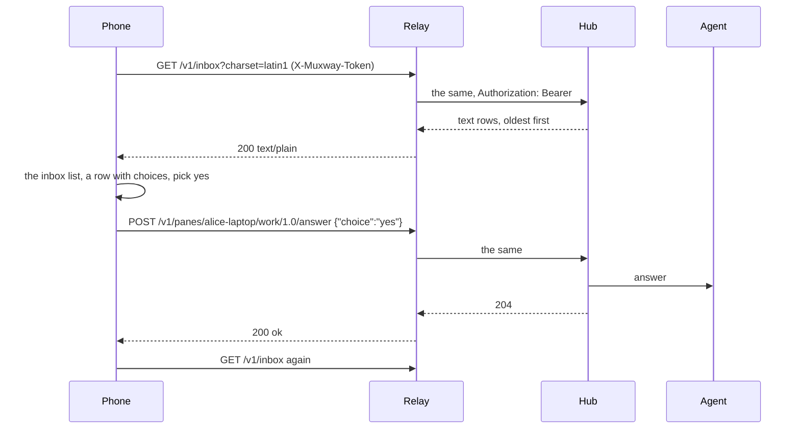
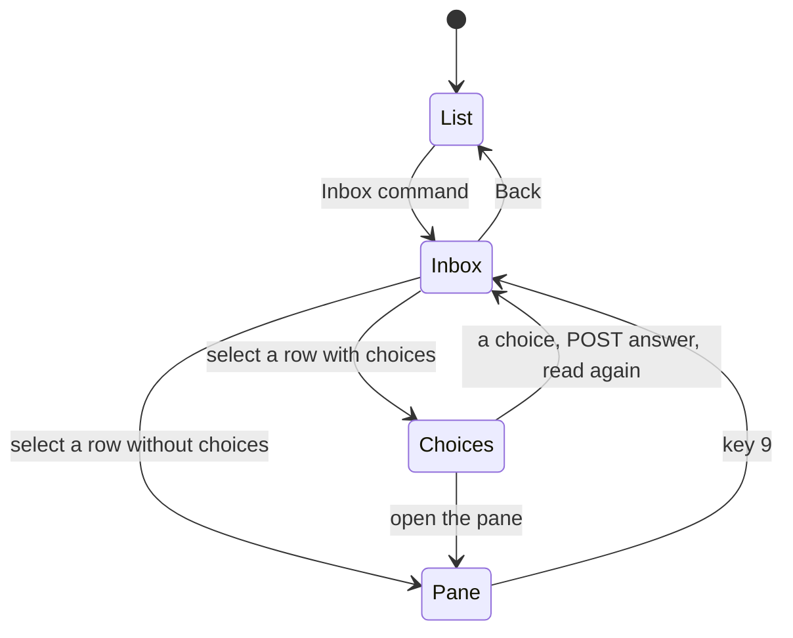

# Feature: what waits, and a question's answer, on the keypad

> Status: approved 2026-10-31, implemented in version 0.5.0. Follows the core's
> `docs/plans/2026-10-31-agent-orchestration.md` (muxway#181, merged as
> PR #183), whose plan left the native clients to their own repositories.

## 1. Goal

The core now lists what waits across hosts in one call (`GET /v1/inbox`,
with a text mode made for this phone) and lets a process in a pane ask a
question with fixed answers, answered with `POST
/v1/panes/{address}/answer`. The phone shows none of it: the pane
listing's fifth column, the kind of attention, reaches it and is thrown
away; nothing lists what waits; a question's choices never arrive, since
only the inbox's text mode carries them. This plan, within what a 30 KiB
MIDP 1.0 JAR and a keypad allow:

- **the kind in the list**: a pane that waits shows it in the two-column
  prefix the list already has: `*?` a question, `*!` a permission, `*z`
  idle, `*v` done (the writable `*` as today, a space where it is not);
- **the inbox**: an `Inbox` command on the pane list and `9` on the pane
  view read `GET /v1/inbox` in text mode and list every waiting pane,
  oldest first, as `? name: text`; select opens the pane; a row with
  choices first offers them;
- **answers**: picking a choice posts it with `/answer`; nothing is typed
  into the pane; `409` and `400` are told in words.

Out of scope: events and polling for them (no long poll on this phone,
by design), per-harness marks beyond the `(command)` suffix (one more
glyph the Latin-1 font may not have), lenses for the other harnesses,
and the 1.0 build beyond the kind marker (see the decision below).

## 2. Design

### The kind in the list

`list()` already splits the row on TAB; it reads `f[4]` and maps
`question` `permission` `idle` `done` to `?` `!` `z` `v`, which replaces
the second character of the prefix (`"* "` becomes `"*?"`). Four string
compares and no new class: within the 1.0 JAR's room.

### The inbox

A new job `INBOX` reads `inbox[?charset=…]`, text mode:
`<address>\t<kind>\t<at>\t<text>\t<choices joined by |>`, oldest first as
the hub sends it. A `List` "inbox" takes one row per pane, `? name: text`
with the name from the pane list's names when the address is known there
(else the address), text cut to the list's width by `Text.label`'s rules;
the parallel Vectors keep the address and the choices. Empty: one row,
`nothing waits`. Select on a row without choices opens the pane as the
pane list does. Select on a row with choices opens a chooser `List` with
the choices and, last, `open the pane`; a choice selected runs the job
`ANSWER`, `POST panes/{address}/answer` with `{"choice":"…"}` built as
`Api.text` builds its body, then re-reads the inbox. `Api.problem` learns
`409` (*no question now*); `400` on an answer reads *not a choice*.

The pane view gets `9` for the inbox (a free key; `4` `6` `7` stay free),
in the keypad table of `pane-view.md`, the help string and the overlay
hint. The pane list gets the `Inbox` command.

Both are behind `Ui.INBOX`, true in the 2.0 profile and false in 1.0,
as `Files.ANY` is for images: the 1.0 JAR has some 350 bytes left under
its cap and the inbox is a screen, a job and a parser. The 1.0 phone
keeps the kind marker, which is the cheap part. If even the marker pushes
the 1.0 JAR over the cap, it goes behind `Ui.INBOX` too and the plan says
so in the review.

### The relay

`docs/features/relay.md` adds `GET /v1/inbox` and `POST
/v1/panes/{address}/answer` to the paths a relay forwards, and nothing
else; the Caddy example's matcher gains `/v1/inbox` (`/v1/panes/*`
already carries `answer`). The answer's body is within the 16 KiB cap.

### Guideline rows

In the core's `docs/ui-guideline.md` §1.6 the MIDP half of the last
column: the inbox row *`Inbox` on the list's menu, `9` on the pane*;
answer a question *the inbox row's choices*; open the oldest stays `—`
(the inbox's first row is the oldest).

## 3. Protocol and API changes

None to the protocol. Newly used: `GET /v1/inbox` text mode and `POST
/v1/panes/{address}/answer`, both v1. `docs/ARCHITECTURE.md`'s "Protocol
features used" lists them and drops *no other route* to *no `/v1/me`, no
tree, no long-poll or events*.

## 4. Security analysis

- **An answer is a write**: the hub checks the write grant and the pane's
  mark and the agent checks the choice against the list it gave; the
  phone sends the choice exactly as the inbox row carried it, escaped as
  `Api.text` escapes text. A read-only pane's row offers no choices
  (`mode` is not in the inbox's text columns, so the phone learns it from
  the pane list's `writable` for a known address, and otherwise offers
  them and lets the hub's `403` speak).
- **Choices from the hub** are split on `|`, capped at eight, each cut to
  40 characters and passed through `Text.printable`, so a hostile relay
  cannot put control characters or endless text into a `List`.
- **The relay path**: two more paths on the allowlist, both already
  behind the token header; a relay that forwards only the listed paths
  stays closed. The plain-HTTP warning covers the answer as it covers
  input: an answer over `http://` to a remote relay is a choice in the
  clear, and the existing warning is what tells the user so.
- Nothing is logged on the phone beyond the trace in the test build; the
  trace prints paths and status codes, never the token or a choice.
- No new dependency; both builds checked by `check-midp1.sh` and the JAR
  cap.

## 5. Privacy check

Fixtures are synthetic (`alice-laptop`, *deploy to staging?*); emulator
shots come from the test hub.

## 6. Test plan

| # | Test | Kind | Expected |
|---|------|------|----------|
| S16 | an answer with a read-only token, through the relay | e2e-security | `403`, the words shown; the ask still waits |
| S18 | the relay feeds a row with nine choices, a 41-character one and a control character | e2e-security | capped, cut, cleaned; the list intact |
| S19 | the app requests only the allowlisted paths across the whole run | e2e-security | the relay's log shows `inbox` and `answer` and nothing new |
| J15 | the inbox row parser: five columns, choices split on `\|`, empty last column | unit | as the format says |
| F24 | a waiting pane shows `*?` in the list on both builds | e2e | the row |
| F25 | the inbox lists two hosts' panes oldest first; select opens the pane | e2e | shots `inbox`, `inbox-open` |
| F26 | `muxway ask` answered from the chooser; `409` on a second try | e2e | exit 0 with the choice; *no question now* |
| F27 | `9` opens the inbox from a pane; the 1.0 build has no `Inbox` and ignores `9` | e2e | the screens |
| build | `muxway1.jar` under the cap, `check-midp1.sh` clean | build | as today |

## 7. Documentation

`docs/features/pane-view.md` (the keypad table), a new
`docs/features/inbox.md`, `docs/features/relay.md` (the paths, the Caddy
matcher), `docs/ARCHITECTURE.md`, the README (what the phone shows), the
core's `docs/ui-guideline.md` §1.6.

## 8. Implementation steps

1. The kind marker in `list()`; both builds; the cap checked.
2. `Ui.INBOX`; the `INBOX` job, the inbox parser and `List`; the `Inbox`
   command and key `9`; help and overlay hint.
3. The chooser `List`, the `ANSWER` job, `Api.problem` 409.
4. Docs, relay paths, the guideline rows.
5. Tests; the run; version 0.5.0; release notes.

---

## Review (after implementation)

- [x] Diff matches the plan, deviations explained here
- [x] Security rules (AGENTS.md section 2) hold
- [x] Privacy check passed: `scripts/prepush-check.sh` clean and diff read
- [x] Docs and diagrams updated

Deviations: the 1.0 JAR takes the kind marker and stays under the cap
(30637 bytes, 83 to spare), so nothing moved behind `Ui.INBOX` beyond
what the plan said. Test ids differ from the table: the suite already
had an F25, so the kind marker is F24, the inbox F26, the answer F27 and
key `9` F28; J15 is the unit test of the row parser and the choices.
A hostile relay's choices are cut by the body filter every answer goes
through, not by a second pass, which the inbox page says.

## Test run

Run `20261101-094429-c48ba04` at commit `c48ba04`, recorded as
[issue #26](https://github.com/notmarkopadjen/muxway-midp/issues/26):
174 tests, 2 failed, both on the 1.0 build and both timeouts (S05 and
F11) while two other suites shared the machine's four cores; both pass
on their own at the same commit. Two earlier full runs at `36f632e` and
`9a949d9` each lost one test to a menu pick that landed on the first
entry, which `c48ba04` fixes in the harness; those two tests pass since.
The pull request's own run is the one to go by. The device test on the
owner's phone is still to come.
