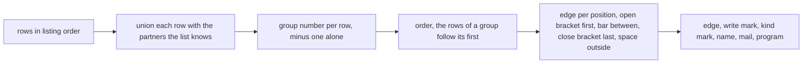
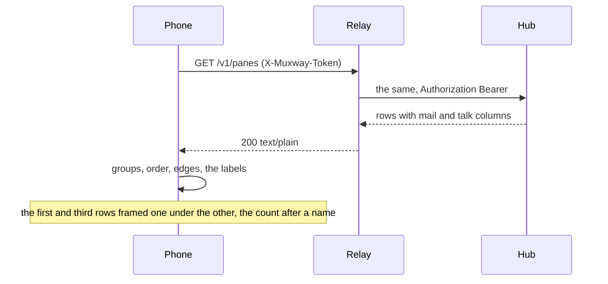

# Feature: talk groups and mail counts on the keypad

> Status: proposed 2026-11-02, reviewed with the pull request. Follows the
> core's `docs/plans/2026-10-31-pane-talk.md` and `2026-11-01-mail.md`
> (muxway#193), whose plans left the native clients to their own
> repositories; the issue here is #25.

## 1. Goal

The core's listing now says which panes talked to each other in the last
ten minutes (`talk`: the partners, partners of partners making a group)
and which pane's process holds unread mail (`mail`: the count). The web
frames a group's tabs, tiles and rows in the talk hue and writes `✉ n`
after a name. The phone shows neither, and cannot yet: it reads the
listing in text mode, which carries neither field. This plan, within a
keypad list and a 30 KiB MIDP 1.0 JAR:

- **groups**: the rows of a group are kept together in the pane list and
  framed by an edge character at the row's left, `[` on the first row,
  `|` between, `]` on the last, like the bracket of a frame; rows outside
  a group get a space there, and the column appears only while the list
  holds a group, so a list without talk looks as it does today;
- **mail**: `✉ n` after the pane's name while its process has unread
  mail, `M n` when the Text setting is Latin-1 or ASCII (the small phones'
  fonts have no envelope);
- **the text listing**: two columns proposed for the core, so the phone
  learns both from the one call it already makes.

No notification per message, as on the web. Out of scope, follow-ups
when this client gets them: the feed (`GET /v1/talk` has a text mode),
a messages page, mailing the open pane (`POST /v1/panes/{address}/mail`)
and laying a partner beside (a phone shows one pane). Also out of scope:
colour. The pane list is an `lcdui` `List`, text labels on the phone's
own theme, so the talk hue has no place here; the edge and the count are
the frame.

## 2. Design

### The columns

`GET /v1/panes` in text mode becomes

```
<address> TAB <mode> TAB <command> TAB <title> TAB <kind> TAB <mail> TAB <talk>
```

`mail` is the unread count in decimal, empty when the pane holds none;
`talk` the partners' current addresses joined by `|`, newest first as the
JSON lists them, empty when the pane talked with nobody. Both columns are
ASCII (an address is, by the protocol's grammar), so `charset` leaves
them alone. The core change is §3; the phone tolerates their absence,
reading them only when a row has more than five columns, so a hub of
today lists as it did.

### Groups

A new class `Talk`, pure string work, no `lcdui`: `groups` puts every
row in a set with each partner named in its column that the list knows
(union-find over the row indices; a partner not in the list is skipped,
a row naming itself is nothing), and gives each row its group's number,
`-1` for a row alone or in a set of one; `order` walks the rows in
listing order and, at a group's first row, emits the group's rows one
after another; `edge` is the character for a position of that order.
`list()` collects the labels and the talk column in Vectors while it
parses, then appends the rows in the computed order and rebuilds
`addresses`, `names`, `commands` and `writable` in the same order, so a
select still opens the row it names.



### Mail

`Text.mail` turns the column into the mark: digits only, three at most
(the agent holds fifty mails per pane, so more is a relay's lie), else
nothing; `✉ ` before the count when the Text setting is Unicode, `M `
otherwise. `Text.label` takes the mark and puts it after the name,
before the program in brackets, so the count survives the cut at 64
characters and a narrow screen: `*?build ✉ 2 (claude)`.

### The builds

Both go behind `Ui.TALK`, true in the 2.0 profile and false in 1.0, as
`Ui.INBOX` is: the 1.0 JAR has 83 bytes under its cap and even the mail
mark is a method and a few string joins. `javac` folds `if (Ui.TALK)`
away where the constant is false and ProGuard drops `Talk`, so the 1.0
build's list stays byte for byte what it is. If the 2.0 build's `list()`
were ever to leave room, the mail mark is the first to move to 1.0.



### Guideline rows

In the core's `docs/ui-guideline.md` the strip row's "(web; Android,
glasses and MIDP follow up)" after `✉ n` loses MIDP, and §1.2's talk
paragraph gains the keypad's edge where it names each client's frame.
That edit is the core's, with the columns.

## 3. Protocol and API changes

One addition, compatible within v1: the text mode of `GET /v1/panes`
gains the two trailing columns above, `mail` and `talk`, in that order,
after `kind`. A client that splits on TAB and reads by index is not
touched; the inbox's text mode is not changed. `docs/protocol/v1.md`'s
text-mode line and `docs/features/talk.md` and `mail.md` ("What clients
see") say so. The phone asks for nothing new: no route, no parameter.
`docs/ARCHITECTURE.md`'s "Protocol features used" names the two columns.

## 4. Security analysis

- **Nothing is written**: the feature reads two columns of a listing the
  phone already reads under its token, and the hub lists a partner only
  among the panes the token may read; a pane the token may not see is
  not named, so the phone cannot learn of it from the column.
- **Input across the relay**: a relay may forge both columns. A mail
  count that is not one to three digits shows nothing; a partner that
  is not an address the list holds is skipped, so a forged address, a
  path or a control sequence cannot put a row in a group, and `Text.screen`
  has already dropped control characters from the whole body. A row
  naming itself, or a partner twice, changes nothing. Edges and marks
  are the phone's own characters, never the relay's.
- **Denial**: a relay that links every row makes one group of the whole
  list, which is what the columns say; the list stays usable, a select
  opens the row shown.
- Nothing is logged on the phone beyond the trace of the test build,
  which prints the labels as drawn and never the token.
- No new dependency; both builds checked by `check-midp1.sh` and the JAR
  cap.

## 5. Privacy check

Fixtures are synthetic (`alice-laptop`, `test-pane`); emulator shots come
from the test hub and a test relay.

## 6. Test plan

| # | Test | Kind | Expected |
|---|------|------|----------|
| S20 | the relay forges the columns: a count of letters, one of 300 digits, a partner outside the list, a path, a row naming itself | e2e-security | no mail mark, no frame, the list intact and selectable |
| J16 | `Talk.groups` and `order`: partners of partners one group, two groups kept apart, a partner unknown skipped, a group's rows pulled behind its first | unit | the numbers and the order |
| J17 | `Text.mail`: digits, Unicode and Latin-1 forms, letters and four digits refused; `Text.label` puts the mark before the program | unit | the strings |
| F29 | the relay adds the columns to the hub's rows: three panes, the first talking with the third and holding two mails | e2e-ui | 2.0: `[` and `]` on the two rows one under the other, `✉ 2` after the first name, the middle pane last with a space; 1.0: the list as today; shot `talk` |
| F30 | select on the second row of a regrouped list opens the pane it names | e2e-ui | the content of `work/0.2` |
| build | `muxway1.jar` under the cap, `check-midp1.sh` clean | build | as today |

A test against a hub that writes the columns itself (two panes talking
through `muxway client send --from`) joins the suite when the core
lands them; until then the relay stands in, as it does for the inbox's
forged rows.

## 7. Documentation

`docs/features/pane-view.md` (the list), `docs/features/inbox.md` (a
line pointing at the new section), `docs/ARCHITECTURE.md` (the columns),
the README (what the phone shows), this plan; the core's protocol page,
feature pages and guideline rows with the columns.

## 8. Implementation steps

1. `Ui.TALK`; `Text.mail`, `Text.label` with the mark; `Talk`; unit
   tests J16 and J17.
2. `list()` collects, orders and frames behind the flag; both builds;
   the cap checked.
3. The relay's `talk` and `lie-talk` modes in the harness; S20, F29,
   F30.
4. Docs; version 0.6.0.
5. The run, recorded; the core's columns proposed.

---

## Review (after implementation)

- [x] Diff matches the plan, deviations explained here
- [x] Security rules (AGENTS.md section 2) hold
- [x] Privacy check passed: `scripts/prepush-check.sh` clean and diff read
- [x] Docs and diagrams updated

Deviations: none in the behaviour. The 1.0 JAR grew by 20 bytes to
30657, the constant pool of the shared `list()`, and has 63 to spare;
`Talk` is not in it. The mail mark cuts the name to make room rather
than being cut itself, so a long title shows `… M 7` at the end of its
64 characters.

## Test run

Run 20261102-141912-3616384, recorded as [issue #30](https://github.com/notmarkopadjen/muxway-midp/issues/30): 194 tests passed, none failed, against the core's `text-columns` branch (main plus the text listing's mail and talk columns). The pull request's CI runs the same suite against the core's `main`, which has no columns yet, and passed too: the relay adds the columns where the hub has none and replaces them where it has, since 3616384. The Nokia test is Marko's.
