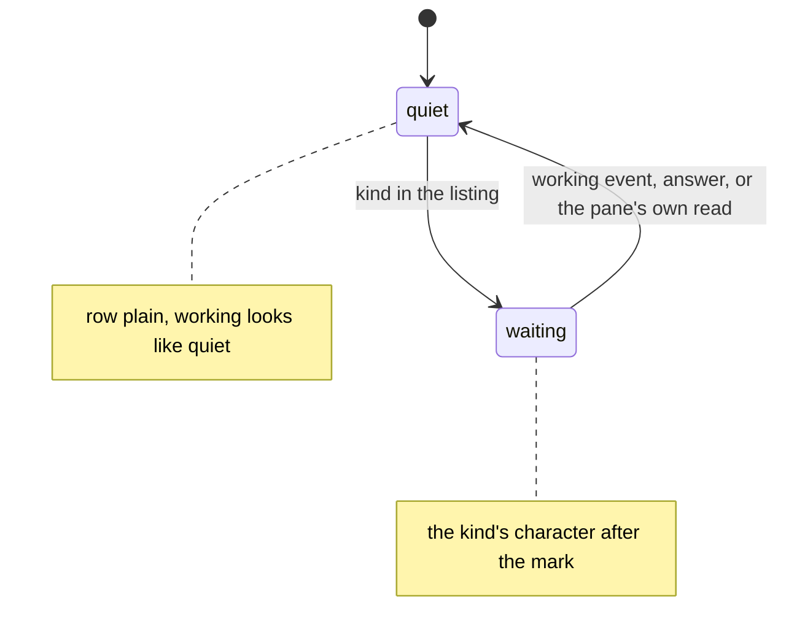

# Feature: a working pane unpainted on the keypad

> Status: proposed 2026-11-03. Parity with the core's "Focus marks on
> the strip and the tile header, and a working pane unpainted"
> (guideline §1.2 and §1.5, the owner's decision of 2026-11-02); the
> issue here is #31.

## 1. Goal

The owner decided that the lens's **working** state is plain: the
turning ring and the word carry it, the dim paint goes. **Waiting**
keeps the inverted paint. The web and Android painted a working tab dim
and change; this client never did, and the issue asks every client to
check.

What the keypad draws today, verified in the source:

- the pane list is an `lcdui` `List`: text labels in the phone's own
  type and colours, nothing the app paints. The only mark of state is
  the character after the write mark, `?` `!` `z` `v` for the four
  waiting kinds, a space otherwise;
- the pane view is a `Canvas` drawn black on white; the inverted rows of
  the `#` overlay are its chrome (the name, the position, the key
  hints), not a state;
- a `working` event clears the pane's attention on the hub, and the
  text listing's `kind` column is then empty, so a working row is plain
  already (F24 checks it). The pane's own screen moving is what tells
  the reader.

So no pixel changes. What changes is the record: the repository's docs
never said how the three states of §1.2 map onto the keypad, and the
next parity issue should find the answer on the page. This plan writes
it down, pins it with a test, and names the one choice that is the
owner's.

Out of scope: a working mark of its own. The listing cannot say
working (its `kind` is empty once attention clears), a `List` label
cannot turn a ring, and a word costs six of sixteen columns. Should the
owner want one, it is a plan of its own with a core change (the listing
would have to carry it).

## 2. Design

The keypad's reading of §1.2, to be written into `docs/features/pane-view.md`:

| State | List row | Pane view |
|---|---|---|
| waiting | the kind's character after the write mark: `?` question, `!` permission, `z` idle, `v` done; the inbox says what for | drawn as it is; `9` opens the inbox |
| working | plain, no glyph, no word: the listing's `kind` is empty, and the screen moves | plain |
| quiet | plain | plain |

No inversion and no pulse anywhere: a `List` has no paint of the app's,
and the owner's rule that selection is never a colour holds by
construction, the phone's own highlight is the selection.

Code: none. Components touched: `docs/features/pane-view.md`, the
README's one clause, `tests/e2e/run.py` (F24), this plan.

The choice for the owner: **(a)** leave working unmarked on the keypad
(recommended: nothing to ask the hub, nothing to fit on 96 pixels), or
**(b)** a mark for working later, which needs the listing to say it.
The plan assumes (a).

## 3. Protocol and API changes

None.

## 4. Security analysis

- Nothing is requested, sent or stored that was not before.
- The `kind` column was always parsed and anything outside the four
  waiting kinds, `working` included, draws a space (`Text.mark`, unit
  test `mark_per_kind`); a relay that forges the column gets a space
  (S09, S20).
- Logged: the row's label, as before. No secret, no pane content.
- No new dependencies.
- MIDP 1.0 through the relay: unchanged, the relay forwards the same
  paths.

## 5. Privacy check

The docs name `test-pane`, `alice` and the emulator; the screenshots
are the suite's, against the test hub. No real host, person or secret.

## 6. Test plan

| # | Test | Kind | Expected |
|---|------|------|----------|
| 1 | S09, S20 (existing): a relay that forges the mode, kind, mail and talk columns | e2e-security | the mark follows the mode column, a forged kind draws a space, unchanged |
| 2 | U06 `mark_per_kind` (existing): `working` and an empty kind | unit | a space each |
| 3 | F24, extended: after the `working` event the row is plain; the pane opened while working is drawn plain with the overlay on | UI, both builds | label `* test-pane (bash)`; screenshots `cleared`, `working-open` |

## 7. Documentation

`docs/features/pane-view.md` (the list: the states and the diagram
above), the README (one clause), this plan. Proposed to the core with
the pull request, not done here: a clause in guideline §1.2 for the
keypad, as there is one for the glasses' `mail n`.

## 8. Implementation steps

1. F24's extra step and screenshot.
2. The docs.
3. Review, the run on both builds, recorded; the pull request, draft
   until the run is green.

---

## Review (after implementation)

- [ ] Diff matches the plan, deviations explained here
- [ ] Security rules (AGENTS.md section 2) hold
- [ ] Privacy check passed: `scripts/prepush-check.sh` clean and diff read
- [ ] Docs and diagrams updated

## Test run

To come.
