# Feature: later, a pane parked by its owner, on the keypad

> Status: approved 2026-11-04. Parity with the core's
> `docs/plans/2026-11-03-later.md` (muxway#241); the issue here is #37.
> Guideline §1.2 (the *later* row), §1.4 *strip*, §1.6 *the inbox*,
> *open the oldest waiting pane*, *park the pane for later*.

## 1. Goal

The owner can park a pane for **later** from any client: the mark lives
on the host's agent, every listing carries it, the pane stops calling
and the inbox lists it last, until the owner opens it again or wakes it
on purpose. The hub's text mode already says so: the `kind` column of
`GET /v1/panes` and `GET /v1/inbox` reads `later` for a parked pane,
and `POST /v1/panes/{address}/later` with `{"later": true}` or
`{"later": false}` sets it under the write grant. This phone throws the
word away today and draws a parked pane as quiet.

After this change:

- **the mark**: a parked pane shows `zz` where the kind's character goes
  (the font has no moon), on both builds: `*zz build (claude)` in the
  pane list, `zz build (claude): deploy?` in the inbox, `> zz build`
  in the pane view's overlay;
- **the command** (MIDP 2.0 build): *Later* on a writable pane's menu
  parks it, *Wake* in its place while it is parked;
- **opening wakes** (MIDP 2.0 build): a parked pane opened from the
  list or the inbox is woken as it opens, on a writable pane only, as
  the web's tab click and the Android tap do.

Out of scope: a key for it (the keypad's free keys stay free; the
command is a menu entry, as the issue asks); *later* on an inbox row
(the web has it; the phone's inbox row opens or answers); any order of
the pane list (the list mirrors the hub's order, the strip's parked-last
order is the web's and Android's); the command and the wake on the
MIDP 1.0 build, which has 63 bytes left under its cap (see §2).

## 2. Design

### The mark

`Text.mark()` answers a `String` now, not a `char`: `?` `!` `z` `v` as
before, `zz` for `later`, a space for anything else. The pane list's
prefix stays two columns for the four kinds; a two-letter mark gets a
space after it so the name does not run into it (`*zz build`). The
inbox label already puts a space after the mark. Both builds read the
column already, so the 1.0 phone gets the mark for the cost of one
string compare; if that alone pushes the JAR over 30 KiB the mark goes
behind `Ui.LATER` and the review says so.

### The state

The pane list keeps, beside the addresses, names, commands and write
marks, whether each row is parked (`later`, a Vector of Booleans,
carried through `arrange()` like the others), and `PaneView` gets
`later`, set when the pane opens. The overlay's top row shows `zz `
before the name while it holds. MIDP 2.0 build only, behind a new
`Ui.LATER` (true there, false in the 1.0 profile, so javac drops the
code as it drops the inbox's).

### The command

`open()` adds *Later* or *Wake* to a writable pane's menu by the row's
state (priority 5, after *Pane*). Either runs the job `LATER`, which
posts `{"later": true}` or `false` to `panes/{address}/later`. On `204`
(or `200` from a relay that cannot pass an empty answer on) the view's
flag flips, the menu entry is swapped, and one alert says *Parked for
later.* or *Awake.*, since nothing else on the pane's screen changes.
`404` reads *This host does not park panes.* (an agent older than the
op); every other status goes through `problem()` as today (`403` *Read
only.*, `429` *Too many tries*). The list re-reads itself on *Back*, so
the mark follows.

### The wake on open

The `OPEN` job, before its first read, posts `{"later": false}` when
the pane is parked and writable, then reads as today. The answer is
traced, not shown: the owner asked for the pane, and a wake the hub
refuses leaves the mark where it was for the next listing to show. The
inbox's *Open the pane* and a row without choices both go through
`open()`, so they wake too. A reader opens a parked pane as any pane,
nothing is posted.

```mermaid
sequenceDiagram
    participant P as Phone (MIDP 2.0)
    participant R as Relay
    participant H as Hub
    participant A as Agent
    P->>R: POST /v1/panes/alice-laptop/work/0.0/later {"later":true}
    R->>H: the same, Authorization: Bearer
    H->>A: later %3 true (write grant, pane writable, audit)
    A-->>H: ok
    H-->>R: 204
    R-->>P: 200 ok
    Note over P: Wake replaces Later; "Parked for later."
    P->>R: GET /v1/panes
    R-->>P: alice-laptop/work/0.0 TAB write TAB claude TAB build TAB later TAB TAB
    Note over P: *zz build (claude)
    P->>R: GET /v1/inbox
    R-->>P: ...awake panes..., then alice-laptop/work/0.0 TAB later TAB at TAB TAB
    Note over P: select the row: open, and
    P->>R: POST /v1/panes/alice-laptop/work/0.0/later {"later":false}
    R-->>P: 200 ok
    P->>R: GET /v1/panes/alice-laptop/work/0.0?lines=120&width=400
```

```mermaid
stateDiagram-v2
    [*] --> Awake
    Awake --> Later: Later on the pane's menu (writable, MIDP 2.0)
    Later --> Awake: Wake on the menu
    Later --> Awake: the pane opened from the list or the inbox (writable, MIDP 2.0)
    Later --> Awake: input, an answer or mail from any client
    Later --> Later: a notification arrives; the mark stays, the kind waits underneath
    note right of Later: list *zz name, inbox zz name last, overlay > zz name
```



### What each client shows, here

| Where | Later |
|---|---|
| pane list | the hub's order kept; `zz` where the kind's character goes, a space after it |
| inbox | the hub's order kept: awake panes first, parked last; `zz name: text`, the text and the choices the attention's underneath, if any |
| pane view | plain; the overlay's top row `> zz name` |
| menu | *Later* on a writable pane, *Wake* while parked (MIDP 2.0) |
| MIDP 1.0 | the mark alone, the hub's order; no command, no wake |

### Components touched

`Text.mark()` and its callers; `Muxway` (the `later` Vector, the
`LATER` job, the commands, the wake in `OPEN`); `PaneView.later` and
the overlay; `Api.later()` for the body; `Ui.LATER` in both profiles;
`docs/features/later.md` (new), `pane-view.md`, `inbox.md`,
`relay.md`, `ARCHITECTURE.md`, the README; `tests/e2e/harness.py`
(`Core.later()`, the pane menu), `tests/e2e/run.py` (S21, F31, F32,
the relay's allow list), `tests/unit/UnitTest.java`.

## 3. Protocol and API changes

None to the protocol. Newly used: `POST /v1/panes/{address}/later`
(v1, since 2026-11-03), and the value `later` in the `kind` column of
the two text listings, which the app read already. The relay forwards
one more path; the Caddy example's `/v1/panes/*` carries it already.
The pinned protocol version does not change.

## 4. Security analysis

- **A park or a wake is a write.** The hub checks the write grant and
  the pane's mark and the agent checks both again; a reader's request
  is `403`. The phone offers the command on a writable pane only and
  wakes on open only there, and a relay that lies about `mode` (S04)
  gets the hub's `403` in words, as for a reply.
- **What an attacker gains** with the phone's token: parking a pane so
  its owner's clients stop calling for it, which is less than typing
  into it, which the same grant allows.
- **Input across the boundary.** The body is a fixed string of the
  app's, one boolean, built by `Api.later()`; nothing the hub or a pane
  wrote goes into it. The `kind` column is read as before: anything but
  the five known words draws a space, so a forged column (S20) puts at
  most `zz` on a row and cannot make the phone post anything.
- **Nothing is typed, nothing is read** beyond today's listings. A
  wake sends no key and no text to the pane.
- **Logging.** The hub and the host audit the park and the wake with
  the actor, the pane and the value; the phone logs nothing, and the
  test build's trace prints the status code, never the token.
- **MIDP 1.0 through the relay.** The small build posts nothing new.
  The 2.0 build's park travels in the clear between the phone and the
  relay like every input; the warning Settings shows once for a plain
  HTTP server covers it.
- **Rate limit.** Five a second per principal on the hub; the phone
  runs one job at a time and asks before posting, so it cannot reach
  it by itself. `429` is shown in words.
- No new dependency; both builds checked by `check-midp1.sh` and the
  JAR cap.

## 5. Privacy check

Docs and tests use `alice-laptop`, `work`, `test-pane`, `build`.
Screenshots come from the emulator against the test hub. The deny-list
grep and gitleaks run before the push.

## 6. Test plan

| # | Test | Kind | Expected |
|---|------|------|----------|
| 1 | S21: a read-only token on a pane the harness parked: the list shows `zz`, the menu has no *Later*, opening posts nothing; then a relay that writes `later` into the kind column of a pane the hub lists awake | e2e-security, both builds | `  zz test-pane (bash)`; no `POST` reaches the relay; the forged row shows `zz` and opening it posts nothing (read-only) |
| 2 | S19 (existing) with `later` on the relay's allow list | e2e-security | the app requests only the paths a relay forwards, `later` among them |
| 3 | S20 (existing): forged kind, mail and talk columns | e2e-security | unchanged |
| 4 | F31: *Later* on the pane's menu; the hub's inbox says `later`; the list `*zz test-pane (bash)`; a second pane gets a question after the parking; the inbox lists it first and the parked pane last; selecting the parked row opens and wakes it (`{"later":false}` seen by the relay); *Back*, the list is plain; *Later* again, then *Wake* | UI, MIDP 2.0 | screenshots `parked`, `parked-list`, `parked-inbox`, `woken` |
| 5 | F32: a pane the harness parked, opened from the list | UI, both builds | 2.0: `POST …/later` with `false`, the hub's inbox is empty after; 1.0: the mark shows, no `POST`, the pane stays parked on the hub |
| 6 | U: `Text.mark("later")`, `inboxLabel` with `later`, `Api.later(true/false)` | unit | `zz`, `zz build`, `{"later":true}` / `{"later":false}` |
| 7 | build check (existing) | build | the 1.0 JAR under 30 KiB, nothing newer than MIDP 1.0 referenced |

## 7. Documentation

- `docs/features/later.md` (new): what it does here, the states, the
  diagram, security.
- `docs/features/pane-view.md`: the states table gains the *later*
  row; the mark in the list section; the overlay; the menu.
- `docs/features/inbox.md`: parked panes last, `zz`, opening wakes.
- `docs/features/relay.md` and `docs/ARCHITECTURE.md`: the path.
- README: one bullet.
- Proposed to the core with the pull request: guideline §1.6 MIDP
  column, *later* row, from *follow-up* to *Later on the pane's menu;
  opening a parked pane wakes it (MIDP 2.0)*.

## 8. Implementation steps

1. `Text.mark()` as a String, `zz`; the unit tests; both builds, the
   1.0 JAR measured.
2. `Ui.LATER`, the `later` Vector, `PaneView.later`, the overlay.
3. `Api.later()`, the `LATER` job, the commands, the wake in `OPEN`.
4. Harness: `Core.later()`, the pane menu; S21, F31, F32; the allow
   list.
5. Docs; version 0.7.0.
6. Review, the full run on both builds, recorded; the pull request.

---

## Review (after implementation)

- [ ] Diff matches the plan, deviations explained here
- [ ] Security rules (AGENTS.md section 2) hold
- [ ] Privacy check passed: `scripts/prepush-check.sh` clean and diff read
- [ ] Docs and diagrams updated

## Test run

Link to the recorded run: result, commit, logs, screenshots.
