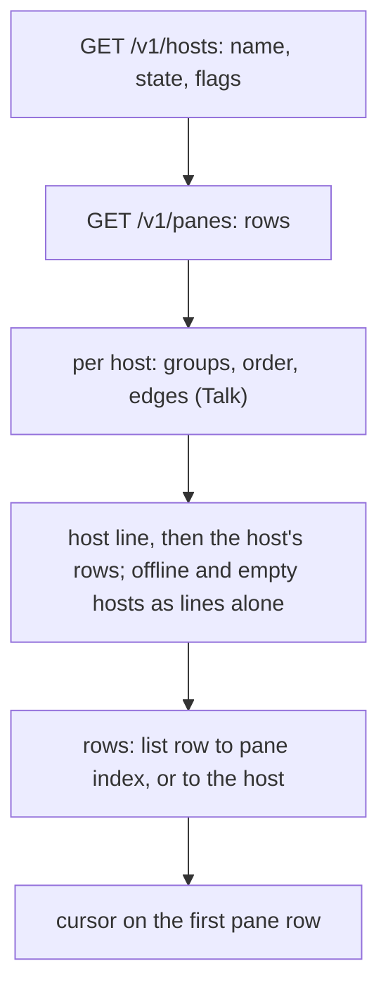
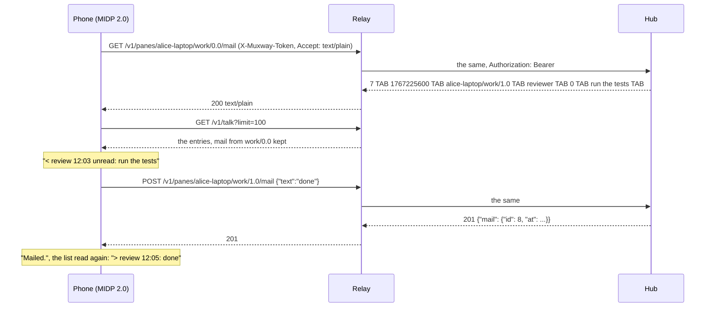
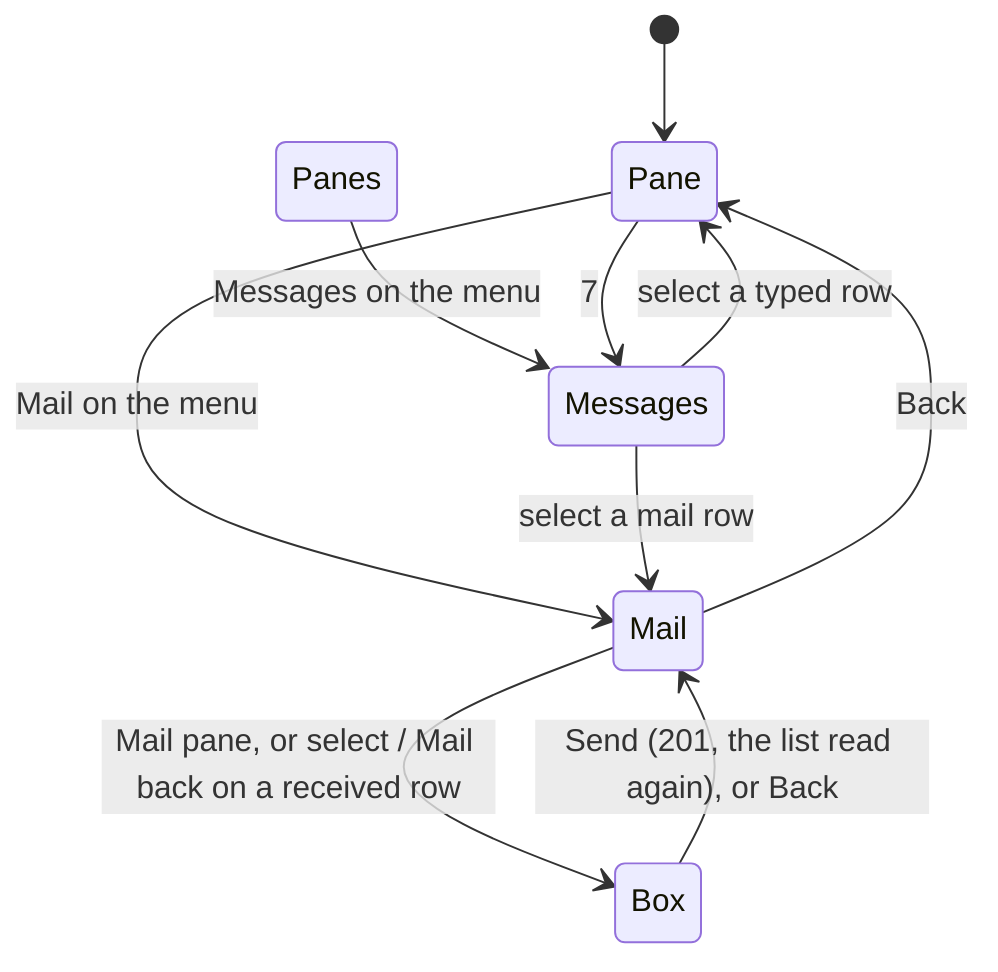

# Feature: messages, mail and the list and pane view catching up

> Status: approved 2026-11-04 as proposed; implemented in version 0.9.0. The parity pass of
> that day: issues #46 (messages, the mail list, mailing a pane) and #47
> (host lines, a list timer, D-pad next and previous, the harness name,
> the overlay, a commands list, a theme setting; with the core's text
> mode: what waits under a parked pane, `+ session`, `+ pane`, Close).
> Closes #40 as well (the slanted overlay name, done in main at 4f5d9da).
> The core side is muxway#288 (text mode) and muxway#286 (the guideline's
> MIDP cells), on the core's `parity-docs` branch. Follows
> `2026-11-02-talk-and-mail-parity.md`, whose follow-ups these are.

## 1. Goal

The keypad phone shows who talks with whom and who holds mail, but not
what was said: the feed (`GET /v1/talk`), a pane's mail and mailing a
pane are the web's and Android's. The list carries every row of the
guideline's §1.3 but the host lines and the timer, names a Claude pane
`fixing the build (claude)` where every other client says `Claude ·
fixing the build`, and the pane view has no way to the next pane, no
command row, no theme, and an overlay that says less than a header
should. With the hosts' flags and the kind under a parked pane in text
mode (muxway#288), three more actions of §1.6 open up.

After this change, on the **MIDP 2.0 build**:

- **Messages**: a *Messages* screen from `GET /v1/talk` in text mode,
  oldest at the top, `who → whom hh:mm: text`, from the list's menu and
  from `7` on a pane; a row opens the pane it was said to, a mail row
  the mail of that pane.
- **The mail list** of one pane, from `GET /v1/panes/{address}/mail`
  and the feed: `<` what came in (`unread`, `replied`), `>` what it
  sent, merged by time; *Mail* on the pane's menu.
- **Mail the pane, mail back**: a text box like Reply, posted to
  `POST /v1/panes/{address}/mail`; *mail back* aims at the sender of
  the row selected.
- **The list**: a line per host with its state (`online`, `offline`,
  `nothing exposed`) instead of the `host/` prefix and the trailing
  offline rows; `+ session` on a host whose agent allows it; *Auto* on
  the list's menu re-reads it on the pane's timer; Claude and the other
  harnesses named as every client names them.
- **The pane view**: D-pad left and right open the previous and the
  next pane, round at the ends; the `#` overlay carries the kind's
  glyph and `read-only`; a *Commands* list (Claude Code's slash
  commands, a shell's starters) sends a pick with Enter; `+ pane` and
  *Close* on the menu, each behind a confirm list; `zz !` and `zz ?`
  for what waits under a parked pane, in the list, the inbox and the
  overlay.
- **Theme**: amber (default), green or paper on the pane canvas, a
  setting in Settings.
- **The inbox**: a row of a read-only pane opens the pane; its choices
  are not offered.
- **The relay** forwards the new paths and `relay.md` says so, its
  Caddy example matching its list.

On the **MIDP 1.0 build** (432 bytes under its cap at 0.8.0): the
hosts reader stops requiring exactly two columns (it must, once the
core adds some), then, in this order and each only while the JAR stays
under 30 KiB: D-pad left and right; `M n` after a name with unread
mail; `read-only` and the kind's glyph in the overlay; `zz !`. The
review says where the bytes ran out. Everything else stays off there,
behind constants javac folds away.

Out of scope: a count of messages not looked at (the web's `✉ n`
beside the brand), which needs the feed polled in the background: the
phone polls nothing it is not looking at, so there is no count to clear
when Messages opens; `L`, laying a partner beside (one pane on a
phone); the `+ pane` row under every writable window in the list (a
row per window on a screen of six rows; the add menu's `+ pane` on the
pane view, §1.4, is the one the phone gets); `☾ later · ! permission`
with the word (the keypad has the mark); naming a pane; the 1.0 build's
share of everything above the line.

## 2. Design

### 2.1 Text-mode columns the phone wants from the core (muxway#288)

Proposed to the core with this plan, designed against until they land;
the harness's relay adds them to the hub's rows meanwhile, as it did for
`mail` and `talk` (`Relay.columns`). Every reader here ignores columns
and words it does not know.

| Call | Today | Proposed |
|---|---|---|
| `GET /v1/hosts` | `<name> TAB <online\|offline>` | a third column, the host's flags: the JSON's true booleans as words joined by `\|` in the JSON's names (`sessions\|close\|preview\|repeat\|ask\|mail\|dir\|later\|rename`), `keys2` for the key grammar (the plan proposed `keys=2`); empty when none. One column, so a new flag is a new word and never a new column |
| `GET /v1/panes` | nine columns ending `alias TAB cwd` | a tenth, `pending` (the plan proposed `under`; the core named it `pending`): for a parked pane the kind of the attention underneath (`question`, `permission`, `idle`, `done`), empty otherwise |
| `GET /v1/inbox` | five columns ending `choices` | a sixth, `pending`, the same |
| `GET /v1/panes/{address}/mail` | six columns ending `text` | a seventh, `replied`: `1` when the pane answered the mail, empty otherwise |

Not asked for: `last` on a pane row (the Close question says the
session ends with its last pane instead), an inbox count row (see the
goal), an actor on talk rows (the phone shows who and whom by pane).

### 2.2 The list (`Muxway.list`)

```
= alice-laptop online · + session
 * Claude /muxway · fixing the build
[* review /muxway · test-pane (bash) ✉ 2
]* work/0.1 (bash)
= bob-desktop nothing exposed
= carol-pi offline
```

On the 2.0 build the list is built host by host from the hosts call
the app already makes (now parsed first, its flags kept per host) and
the pane rows:

- **a host line** per host the token reads, `= <host> <state>`, the
  state `online` for a host with panes, `nothing exposed` for an online
  host without, `offline`; `· + session` after it where the flags say
  `sessions` (`- + session` on the ASCII setting). The `host/` prefix
  on the rows goes; the trailing `- host offline` rows go. The 1.0 build
  keeps both.
- **the rows** of that host under it, the talk groups pulled together
  as today but **within the host**: a group across two hosts is framed
  under each. (The web frames across; a phone row pulled under another
  host's line would read as that host's.)
- **the harness name** (`Ui.NAMES`): a pane whose command is `claude`,
  or whose title leads with Claude's spark, is `Claude`; `codex`
  Codex, `gemini` Gemini, `agy` Antigravity, `opencode` OpenCode,
  `copilot` Copilot, `aider`, `goose`, `amp` Amp, `cursor-agent`
  Cursor; the title (Claude's codename) follows as the status after the
  folder and the dot: `Claude /muxway · fixing the build`, and the
  bracketed program is left off, the name says it. With an alias the
  alias leads and the harness is the status's first word: `review
  /muxway · Claude · fixing the build`. Any other program as today.
  A title that is empty, the program or the host adds no status.
- **what waits under a parked pane**: `zz` then the under column's
  mark and a space: `*zz ! build`, `*zz ? review`; nothing under, `*zz
  build` as today. The inbox row and the overlay the same.
- **the cursor** starts on the first pane row, not the host line, so
  select opens a pane as today; a parallel `rows` Vector maps every
  list row to its pane index, or to its host for a host line.
- **select on a host line** with `+ session` opens the *Session* box
  (§2.6); on any other host line nothing happens.
- **Auto** on the list's menu (both soft-key menus keep Refresh,
  Settings, Exit, Inbox, Messages): the list is re-read every interval
  (the Settings value, 10 s default) while it is the current screen, by
  a quiet job that shows no *Loading panes...* form and keeps the
  selection by address; *Back* from a pane leaves it on, Settings
  turns it off, as the pane's does.



### 2.3 The pane view (`PaneView`, `Muxway`)

- **D-pad left and right** (`getGameAction` `LEFT` / `RIGHT`): the
  previous and the next pane in the list's order, round at either end,
  through `open(i)`; parked panes are opened and woken as from the
  list (the swipe skips them on Android; the keypad has no other way to
  them, and opening is the owner coming back). Both builds if the 1.0
  bytes allow.
- **The overlay's top row**: `> ` or two spaces, then the kind's mark
  as the list drew it (`?` `!` `z` `v`, `zz`, `zz !`), then the name
  (slanted while parked); `read-only` at the row's right on a pane the
  token cannot write, when it fits. The mark is the list's and changes
  with the next listing, not with a read of the pane.
- **`7`** opens Messages (2.0); the help text in Settings and the
  overlay's hint name it.
- **The menu** on a writable pane gains *Mail*, *Commands*, *+ pane*
  and *Close* (2.0): *Mail* on every pane the token reads where the
  host's flags are unknown or say `mail`; *+ pane* on a writable pane;
  *Close* on a writable pane whose host says `close`; *Commands* on a
  writable pane whose program has a list.
- **Theme** (`Ui.THEME`, 2.0): the canvas paints background and ink
  from the guideline's tokens, amber `#0a0603` / `#ffb000`, green
  `#050806` / `#39ff14`, paper `#f1ead8` / `#1f2a1f`; the overlay's
  bars stay inverted (ink ground, background letters); the wait mark
  is drawn with `drawArc` in the ink, a turning segment, instead of the
  black-on-white frames (the *Loading panes...* form keeps the frames:
  it is the phone's own form). Settings gets a *Theme* choice; the
  record store goes to version 4 with the theme after `installed`,
  the pane views after it; a version 3 record reads as before with
  amber. The 1.0 build stays black on white and skips the field.

### 2.4 Messages (`Talk` screen, `Ui.MAIL`, 2.0)

*Messages* on the list's menu or `7` on a pane asks `GET
/v1/talk?limit=100` in text mode (`charset` as the list) and lists the
entries oldest at the top, as the hub orders them, one `List` entry
each, the list's fit policy set to wrap so the text runs on under the
first row (MIDP 2.0's `setFitPolicy`):

```
review → build 12:03: run the tests on the branch and tell me
  what fails
build → review 12:05: ✉ done, two failures
client → build 12:06: ✉ look at the log
```

- a row is read when its first column is a number, its third or fourth
  an address by the protocol's grammar, its fifth one of `text`, `key`,
  `answer`, `mail`; the `next TAB seq` row and anything else is
  skipped; `who` and `whom` are the list's names for addresses the list
  holds (the alias where there is one), else the address's place after
  the host; an empty `from` (a mail from a client that is not a pane)
  reads `client`;
- the time is `at` in the phone's local time, `hh:mm`; a `key` entry
  shows the key's name, an `answer` the choice, a `mail` its text with
  `✉` (`M` without the envelope) in front;
- entries are cut at 240 characters (the hub sends 200 of text);
- select on a `mail` row opens the mail list of its `to` pane when the
  list holds it; on any other row the `to` pane; *Refresh* reads
  again, *Back* returns to where it was opened from; *Nothing said.*
  when there is none.

### 2.5 The mail list and mailing (`Mail` screen, `Ui.MAIL`, 2.0)

*Mail* on the pane's menu asks two things and merges them by time,
oldest at the top, wrapped as Messages is:

- `GET /v1/panes/{address}/mail`: what came in, `<`, the sender's name
  (the `from` column through the list, else the actor column for a
  client's mail), the time, `unread` while `read_at` is `0`, `replied`
  where the seventh column says so, then the text;
- `GET /v1/talk?limit=100` filtered to `mail` entries whose `from` is
  this pane: what it sent, `>`, the recipient's name, the time, the
  text.

```
< review 12:03 unread: run the tests on the branch
> review 12:05: done, two failures
< client 12:06 replied: look at the log
```

The menu: *Mail pane* (a writable pane) opens the *Mail* box; *Mail
back* on a selected `<` row whose sender is a pane the list marks
writable opens the box aimed at the sender, as select on that row
does; *Refresh*; *Back* to the pane. The box is a `TextBox` of 1000
characters titled `Mail <name>`; *Send* posts `{"text": "..."}` to
`POST /v1/panes/{target}/mail`, control characters dropped as from
Reply, and with no `from`: the phone is a client, not a pane, so the
mail is a mail and never a reply. `201` says *Mailed.* and re-reads
the list; `404` *This host holds no mail.*; `409` *The mailbox is
full.*; the rest in the usual words. Where the hosts' flags are known
and say no `mail`, *Mail* is not on the menu.





### 2.6 `+ session`, `+ pane`, Close (`Ui.HOSTS`, 2.0, with the flags)

- **`+ session`**: select on a host line that carries it opens the
  *Session* box: a name, `[a-z0-9_-]{1,32}`, checked on the phone
  before any request; *Start* posts `{"name": "..."}` to
  `POST /v1/hosts/{host}/sessions`; `201` re-reads the list and opens
  the session's first pane (its address from the JSON answer, taken
  only when it passes the address grammar and the new list holds it);
  `409` *That name exists.* or *Too many sessions.*; `404` *This host
  does not start sessions.*; `429` in the usual words. Offered only
  where the flags say `sessions`; the token's grant is the hub's to
  check.
- **`+ pane`** on a writable pane's menu opens a confirm list, *New
  pane beside <name>?*: *Beside*, *Below*, *Cancel* (the phone cannot
  see the window's shape; the owner picks the split). A pick posts
  `{"direction": "h"}` or `"v"` to
  `POST /v1/windows/{host}/{session}/{window}/panes`, the path from
  the pane's address; `201` re-reads the list and opens the new pane
  as above; `403` *Read only.*; `409` *The window is full.*
- **Close** on a writable pane whose host says `close` opens *Close the
  pane on <host>? What runs in it ends; a session ends with its last
  pane.*: *Close*, *Keep*. *Close* posts to
  `POST /v1/panes/{address}/close`; `204` returns to the list and
  re-reads it; `404` *This host does not close panes.*; the rest in
  words.

```mermaid
sequenceDiagram
    participant P as Phone (MIDP 2.0)
    participant R as Relay
    participant H as Hub
    P->>R: GET /v1/hosts
    R-->>P: alice-laptop TAB online TAB sessions|close|mail|later|ask
    Note over P: "= alice-laptop online · + session"; Close on the pane menu
    P->>R: POST /v1/hosts/alice-laptop/sessions {"name":"scratch"}
    R->>H: the same
    H-->>R: 201 {"pane": {"address": "alice-laptop/scratch/0.0", ...}}
    R-->>P: 201
    P->>R: GET /v1/panes
    Note over P: the new pane opened
    P->>R: POST /v1/panes/alice-laptop/scratch/0.0/close
    R-->>P: 204 (200 ok through a WAP relay)
    P->>R: GET /v1/panes
    Note over P: the list, without it
```

### 2.7 Commands (`Commands` class, `Ui.COMMANDS`, 2.0)

*Commands* on a writable pane's menu opens a `List` of the program's
row, the lists the web's `commands.ts` has, fixed strings in the JAR:

- the pane runs `claude`, or its view is set to the Claude Code lens:
  `/clear /exit /compact /rename /model /resume /usage /context /help
  /status /cost /todos /plan /review /memory /init /config
  /permissions /mcp /agents /hooks /doctor /fast /export`;
- the pane runs a shell (`bash zsh fish sh dash ash ksh tcsh csh`):
  `exit htop claude "claude -c" "claude --resume" codex agy gemini
  "git status" "git diff" "git log --oneline -20" "git pull" "git
  push" "git stash" "git stash pop" make "make test" "npm test" "npm
  run build" "docker ps" "tmux ls" ls "ls -la" pwd "cd .." clear
  history "df -h" "free -h"`;
- any other program: no entry on the menu.

A pick sends the text and Enter (the `SEND` job, as Reply's *Send*
does); `/rename` opens Reply with it typed and waits, as on the web.
No lines sent before are kept (the phone keeps no history).

### 2.8 The inbox (`Inbox`)

A row whose pane the list marks read-only opens the pane; the *Answer*
list is not offered (the web and Android disable the buttons). The
inbox is given the list's `writable` Vector with its names. A row's
`under` column (the sixth) puts the mark after `zz` as the list does.

### 2.9 Components touched

`Muxway` (the list, hosts, the timer, the jobs: `TALK`, `MAIL`,
`MAILTO`, `SESSION`, `SPLIT`, `CLOSE`, the quiet `LISTQ`; the menus;
D-pad), `PaneView` (left and right, the overlay, the theme, the drawn
ring), `Text` (the harness name, the under mark, a time, the session
name grammar, the flags), `Talk` (per-host ordering), new `Mail`
(the Messages and Mail screens and their parsers), new `Commands`,
`Inbox` (read-only rows, under), `Prefs` (version 4, theme), `Api`
(nothing new: `call` posts JSON already), `Ui` in both profiles
(`MAIL`, `HOSTS`, `THEME`, `COMMANDS`), `tests/e2e/harness.py` (a
second host, `--allow-sessions`, `--allow-close`, mail and talk from
the host, the relay's new modes), `tests/e2e/run.py`, `UnitTest.java`,
the docs of §7; version 0.9.0.

## 3. Protocol and API changes

Nothing new in the protocol's shape: every call the phone adds exists
in v1 with a text mode or a JSON answer the phone can read
(`GET /v1/talk`, `GET` and `POST /v1/panes/{address}/mail`,
`POST /v1/hosts/{host}/sessions`, `POST
/v1/windows/{host}/{session}/{window}/panes`, `POST
/v1/panes/{address}/close`). The four columns of §2.1 are compatible
additions proposed to the core (muxway#288), trailing, documented in
`docs/protocol/v1.md` and `docs/features/text-mode.md` there; the
phone works with and without them. The pinned protocol version stays.

What the relay must now forward, and `relay.md` lists: `GET /v1/talk`,
`GET` and `POST /v1/panes/{address}/mail`, `POST
/v1/panes/{address}/close`, `POST /v1/hosts/{host}/sessions`, `POST
/v1/windows/{host}/{session}/{window}/panes`. The Caddy example names
each path the app asks for and nothing wider, so the list and the
example agree.

## 4. Security analysis

- **What an attacker gains.** With the phone's token: everything the
  token grants, as before. New writes: a mail to a writable pane (its
  process reads it as advice, never as typed input), a new shell in a
  window the token may already type into, a new session where the
  owner allowed it, and closing a pane where the owner allowed it; each
  is a power the same grant gives the web. The relay path shows mail
  text, session names and the rest in the clear between the phone and
  the relay, like every input today; the once-shown warning for a
  plain-HTTP server covers it, and a token scoped to the phone limits
  it.
- **Authorisation.** Every new write needs the write grant and the
  pane's mark, checked by the hub and the agent (mail, close, split)
  and the owner's `--allow-sessions` / `--allow-close` on the agent;
  the phone offers *Mail pane*, *mail back*, *+ pane*, *Close* and the
  Commands on writable rows only, `+ session` and *Close* where the
  flags say so, and takes the hub's refusal in words otherwise. Reads
  (the feed, a pane's mail) are the token's reads: the hub shows an
  entry only where both panes are readable, a mail list only for a
  readable pane.
- **Input across the trust boundary.** A relay may forge every row:
  feed and mail rows are split on TAB, read by index, taken only when
  the address columns pass the grammar and the kind is one of four
  words, cut at 240 characters, control characters already dropped by
  `Text.screen`; a name is looked up in the list and shown as text
  otherwise, never requested; a mail back or an open goes only to an
  address the list holds, so a forged sender cannot aim a mail at a
  stranger (the hub would refuse anyway). The hosts' flags are words
  matched exactly, unknown ones ignored; a forged `sessions`, `close`
  or `mail` only makes the phone offer the action, and the hub's `404`
  or `403` is shown; a forged `under` draws at most a mark. A session
  name is checked against `[a-z0-9_-]{1,32}` on the phone before any
  request and by the hub again; the host and window of a path come
  from the list's own rows, which passed the address grammar. The
  JSON answers to a split or a session are read with `Text.jsonString`
  for one string, which is used only when it passes the grammar and
  the re-read list holds it. Mail text is the owner's, filtered like a
  reply; the Commands are the JAR's own strings.
- **Rate limits and lockouts** are the hub's; the phone runs one job
  at a time and asks nothing in the background but the list and pane
  timers the owner turned on.
- **Logging.** Nothing is logged on the phone. The test build's trace
  prints the screens and the status codes, so synthetic mail text
  appears in the suite's logs and never the token; the hub and the
  host audit the writes as they do every write.
- **Dependencies.** None new. Both builds go through `check-midp1.sh`
  and the JAR cap; `setFitPolicy` and the theme colours are MIDP 2.0
  and sit behind constants the 1.0 build folds away.
- **When in doubt, deny**: with the hosts' flags unknown (an older
  hub) `+ session` and *Close* are not offered at all; *Mail* is, as
  the issue asks, because a `404` is a clear answer and the action
  writes nothing the process runs.

## 5. Privacy check

Docs, fixtures and tests use `alice-laptop`, `bob-desktop`, `review`,
`build`, `scratch`, `/home/alice/src/project`, `run the tests`.
Screenshots come from the emulator against the test hub and the test
relay. The deny-list grep and gitleaks run before every push.

## 6. Test plan

Security first; `both` is both builds, else the build named. The
relay stands in for the core's columns until they land, then the run
is repeated against the core's `parity-docs`.

| # | Test | Kind | Expected |
|---|------|------|----------|
| S16 (reshaped) | a read-only token: the inbox row opens the pane, no choices; the relay says writable: the choices offered, the hub's *Read only*, the ask still waits | e2e-security, 2.0 | no POST for the honest row; `403` in words for the lie |
| S19 (extended) | every path the app requests, through Messages, Mail, a mail sent, `+ session`, `+ pane`, Close, against the relay's list | e2e-security, 2.0 | nothing outside the list |
| S24 | a read-only token on a mail host: Mail lists, *Mail pane* absent, `5`-like keys send nothing; the relay lies writable: the hub's `403` | e2e-security, 2.0 | no POST honest; *Read only.* for the lie |
| S25 | the relay forges the feed and the mail rows: 300-character text, control characters, an address outside the list, a kind that is not one, a `seq` of letters, a `from` of `../admin` | e2e-security, 2.0 | rows cut and printable, the strangers as text, nothing requested for them, select does nothing on them |
| S26 | the relay forges the hosts' flags: unknown words, 300 columns, `sessions` and `close` on a host whose agent allows neither, a line for a host not in the list | e2e-security, both | the 1.0 build lists as today; the 2.0 build offers `+ session` and Close and shows the hub's `404` in words; nothing else |
| S27 | a session name of `../x`, 33 letters, a space, `A`: refused on the phone | e2e-security, 2.0 | no request; *A name is a-z, 0-9, - and _, up to 32.* |
| S28 | Close and `+ pane` on a read-only pane: not on the menu; a relay that lies writable: the hub's `403` | e2e-security, 2.0 | no POST honest; *Read only.* for the lie |
| S29 | the relay forges `under`: `later` with `x`, 300 letters, `question` on an awake pane | e2e-security, both | `zz` alone, a space; no mark on the awake pane |
| S21, S22, S23, S09, S20 (existing) | the forged columns, the reader | e2e-security | unchanged but for the host line's prefix on 2.0 |
| U | `Text.harness` (Claude by command and by the spark, Codex, Antigravity by `agy`, a shell untouched), `Text.label` with the harness and an alias, the folder and the status in order, `Text.under`, `Text.hhmm`, `Text.session` grammar, `Text.flags`, the feed and mail row parsers, the merge by time, `Talk.order` per host | unit | the strings |
| F35 | Messages: a pane writes to another with `--from` and mails it; `7` on a pane and the list's menu; two rows oldest first with the list's names; select on the typed row opens its pane, on the mail row the mail list | UI, 2.0 | `review → build hh:mm: ...`; shots `messages`, `from-7` |
| F36 | Mail: a mail from the host to the pane; the list `<` `unread`; *Mail pane* sends one; `>` appears; *mail back* on the received row aims at the sender (the sender's mailbox holds it, `muxway mail` on the host prints it); the `✉ n` in the list follows | UI, 2.0 | shots `mail`, `box`, `mailed` |
| F37 | two hosts: lines `= alice-laptop online`, `= bob-desktop nothing exposed`; the second agent stopped: `offline`; the cursor on the first pane; a group across the hosts framed under each | UI, 2.0; 1.0 lists as today | shots `hosts`, `offline` |
| F38 | Auto on the list: a pane exposed after; the row appears without a key, the selection kept; no *Loading* form | UI, both if the 1.0 bytes allow, else 2.0 | shot `auto-list` |
| F39 | D-pad right then left on three panes, round at the end; a parked one woken as it opens | UI, both (1.0 if it fits) | the `View` lines in order; shot `next` |
| F40 | the harness name: a pane titled with the spark and one that says `claude`: `Claude · build`, `Claude` alone for an empty codename; with an alias `review · Claude · build`; a shell as today | UI, 2.0 | shot `harness` |
| F41 | the overlay on a waiting pane and a read-only pane: `> ? build`, `  build` with `read-only` at the right | UI, both if it fits | shots `overlay-kind`, `overlay-read-only` |
| F42 | Commands on a shell pane: `ls -la` picked reaches the pane with Enter; on a Claude pane (the relay says claude) the slash commands; `/rename` opens Reply typed | UI, 2.0 | shots `commands`, `sent` |
| F43 | Theme: green and paper chosen in Settings, kept across a restart; the trace reads `Theme 1`, `Theme 2`; the 1.0 build has no choice | UI, 2.0 | shots `amber`, `green`, `paper` |
| F44 | the inbox on a read-only pane with a question of choices: the row opens the pane | UI, 2.0 | no Answer list; shot `opened` |
| F45 | `+ session` from the host line on an agent with `--allow-sessions`: the box, the pane opened, `scratch/0.0` in the list; `+ pane` *Below*: a new pane opened; Close on an agent with `--allow-close`: the pane gone, the list re-read; the same three on agents without the flags: not offered | UI, 2.0 | shots `session`, `split`, `close` |
| F46 | a parked pane with a permission underneath: `*zz ! build` in the list, `zz ! build` in the inbox, `> zz ! build` in the overlay | UI, both if it fits | shot `under` |
| build | the 1.0 JAR under the cap, `check-midp1.sh` clean, the review's byte ledger | build | as today |

The existing UI tests whose first row changes on the 2.0 build (a
host line before `* test-pane (bash)`) take their prefix from one
helper in the harness.

## 7. Documentation

- New `docs/features/messages.md`: Messages, the mail list, mailing
  and mail back, the diagrams of §2.4 and §2.5, the relay paths, the
  security considerations.
- New `docs/features/new-panes.md`: `+ session`, `+ pane`, Close, the
  confirm lists, the flags, the diagram of §2.6.
- `docs/features/pane-view.md`: the list (host lines, the timer, the
  harness names, the diagram), the keypad table (`7`, D-pad left and
  right), the menu, the overlay, Commands, Theme.
- `docs/features/inbox.md`: choices on a read-only pane; `zz !`.
- `docs/features/later.md`: what waits underneath, now carried.
- `docs/features/relay.md`: the paths, the Caddy example matching them.
- `docs/ARCHITECTURE.md` and the README: the screens, the routes, the
  columns read, the settings.
- The core's guideline cells for MIDP (muxway#286, the console's
  `parity-docs`): the rows for messages, the mail window, mail the
  pane, next / previous (D-pad), theme, `+ session`, `+ pane`, close,
  the command row, the list's host lines and refresh; this plan asks
  for them by mail and binds nothing a row does not name.
- Version 0.9.0.

## 8. Implementation steps

1. The hosts reader tolerant of columns (both builds); the flags, the
   host lines, the per-host grouping, the `rows` map and the cursor
   (2.0); the harness's second host; S26, F37; the list prefix helper
   through the suite.
2. Auto on the list, the quiet job; F38.
3. D-pad left and right; the 1.0 JAR measured; F39.
4. The harness names; unit tests; F40.
5. The overlay's mark and `read-only`; the inbox's read-only rows and
   `under`; the under mark in the list; S16 reshaped, S29, F41, F44,
   F46.
6. Messages: the feed's parser, names, times, the screen, `7`, the
   menu; the relay's forged feed; S25, F35.
7. The mail list, *Mail pane*, *mail back*; the harness's mail from
   the host; S24, F36.
8. Commands; F42.
9. Theme, the record's version 4, the drawn ring; F43.
10. `+ session`, `+ pane`, Close with their confirm lists; S19
    extended, S27, S28, F45.
11. The 1.0 build's share, in the order of §1, each measured; the
    ledger in the review.
12. Docs of §7, `relay.md`, version 0.9.0.
13. Review against this plan and the rules; the full run on both
    builds against the core's `main` and, once pushed, `parity-docs`;
    recorded; the pull request, draft until green; #40 closed with it.

---

## Review (after implementation)

- [x] Diff matches the plan, deviations explained here
- [x] Security rules (AGENTS.md section 2) hold: every new write
      (mail, a session, a split, a close) needs the write grant and the
      host's flag on the hub and the agent, and the phone offers it only
      on writable rows and where the flags say so (S24, S28); forged
      feed, mail, hosts and pending rows are cut, skipped or ignored and
      never requested (S25, S26, S29); a session name is checked on the
      phone (S27); the app asks for the listed paths and no other (S19);
      no secret in any log (S99)
- [x] Privacy check passed: `scripts/prepush-check.sh` clean and diff read
- [x] Docs and diagrams updated

Deviations:

- **The core named the columns** `pending` (the plan said `under`) and
  the key-grammar word `keys2`; the phone reads those. The core's
  guideline cells (muxway `parity-docs`) put `+ session` and `+ pane`
  **on the list's menu**, acting on the row under the cursor, where the
  plan had select on the host line and the pane's menu; the cells won,
  since they are the product's contract: both are on the list's menu
  now, confirmed, and a host line is a line and nothing more. Close
  stays on the pane's menu as the cells say.
- **The 1.0 build's share.** D-pad left and right fit. Nothing else
  did: `M n` costs 260 bytes, the overlay's glyph and `read-only`
  some 100, `zz !` 113, against the 432 the JAR had. The 1.0 JAR is
  30695 bytes, 25 under the cap, after the D-pad, the tolerant hosts
  reader and the shared code paths; the 2.0-only state moved into
  classes of its own (`Hosts`, `Mail`, `Commands`, `Theme`) so that
  ProGuard drops it there, and the 2.0 jobs out of the job switch, which
  grew with every case whether folded or not.
- **A group across hosts** is framed under each host as planned; a
  row whose partners are all on another host wears `[` alone, which
  the plan did not say.
- **The list's names** no longer carry the mail count: the count is on
  the row, the name (used by the inbox, Messages and Mail) is the
  label without it.
- **The overlay's mark follows Later and Wake** on the open pane, so
  the slant and the mark agree before the next listing.
- The feed is asked for with `limit=100` and no charset: the protocol
  gives `GET /v1/talk` no `charset`.

## Test run

Run 20261104-221241-d77cfea, recorded as [issue #48](https://github.com/notmarkopadjen/muxway-midp/issues/48):
256 tests passed, none failed, both builds, against the core's
`parity-docs` branch (5def017, muxway#290: the hosts' flags, `pending`
and `replied` in text mode) with the hub built from it. The pull
request's CI runs the same suite against the core's `main`; the relay
adds the columns where the hub has none and replaces them where it has.
F35's and F36's screenshots show the feed and a pane's mail, F37's the
host lines and an offline host, F43's the three themes, F45's the
session box and the two confirm lists, S26's the forged flags left as
words. The Nokia test is Marko's.
