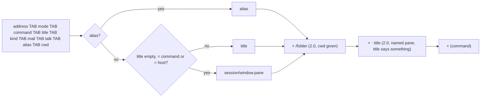
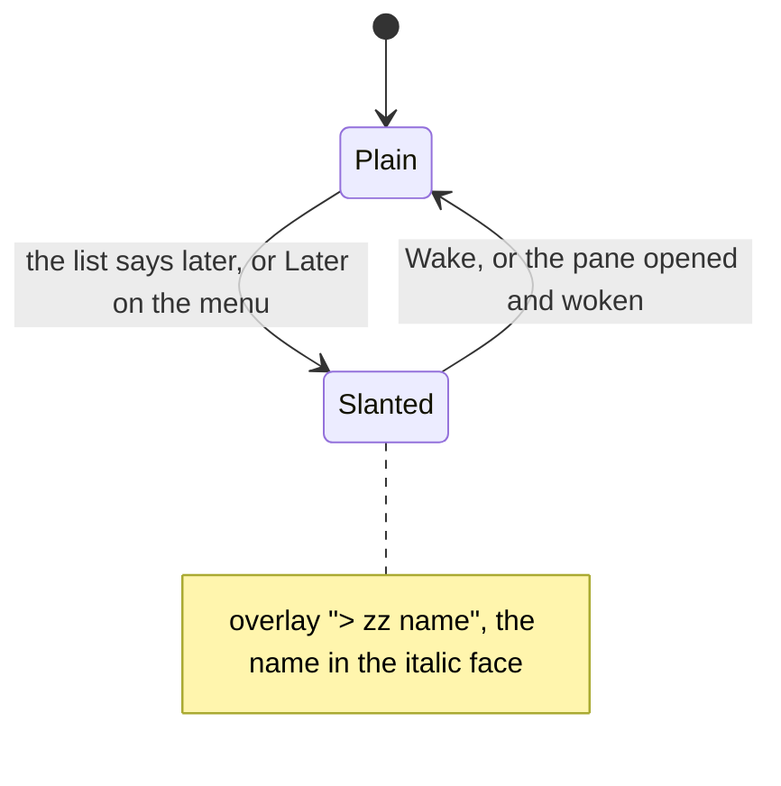

# Feature: the alias is the name, the folder after it; a parked pane's name slanted

> Status: approved 2026-11-04 (header only slants; folder and status on
> the 2.0 row), implemented the same day in version 0.8.0; the core's
> columns are muxway#261. Parity with the core's
> `docs/plans/2026-11-03-pane-names.md` (muxway#232) and
> muxway-android#70 (PR #76); the issues here are #36 and #40.
> Guideline §1.1 (*alias*, *tab*, *folder*, *status style*), §1.2 (the
> *later* row: the pane's name in the header in italics).

## 1. Goal

With four Claude panes open the list reads like four copies of whatever
Claude last wrote into its title, and two sessions on the same subject
pick the same words. The owner now names a pane from the web or Android
(its alias, `alice-laptop/@review`), and the hub tells every pane's
folder to its writers. This phone shows neither: its text listing has no
alias and no folder, and a parked pane's name looks like any other.

After this change:

- **the alias is the name**, on both builds: a pane with an alias goes
  by it in the list row, the inbox row and the pane view's overlay;
  what the program says about itself steps back. Without an alias
  nothing changes;
- **the status and the folder** (MIDP 2.0 build): after the name, the
  folder's last segment where the hub gives one, then the program's own
  words for a named pane, `* review /muxway · fixing the build (claude)`;
  the smallest screen leaves both out, as the guideline says of the
  folder;
- **the slant** (MIDP 2.0 build): the overlay's top row, the phone's
  header, draws a parked pane's name in the italic face, plain again
  when woken. `zz` stays; where the phone's font has no italics the
  mark alone stays, as the guideline allows.

To carry the alias and the folder, **the hub's text listing gains two
trailing columns**: `alias` and `cwd`, after `talk`. A client older
than that ends its row at `talk`, as the MIDP 1.0 build does today with
`mail` and `talk`. That is one small change in the core, its own pull
request there, merged first, since this repository's CI builds the hub
from the core's `main`.

Out of scope: renaming from the phone (a web and Android gesture, the
issue says; the phone shows the name); the whole path (the web's
tooltip; the row has the last segment); the status and the folder on
the MIDP 1.0 build (a 96x65 row holds some twenty characters: the
alias is the part that helps); the alias in `GET /v1/inbox`'s text
rows (the inbox names a pane from the list's row already).

## 2. Design

### The columns (core)

`GET /v1/panes` in text mode:

```
<address> TAB <mode> TAB <command> TAB <title> TAB <kind> TAB <mail> TAB <talk> TAB <alias> TAB <cwd>
```

`alias` is the pane's alias as the JSON gives it, `[a-z0-9-]{1,32}` or
empty. `cwd` is the directory the JSON gives, for a writer of a pane
under a preview root, empty otherwise; a tab or a newline in it, which
a path on the host may hold, becomes a space, and the charset folds it
as it folds the title. Nothing else in the row moves.

### The name (both builds)

`Text.label()` reads the eighth column: an alias that is not empty is
the name, and the title rule (empty, the program's name or the host's
name gives way to the place; Claude's mark dropped) is not asked. The
program stays in brackets: `* review (claude)`, `*?review (claude)`,
`*zz review (claude)`. With panes of several hosts the host leads as
today, `alice-laptop/review (claude)`. The inbox takes the names from
the list, the overlay shows the list's name: both follow.

### The folder and the status (MIDP 2.0 build)

Behind a new `Ui.NAMES` (true in the 2.0 profile, false in the 1.0,
so javac drops it as it drops the talk columns):

- the folder: the last segment of the ninth column, after the name
  with a slash in front, `fixing the build /muxway (claude)`, so two
  Claude panes on the same subject in two checkouts read apart; nothing
  when the column is empty or ends in a slash;
- the status: for a named pane, the title the name replaced, after the
  folder and a middle dot, `review /muxway · fixing the build (claude)`;
  the dot is `-` on the ASCII setting, whose font has none. A title that
  says nothing (empty, the program, the host) adds no status.

The mail count and the cut stay as they are: the name, the folder and
the status give way, the count and the program stay within 64.



### The slant (MIDP 2.0 build)

`PaneView` holds a second font, the italic of the same face and size,
and the overlay's top row draws the prefix (`> `, `zz `) in the plain
face and the name in the italic one while `later` holds; `parked()`
already flips the flag on the view, so *Wake* and the wake on open
straighten the name on the next paint. The trace line for `#` says
`italic` while it draws so, so a test can read it. The list row is a
phone `List` entry and stays plain with `zz` (an option below asks
whether it should slant too, with `List.setFont`, MIDP 2.0 only).



### Components touched

Core: `internal/hub/api.go` (two columns), `e2e/s2_flow_test.go` (the
row), `docs/protocol/v1.md`, `docs/features/text-mode.md`. Here:
`Text.label()`, `Muxway.list()` (passes the columns and the setting),
`PaneView` (the italic face, the overlay, the trace), `Ui.NAMES` in both
profiles, `tests/e2e/harness.py` (`Core.start(preview=)`, `alias()`),
`tests/e2e/run.py` (S22, F33, F34, the relay's forged columns),
`tests/unit/UnitTest.java`, `docs/features/pane-view.md`, `later.md`,
`inbox.md`, `ARCHITECTURE.md`, the README; version 0.8.0.

## 3. Protocol and API changes

One compatible addition in the core: the two trailing columns of
`GET /v1/panes` in text mode, documented in `v1.md` with the rule for
older hubs ("a hub older than the alias ends the row at `talk`"). The
JSON is untouched; no new endpoint; the pinned protocol version stays.

## 4. Security analysis

- **The alias is text the pane's writers choose**, like the title: a
  writer of a shell pane sets it with `muxway expose --name`. The hub
  and the agent keep it to `[a-z0-9-]{1,32}`; the phone does not trust
  that: the row is split on TAB, the label is cut at 64, control
  characters never reach a label (`Text.screen()` on every body). An
  alias made to look like another pane misleads the eye only, as a
  forged title does (S09): the program in brackets is the hub's, the
  address the row opens is the first column's, and the hub decides what
  the token may write. S22 forges both columns.
- **The folder is a path on the host.** The hub gives it to a writer of
  the pane under a preview root the owner named, as the JSON does since
  2026-11-03, and to nobody else; the phone shows the last segment and
  never asks for the directory. Between the phone and the relay it
  travels in the clear like the pane's own content, which shows paths
  anyway; the warning Settings shows once for a plain-HTTP server
  covers it.
- **Nothing is written.** Both features read columns of a listing the
  app read already; no request is added, the relay's allow list (S19)
  does not change. The slant reads a flag the app holds.
- **Oversized and malformed input.** A 300-character alias, a cwd of
  tabs, a cwd that is `../..`: the label is cut, the tabs are columns
  that are ignored, the segment after the last slash is shown as text.
  The body cap (32 KiB) and the row loop are as before.
- **Logging.** Nothing new is logged; the test build's trace shows the
  labels it shows today.
- No new dependency; both builds checked by `check-midp1.sh` and the
  JAR cap. The 1.0 JAR had 36 bytes to spare after 0.7.0; the alias
  rule needs more, so the review will say what gave way (first
  candidate: the two optional manifest attributes the JAD carries
  anyway, `MIDlet-Description` and `MIDlet-Info-URL`; the JAD is what
  the phone reads before an install).

## 5. Privacy check

Docs and tests use `alice-laptop`, `review`, `build`, `/home/alice/src/project`.
Screenshots come from the emulator against the test hub. The deny-list
grep and gitleaks run before the push.

## 6. Test plan

| # | Test | Kind | Expected |
|---|------|------|----------|
| 1 | S22: a relay that forges the alias and cwd columns: 300 letters, control characters, `../../etc`, a stranger's address as the alias, a cwd ending in a slash | e2e-security, both builds | every row at most 66 characters, printable; the forged alias replaces the name only; selecting the row opens the hub's pane (first column); nothing is posted |
| 2 | S22 (same run): a read-only token on a host with a preview root | e2e-security | the hub's row has an empty cwd; the 2.0 list shows no folder |
| 3 | S09, S20, S21 (existing) | e2e-security | unchanged |
| 4 | F33: `expose --name review` on the titled pane, a preview root on the agent; the list, the overlay, the inbox after a question | UI, both builds | 1.0: `* review (bash)`; 2.0: `* review /<dir> · test-pane (bash)`; the second pane, unnamed, `* work/0.1 /<dir> (bash)` (2.0) and `* work/0.1 (bash)` (1.0); the overlay `> review …`; the inbox `? review …: deploy?`; screenshots `named`, `overlay`, `inbox` |
| 5 | F34: a pane parked elsewhere, opened, `#` | UI, MIDP 2.0 | the trace reads `Info on italic`; *Wake*, `#` twice: `Info on` plain; screenshots `slanted`, `straight` |
| 6 | U: `label` with an alias, with an alias and the host, with an empty alias, the cut with an alias; with `Ui.NAMES` the folder from `/home/alice/src/project`, from a trailing slash, from an empty column, the status after a named pane, no status for a title like the program, the ASCII dash | unit | as §2 |
| 7 | core s2_flow (extended): the text row ends `\talias\tcwd`, empty for a plain pane, the alias after `expose --name`, cwd for a writer under a root and empty for a reader | e2e (core) | the row as §2 |
| 8 | build check (existing) | build | the 1.0 JAR under 30 KiB, nothing newer than MIDP 1.0 referenced |

## 7. Documentation

- Core: `docs/protocol/v1.md` text-mode row and the compatibility table;
  `docs/features/text-mode.md` the listing's columns.
- `docs/features/pane-view.md`: the list section (the alias, the folder,
  the status, the diagram), the states table's *later* row (the slant),
  the overlay.
- `docs/features/later.md`: the slant in the mark table and the 2.0
  section. `docs/features/inbox.md`: the alias names the row.
- `docs/ARCHITECTURE.md` and the README: the row's columns, one bullet.
- Proposed to the core with the pull request: guideline §1.1 and §1.2
  MIDP notes (the alias on both builds, folder and status on 2.0, the
  slant in the overlay).

## 8. Implementation steps

1. Core, from `origin/main` in a worktree: the two columns, the test,
   the docs; pull request, merged before step 6.
2. `Text.label()` with the alias; `Ui.NAMES`; the folder and the status;
   unit tests; both builds, the 1.0 JAR measured and made to fit.
3. `PaneView`: the italic face, the overlay, the trace.
4. Harness: `preview=`, `Core.alias()`, the forged columns; S22, F33,
   F34.
5. Docs; version 0.8.0.
6. Review, the full run on both builds against the core's `main`,
   recorded; the pull request.

---

## Review (after implementation)

- [x] Diff matches the plan, deviations explained here
- [x] Security rules (AGENTS.md section 2) hold: nothing new is
      requested or written; the alias and the folder are columns of a
      listing the app read already, split on TAB, cut at 64 and stripped
      of control characters like the title (S22); the hub gives the
      folder to a writer under a root only (S23, core Sec140); the
      slant reads a flag the app holds
- [x] Privacy check passed: `scripts/prepush-check.sh` clean and diff read
- [x] Docs and diagrams updated

Deviations:

- The 1.0 JAR went 62 bytes over the cap with the alias rule. What gave
  way is not the manifest the plan named first but the watchdog thread:
  the spinner, which runs for the same job and wakes every 150 ms
  anyway, now gives the job up once it has run for its patience, and
  the third anonymous class is gone. The 1.0 JAR is 30288 bytes, 432
  under the cap. The timeout fires on the spinner's tick, at most 150 ms
  later than before.
- The reader's check moved out of S22 into its own S23 (MIDP 2.0): S22
  wants a forging relay, S23 an honest hub with a preview root.
- `Text.label()` takes the Text setting as a fourth argument (the dot or
  a dash), so the 1.0 build's call carries one unused boolean.

## Test run

Run 20261104-131030-6865d27, recorded as [issue #43](https://github.com/notmarkopadjen/muxway-midp/issues/43):
220 tests passed, none failed, both builds, against the core's `main`
(1b2a71a, with the two columns of muxway#261). F33's screenshots show
the named pane first in the list on both builds, with the folder and
the status on MIDP 2.0, and in the inbox; F34's show the overlay's name
slanted while the pane is parked and straight after *Wake*; S22's the
forged columns cut to the row. The run before it at d377349
([issue #42](https://github.com/notmarkopadjen/muxway-midp/issues/42))
was red on two faults of the emulator itself (S05, S06), green alone;
the harness gives the soft-key menu more time since.
