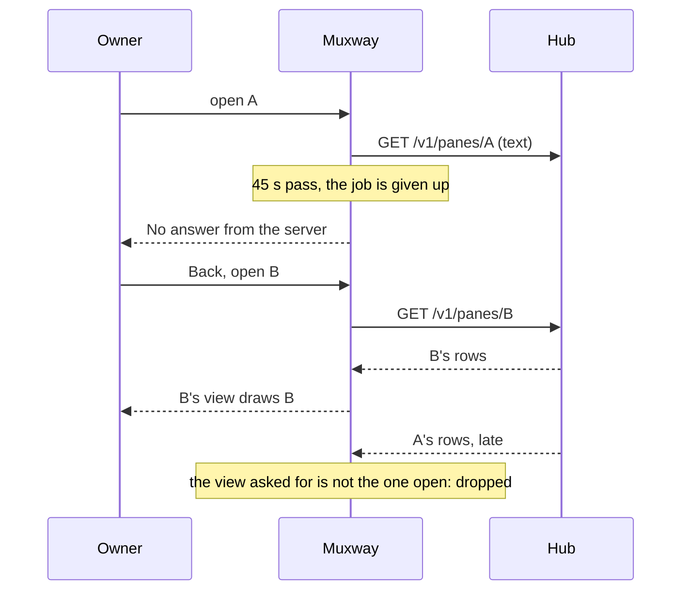
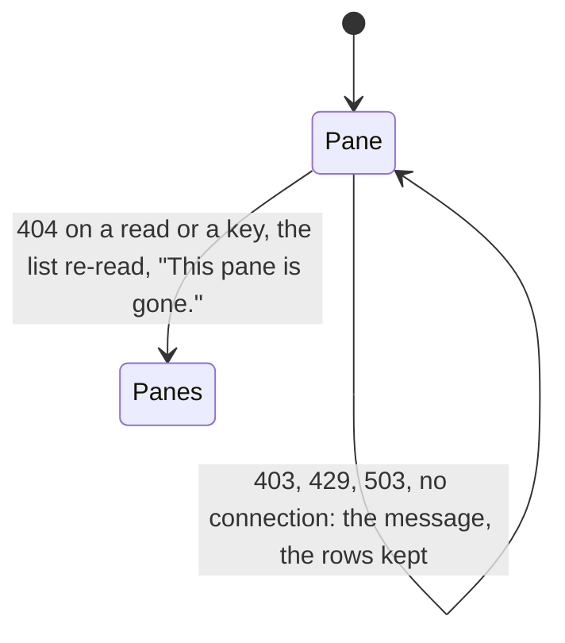
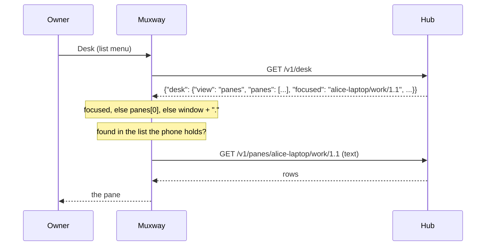

# Feature: a pane view that shows its own pane or nothing, and the desk's focused pane from the list

> Status: proposed 2026-11-07, reviewed with the pull request; implemented
> the same day in version 0.10.0. Parity with the core's tiles cell
> (`docs/ui-guideline.md` §1.4, muxway#284, PR muxway#303) and the desk
> row (§1.1, muxway#305); the issues here are #51 and #52. One pull
> request for both, as the owner asked.

## 1. Goal

**The pane view shows its own pane or nothing** (#51). The web's tile
learnt to know its pane by id, to draw no frame of another pane, to
follow its pane when the host renumbers it, to close with a word when it
is gone, and to show a CRT warm-up while it has nothing of its own. The
phone opens a fresh canvas for every pane, so it never kept a frame; but
two seams let another pane's text, or a dead pane's, onto the screen:

- **a late answer**: a read the phone gave up on (45 s) still lands when
  it arrives, in whatever view is open by then. Open pane A, wait the
  patience out, go back, open pane B: A's rows are drawn in B's view when
  A's hub answer finally comes;
- **a pane that is gone**: a read or a key on a pane the host closed
  answers `404`; the phone says *Not found.* and stays on the dead
  pane's last rows, which are nobody's now, and may read another pane's
  rows under that address once the host renumbers.

After this change, on both builds: a late answer is dropped unless the
view it was asked for is still the one open; a `404` on the open pane
says *This pane is gone.*, leaves the view and reads the list again. On
the MIDP 2.0 build the view shows a **warm-up** while it has nothing of
its own and a request runs: a line across the middle of the box in the
theme's ink that widens from the centre and opens into a band, then
settles to a line until the first rows come; the smallest screen stays
blank, as the issue allows, with the wait mark in its corner as for
every request.

**The desk's focused pane from the list** (#52), MIDP 2.0 build. The hub
keeps the desk, the view the owner's clients share (`GET /v1/desk`).
*Desk* on the pane list's menu reads it and opens the pane it is focused
on: the first of its panes when none is focused, the window's first pane
in the list for a window desk. The phone reads the desk and never writes
it. A desk without panes says *The desk is empty.*; a hub without the
endpoint says *This hub has no desk.*

Out of scope, and why:

- **the pane known by its id, and the follow on a renumber.** The text
  listing this client pins has no `pane_id` column
  (`address mode command title kind mail talk alias cwd pending`), and a
  text-mode pane read carries no identity either, so the phone cannot
  tell a pane renumbered under the address it holds from the pane it
  opened. That is a gap in the core's text mode, reported with this
  plan for the core to take up (a trailing `pane_id` column on the
  listing after `pending`, as `alias`, `cwd` and `pending` were added,
  and the same on the inbox's rows); when the column lands the phone can
  learn its pane's id at open and follow it from a re-read list. Until
  then the phone has the rule it can keep: it draws its own view's
  answer or nothing, and a `404` closes it with a word;
- **the desk as a row at the top of the list.** The 2.0 list is a phone
  `List` whose rows are panes and host lines, read by every test as
  `Panes: ...`; a row that is no pane would shift every index and every
  expectation. The issue allows the menu, where *Inbox* and *Messages*
  live already: *Desk* goes first there;
- **the desk on the MIDP 1.0 build**: a request, a JSON reader and a
  menu entry, with 25 bytes under the cap. The two rules of #51 are
  tried on the 1.0 build in this order, each only while the JAR fits:
  the late answer dropped, then *gone*; the review says what fitted
  and what gave way (first candidate to give way: the manifest's
  optional `MIDlet-Description` and `MIDlet-Info-URL`, which the JAD
  keeps);
- writing the desk (the small clients read it, the guideline says);
  following the `desk` event (the phone polls nothing it is not
  looking at); the minimised row, the arrangement, the tab order.

## 2. Design

### 2.1 A late answer is nobody's

`Muxway.read` captures the view it reads for before the request and,
once the hub has answered, sets the text on that view only if it is
still the one open (`v == view`); otherwise the answer is dropped, not
traced, not drawn. The ETag follows the same rule. A view is made afresh
by `open`, so a late answer for pane A can never meet pane B's view, and
a late answer for the same pane still open is that pane's own (a
refresh pressed after the give-up would draw the same rows).



What this does not close: the one `Api` object the jobs share. A late
answer writes `api.body` while the next job may be reading it, a window
of microseconds between its `call` returning and `setText`; closing it
needs an `Api` per job or a body returned by value, more bytes than the
1.0 build has. Noted, accepted: the view check above closes the
second-long window the owner can see.

### 2.2 Gone

`problem(404)` on a job of the open view (`OPEN`, `REFRESH`, `POLL`,
`SEND`, `TYPE`, `KEY`) is the pane gone (the hub's `not_found` for an
address no pane has; a host without the feature answers `404` on
`/later`, `/files`, `/close` too, but those are told apart before
`problem` is asked). The phone drops the view (`view = null`, Auto
off), reads the list again on the same job thread and shows it, then
says *This pane is gone.* over it. The list is read before the word so
the word's dismissal lands on a fresh list, not on the row of a pane
that is not there.



### 2.3 The warm-up (MIDP 2.0 build)

`PaneView` keeps `lit`, false until its first `setText`. While `!lit`
and a request runs (`frame >= 0`, the spinner's step), `paint` draws
the tube coming on instead of rows, in the theme's ink on its ground:

| step (150 ms each) | drawn |
|---|---|
| 0 | a 1 px line at mid-height, half the width, centred |
| 1 | the line across the whole width |
| 2 | a band 3 px tall |
| 3 | a band 5 px tall |
| 4 and on | a 1 px line across the width, until the rows come |

Nothing is drawn while no request runs and the view has no rows (a read
that failed: the message says why, the box stays blank). The trace says
`Warm-up` once per view on the first frame drawn, so a test can read it.
Behind `Ui.WARMUP`, true on 2.0, false on 1.0 where javac folds it away.

### 2.4 The desk (MIDP 2.0 build)

*Desk* on the pane list's menu (first of the entries, before *Inbox*)
starts the `DESK` job behind the wait form (*Reading the desk...*):

1. `GET /v1/desk`. The hub answers JSON whatever `Accept` says; the
   phone reads it with `Text.jsonString`, as it reads a session's and a
   split's answers. `404`: *This hub has no desk.* Any other failure:
   the usual message.
2. `Text.deskFocus(json)`: `focused` when present and not empty; else
   the first string of `panes`; else `window` with a dot appended, so
   the first pane of that window in the list is meant; null for a desk
   with none of these.
3. The pick is looked up in the list the phone holds (`addresses`): an
   exact address, or for a window the first address that starts with
   it. The list is the hub's own listing, so nothing the desk names
   opens unless the hub listed it for this token; a pick the list has
   not is one re-read of the list away (the list may be stale), and
   after that *The desk's pane is not in the list.*
4. The row is selected and opened after the job, through `openNext`,
   as a new session's pane is: `View ... `, then the read.



```mermaid
flowchart LR
    D["desk JSON"] --> F{focused?}
    F -- yes --> P["that address"]
    F -- no --> A{panes[0]?}
    A -- yes --> P
    A -- no --> W{window?}
    W -- yes --> P2["window + '.': its first pane in the list"]
    W -- no --> E["The desk is empty."]
    P --> L{in the list?}
    P2 --> L
    L -- yes --> O["open"]
    L -- no --> R["list re-read, looked up again"]
    R -- still no --> N["The desk's pane is not in the list."]
```

`Text.jsonString` is split into the key lookup (`jsonValue`) and the
string reader (`jsonText`), and `Text.jsonFirst` reads the first string
of an array under a key with the same two; the 1.0 build does not call
any of them, so ProGuard keeps them out of its JAR.

### Components touched

`Muxway` (`read`, `problem`, `gone`, the `DESK` job and command, the
wait note, `where`), `PaneView` (`lit`, the warm-up), `Text`
(`jsonValue`, `jsonText`, `jsonFirst`, `deskFocus`), `Ui` in both
profiles (`WARMUP`, `DESK`), `scripts/build.sh` if the manifest must
give way, `tests/e2e/harness.py` (relay modes `late` and `slow`,
`lie-desk`; `Core.desk`; the menus), `tests/e2e/run.py` (S30, S31, F47,
F48, F49, S19's paths, `ALLOWED`), `tests/unit/UnitTest.java`,
`docs/features/pane-view.md`, a new `docs/features/desk.md`,
`docs/features/relay.md`, `docs/ARCHITECTURE.md`, the README; version
0.10.0.

## 3. Protocol and API changes

None in the core. The phone adds one read, `GET /v1/desk`, JSON as the
hub gives it (the endpoint has no text mode; the body is at most 8 KiB,
under the phone's 32 KiB cap). The relay's list of forwarded paths
gains it (`relay.md`, the Caddy example's regexp). The pinned protocol
version stays.

The core gap (the `pane_id` column in text mode) is the core's to
change, not a change here.

## 4. Security analysis

- **A late answer** is text from the hub for a pane the token may read;
  dropping it changes nothing the hub decides. What it closes is one
  pane's rows drawn as another's, which misleads the owner (and could
  make a key meant for B land in B while the eye reads A). Nothing new
  is requested or written.
- **Gone.** A `404` from the hub for the open pane sends the phone to
  the list. A relay that lies with `404` on every read makes the phone
  leave the pane and re-read the list: nothing is posted, nothing is
  opened the hub did not list, and the owner sees the list it always
  could; the same relay could as well answer rows of its own, which
  S05 and S06 cover. A key pressed on a pane that died is refused by
  the hub (`404`) before the phone hears of it, so the gone rule is
  told after the hub's refusal, never instead of it.
- **The desk is read, never written.** One `GET`; no `PUT` exists in the
  phone and the relay's allow list (S19) has no `PUT`. The hub filters
  the desk to the panes the token may read before answering (its
  `forPrincipal`), and the phone adds its own check: the pick is opened
  only when it is a row of the listing the phone holds from the same
  hub, so a desk that names a pane outside the token's grants, or a
  relay that forges one (`../../admin`, a stranger's address, 300
  letters, control characters, which `Text.screen` strips from every
  body anyway), opens nothing and says the pane is not in the list. The
  row opened is the list's, with the list's mode: a forged desk cannot
  make a read-only pane writable. S31 forges it; S19 confirms the one
  path.
- **Oversized and malformed input.** The desk body is cut at 32 KiB by
  `Api`; `jsonText` returns null on a bad escape; a missing or empty
  key is "none"; the window prefix is matched against the listing's
  own addresses with `startsWith`, so a prefix like `../` or `alice`
  alone matches nothing or only panes the hub listed.
- **Logging.** Nothing new is logged. The test build's trace names the
  address the desk opens (`View ...`), as it does for every open, and
  `Warm-up`; pane content is traced in test builds only, as before.
- **The relay path** (AGENTS.md §7): the desk's JSON travels in the
  clear between the phone and the relay like the listing, which names
  the same panes already; it holds addresses and the writer's name
  (`by`), never a secret. The token is in `X-Muxway-Token`, as for every
  request, and the plain-HTTP warning Settings shows once covers the
  path.
- No new dependency; both builds checked by `check-midp1.sh` and the
  JAR cap.

## 5. Privacy check

Docs and tests use `alice-laptop`, `bob-desktop`, `review`, `work/0.1`.
Screenshots come from the emulator against the test hub. The deny-list
grep and gitleaks run before the push.

## 6. Test plan

| # | Test | Kind | Expected |
|---|------|------|----------|
| 1 | S30: a relay that holds pane A's read past the phone's patience and answers it late with marked rows; the phone gives up, goes Back, opens pane B | e2e-security, both builds | B's rows on screen; the marked rows never traced or drawn; nothing posted; screenshots `blank` (A's view before any answer: no rows of anyone), `other` |
| 2 | S31: a relay that forges the desk: `focused` a path up, then a stranger's address, then 300 letters with control characters, then a pane of another token's grant; a read-only token | e2e-security, 2.0 | nothing opened, *The desk's pane is not in the list.* each time; no request but `GET /v1/desk` and the list; a reader opens the desk's pane as read-only |
| 3 | S19 (extended) | e2e-security, 2.0 | `GET /v1/desk` among the paths, every path on the relay's list |
| 4 | F47: the second pane open; it is killed on the host; `1` | UI, both builds | *This pane is gone.*, the list again without it; screenshot `gone`; the same on a key sent |
| 5 | F48: a relay that holds the read three seconds | UI, both builds | 2.0: the trace reads `Warm-up` before the rows, screenshot `warm-up` of the band; 1.0: a blank box, screenshot `blank`; then the rows |
| 6 | F49: *Desk* on a fresh hub, then after another client wrote a panes desk with a focus, one without a focus, a window desk without a focus | UI, 2.0 | *The desk is empty.*; the focused pane opens; the first pane opens; the window's first pane opens; screenshots `empty`, `focused` |
| 7 | U: `jsonFirst` on an array of strings, an empty array, a missing key, a bad escape; `deskFocus` with a focus, without, a window desk, an empty desk | unit | as §2.4 |
| 8 | build check (existing) | build | the 1.0 JAR under 30 KiB, nothing newer than MIDP 1.0 referenced |

## 7. Documentation

- `docs/features/pane-view.md`: the screen section (own pane or nothing,
  the late answer, gone, the warm-up), the states diagram.
- `docs/features/desk.md`: new, the desk from the list.
- `docs/features/relay.md`: `GET /v1/desk` in the list and the Caddy
  regexp.
- `docs/ARCHITECTURE.md`: the screens (Desk), the requests (the late
  answer rule), the protocol features used.
- README: a bullet each.
- Proposed to the core with the pull request: the guideline's MIDP
  cells for *tiles* (§1.4) and *desk* (§1.1), and the text-mode
  `pane_id` column.

## 8. Implementation steps

1. `read` with the captured view; `problem(404)` and `gone`; both
   builds measured against the cap.
2. `PaneView.lit` and the warm-up; `Ui.WARMUP`.
3. `Text.jsonValue`, `jsonText`, `jsonFirst`, `deskFocus`; unit tests.
4. The `DESK` job and the menu entry; `Ui.DESK`; the harness's menus.
5. Harness: relay modes `late`, `slow`, `lie-desk`; `Core.desk`; S30,
   S31, F47, F48, F49; S19 and `ALLOWED`.
6. Docs; version 0.10.0.
7. Review, the full run on both builds against the core's `main`,
   recorded; the pull request.

---

## Review (after implementation)

- [x] Diff matches the plan, deviations explained here
- [x] Security rules (AGENTS.md section 2) hold: nothing new is
      written; the desk is one `GET` under the token, filtered by the
      hub to the token's grants and checked on the phone against the
      hub's own listing, so a forged desk opens nothing (S31) and a
      reader gets what the hub leaves it, read-only (S32); a late
      answer is dropped unless it is the open view's (S30); a `404`
      sends the phone to the list and posts nothing (F47); the app asks
      for the listed paths and no other (S19); no secret in any log
      (S99)
- [x] Privacy check passed: `scripts/prepush-check.sh` clean and diff read
- [x] Docs and diagrams updated

Deviations:

- **Both rules of #51 fitted the 1.0 build**: the late answer dropped
  and *gone*, 96 bytes together, against the 25 the JAR had. What gave
  way is what the plan named first: the 1.0 JAR's manifest leaves out
  `MIDlet-Description` and `MIDlet-Info-URL` (the JAD keeps both; a
  phone reads the JAD before the install) and carries
  `Created-By: muxway` where `jar` would write its own version string.
  The 1.0 JAR is 30699 bytes, 21 under the cap.
- **A race left as it was**, for those bytes: the spinner thread reads
  `view` twice a turn (`view != null`, then `view.busy(step)`), and
  *gone* now sets `view` to null from the job thread. A null between
  the two reads ends the spinner thread with an exception; the job it
  spun for is finishing anyway, so the app loses nothing but that
  thread's last turn. A local in the loop costs 16 bytes the 1.0 build
  has not; it is the first thing to add when the cap allows.
- **The core issue was not filed** by the agent (its session could not
  create issues in the core); the gap and the proposal are in §1 and
  §3 here and in the pull request for the owner to file.
- **`Text.jsonString` looked for the key as a bare quoted word**, so a
  value that equals the key was taken for it: the hub's desk says
  `"view": "panes"` before `"panes"`, and the first pane was never
  found. The lookup now wants the colon after the key; the sessions'
  and splits' answers (`address`, `error`) read as before.
- **The emulator's menu** took the first entry for the one asked
  (*Keys* for *Back*, for *Refresh*, for *Pane*) five times in the
  first full run, beside the Android and glasses suites on the same
  machine, and once in three runs of F49 after a pane opened from the
  desk, however long the pause before the menu. The harness gives the
  menu 2.5 s to open instead of 1.8 (the owner's own remedy of
  2026-11-04), S30 pauses a second after the give-up's alert, and F49
  opens each desk from a phone started on the list, as the owner picks
  a desk up, with no *Back* in between. Nothing in the product changed
  for it.

## Test run

Link to the recorded run: result, commit, logs, screenshots.
