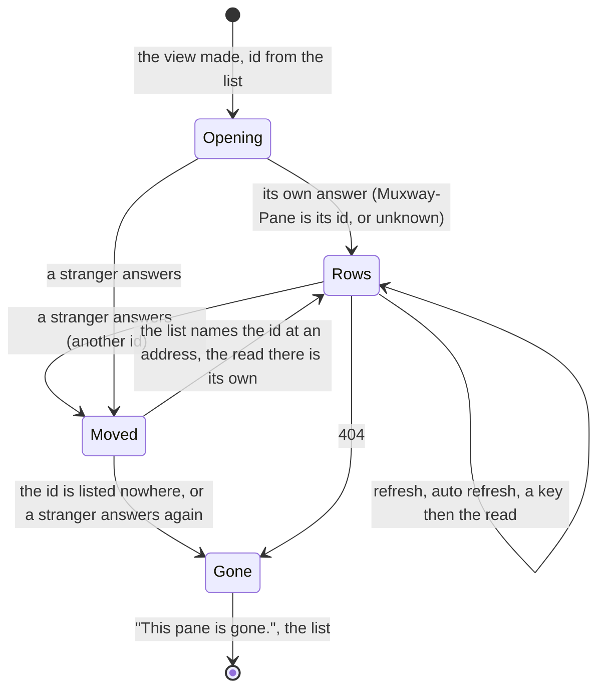

# Feature: the pane known by its id, followed when the host renumbers

> Status: proposed 2026-11-07, reviewed with the pull request. The
> follow-up the plan of #51 (`2026-11-07-own-pane-and-desk.md`) left
> out as a core gap, now that the core's text mode carries the pane id
> (muxway#315, PR muxway#320). Parity with the core's tiles cell
> (`docs/ui-guideline.md` §1.4).

## 1. Goal

The pane view draws its own pane's rows or nothing (#51), but until now
it knew its pane by address alone. An address is a position: when a
pane closes, the host renumbers the panes after it, and the address the
phone holds names another pane. A refresh, an auto refresh or the read
after a key then drew a stranger's rows under the title of the pane the
owner opened, and a key sent went to the stranger. The text listing had
no `pane_id` and a text-mode read no identity, so the phone could not
tell. The core has closed the gap: the rows of `GET /v1/panes` and
`GET /v1/inbox` end in a `pane_id` column (`%<digits>`, the eleventh and
the seventh), and `GET /v1/panes/{address}` carries `Muxway-Pane: %N`
on every `200` and `304`, in text mode too, never on an error.

After this change, on the MIDP 2.0 build, the view knows its pane by
host and id from the listing's last column; every read's `Muxway-Pane`
is checked against it, and when another pane answers the view draws
nothing of those rows, reads the list again and follows its pane to its
new address, or closes with *This pane is gone.* as #51 does; a key
after a renumber reaches the pane the owner sees. The inbox opens a
pane by the id its row carries, so a stale list opens the right pane.
A hub without the column or the header leaves everything as it was.

Out of scope, and why:

- **the MIDP 1.0 build**: the 1.0 JAR is 21 bytes under its 30 KiB cap.
  The feature is a vector, a column read, a header read, a check and a
  follow, measured in §8 and the review; the plan expects it not to fit,
  and the build keeps the address-only rule of #51 with `Ui.IDS` off.
  What was measured is recorded in the review;
- following the pane from a listing the view did not ask for: the view
  reads its pane, not the list, and a renumber shows on its next read
  (a refresh, the auto refresh's cheap `304`, the read after a key); a
  list re-read while the list is the screen makes a new view on open;
- the desk, and anything the core's events give.

## 2. Design

### 2.1 The id from the listing

`list()` keeps one more vector beside `addresses`, `ids`: the eleventh
column when it is a pane id (`Text.paneId`: `%` and one to nine digits),
else the empty string. The inbox keeps the seventh the same way. The
view gets `id` at `open(i)`, traced after the address. A row without
the column, or with one that is not an id, gives an empty `id`, and an
empty `id` switches every check below off: a hub older than the column
behaves as today.

### 2.2 The read's answer is checked

`Api` keeps the answer's `Muxway-Pane` as it keeps `ETag`. `read()`
compares it with the view's `id` before anything else, on a `200` and
on a `304` alike (a `304` has no rows, but it names the pane that
answered, so a renumber shows on the cheapest poll). A header that is
no id, or absent, counts as unknown: the rows are the hub's own answer
to the address, as before this change (a hub older than the header,
or a relay that drops it, loses the check and nothing else). A header
that names another pane is a **stranger**: the rows are not set on the
view, not traced as its own; the view keeps what it had (its own
earlier rows, or the warm-up) and `moved()` runs.

### 2.3 Moved: the list again, then follow or gone

`moved()` reads the list again (quietly: the view stays the screen) and
looks for the view's `id` among the fresh `ids`:

- found: the view **follows**: its `address`, `title`, `name`,
  `command`, `mark` and `later` are the fresh row's, traced as
  `Follow %3 host/work/0.1 host/work/0.0`, and the pane is read once
  more at the new address. The second answer is checked the same way;
  another stranger there ends it as *gone* below, so a hub or a relay
  that never agrees cannot send the phone round in a circle. The list
  may name the id at the address the view had already (the host moved
  the pane and moved it back, or a relay lied in the header): that is a
  follow to the same address, one more read, and the same end on a
  second stranger;
- not found: the pane is **gone**: as #51, the view is dropped, Auto
  off, the list shown (already read) and *This pane is gone.* over it.

```mermaid
sequenceDiagram
    participant U as Owner
    participant M as Muxway
    participant H as Hub
    U->>M: open work/0.1 (test-pane-2, %3 from the list)
    M->>H: GET /v1/panes/host/work/0.1
    H-->>M: rows, Muxway-Pane: %3
    M-->>U: the rows
    Note over H: work/0.0 closes; the host renumbers: %3 is work/0.0, %7 is work/0.1
    U->>M: 1 (refresh)
    M->>H: GET /v1/panes/host/work/0.1
    H-->>M: %7's rows, Muxway-Pane: %7
    Note over M: a stranger: nothing drawn, nothing traced as the view's
    M->>H: GET /v1/panes
    H-->>M: rows ending in … %3 (work/0.0), … %7 (work/0.1)
    Note over M: Follow %3 work/0.1 work/0.0
    M->>H: GET /v1/panes/host/work/0.0
    H-->>M: rows, Muxway-Pane: %3
    M-->>U: its own rows, under its own title
    U->>M: 0, Enter
    M->>H: POST /v1/panes/host/work/0.0/input
```



### 2.4 The inbox opens by id

A row of the inbox names the pane by address and, with this hub, by id.
`Inbox` passes both to `Muxway.open(address, id)`: the list's row with
that id opens when there is one, else the row at that address, else the
list is read again as today. So a row read after a renumber opens the
pane it names even while the phone's list is older than the hub's; the
view's first read then follows the pane to where the hub has it.

### 2.5 The harness

The test relay forwards the hub's `Muxway-Pane` beside `ETag` and
`Content-Type` (a real relay forwards every header; Caddy does). Its
`talk` modes, which cut a listing row at the kind to add the mail and
talk columns, keep the trailing columns instead, so the id reaches the
phone there too. A `lie-pane` mode forges the header on pane reads:
`../x`, `%abc`, `%` and three hundred nines, then `%999999`.

## 3. Protocol and API changes

None to the protocol: the phone reads what the core's `v1` gives since
muxway#320, `pane_id` as the last column of the pane and inbox rows and
`Muxway-Pane` on a pane read, as `docs/protocol/v1.md` describes them.
The relay page adds the header to what a relay must forward.

## 4. Security analysis

- What an attacker gains: nothing new. The phone asks for the same paths
  with the same token, and writes nothing it did not write before; the
  change is that a key pressed after a renumber reaches the pane whose
  rows the owner sees, never the pane that took its address. That
  closes a path by which an owner could type into a stranger's shell
  by accident.
- Authentication and authorisation: unchanged; the hub filters the
  listing, the inbox and every read by the token's grants, so the ids
  the phone holds are those of panes it may read, and a follow lands on
  a listed pane or nowhere.
- Input crossing a trust boundary: the `pane_id` column and the
  `Muxway-Pane` header come from the hub through the relay. Both are
  taken only as `%` and one to nine digits; anything else is unknown
  and changes nothing. A header forged to another id makes the phone
  re-read the list and read once more, then stop with *gone*: two reads
  and a listing, no loop, no write. A relay that forges the header can
  only hide the pane from the phone; it holds the token already and
  could rewrite the rows themselves, as before.
- Logged: the trace (test builds only) names addresses and ids, never
  the token; the rows of a stranger are not traced as the view's.
- No new dependency.

## 5. Privacy check

Docs and tests use the suite's `alice-laptop`, synthetic titles
(`test-pane-2`, `test-pane-3`), a synthetic marker in a pane and ids
`%3`, `%7`. No real host, person or secret; screenshots from the
emulator against the test hub.

## 6. Test plan

| # | Test | Kind | Expected |
|---|------|------|----------|
| 1 | S33: three panes, the second opened, a marker typed into the third; the first is killed, so the host renumbers; refresh, then Enter | e2e-security (2.0) | `Stranger` traced, then `Follow` to work/0.0; no `work/0.1:` trace carries the marker and the screen never shows it; the view's rows come as `work/0.0:`; the Enter is posted to `…/work/0.0/input`, nothing to `work/0.1`; nothing else written |
| 2 | S34: the relay forges `Muxway-Pane` on reads (`lie-pane`) | e2e-security (2.0) | the three malformed headers are unknown and the rows draw as before; the well-formed stranger id gives a list, one more read, then *This pane is gone.*, with no rows of that answer drawn; nothing written; only the listed paths asked |
| 3 | F50: Auto on with a two-second refresh on the second pane; the first is killed | e2e-ui (2.0) | without a key pressed, the poll's answer is a stranger, the view follows to work/0.0 and its rows come; the title in the overlay is the pane's name still |
| 4 | F51: a question on the second pane, the first killed while the phone's list is stale; the inbox's row opened | e2e-ui (2.0) | the inbox row names `work/0.0`; the pane opened is test-pane-2 (`View … %<id>` with its id), its rows come, no rows of test-pane-3 are traced |
| 5 | F47, S30, F48 as they are; the whole suite on both builds | e2e | unchanged: a `404` still says *gone*, the 1.0 build behaves as today |
| 6 | U: `Text.paneId` on `%3`, `%123456789`, `%`, `%abc`, `3`, `%1234567890`, `../x`, empty | unit | true, true, false ×6 |

UI tests take `panes`, `pane`, `followed` (S33, F50), `inbox` (F51),
`forged` (S34) screenshots.

## 7. Documentation

- `docs/features/pane-view.md`: *Its own pane or nothing*: the id, the
  check, the follow and the state diagram above; the renumber paragraph
  that named the gap is replaced; Security.
- `docs/features/inbox.md`: a row opens the pane by its id.
- `docs/features/relay.md`: `Muxway-Pane` among the headers a relay
  passes back.
- `docs/ARCHITECTURE.md`: the listing's eleventh and the inbox's seventh
  column, the header; the pane view's paragraph.
- README: the bullet of *Its own pane or nothing*.
- `version`: 0.11.0.

## 8. Implementation steps

1. `Text.paneId`; `Api.pane`; `Ui.IDS` (2.0 on, 1.0 off); `ids` in
   `list()` and the view's `id`; unit tests.
2. The check in `read()`, `moved()`, the follow and *gone*; the inbox's
   id and `open(address, id)`.
3. The 1.0 build measured with `Ui.IDS` on, the size recorded, the flag
   left off if over the cap.
4. Harness: the header forwarded, the talk columns kept, `lie-pane`;
   S33, S34, F50, F51.
5. Docs; version 0.11.0.
6. Review, the full run on both builds against the core's `main`
   (7d8fcec), recorded; the pull request.

---

## Review (after implementation)

- [x] Diff matches the plan, deviations explained here
- [x] Security rules (AGENTS.md section 2) hold: nothing new is
      written; the id column and the header are taken as `%` and digits
      and nothing else; a forged header costs the phone one listing and
      one read, then the word (S34); a key after a renumber reaches the
      pane the owner sees and the old address is never asked again
      (S33); only the listed paths are asked for; no secret in any log
- [x] Privacy check passed: `scripts/prepush-check.sh` clean and diff read
- [x] Docs and diagrams updated

Deviations and measurements:

- **The 1.0 build**, as the plan expected, has no room: with `Ui.IDS`
  on it is 31365 bytes, 645 over the cap. It is left off there, and the
  1.0 build knows a pane by its address as before (#51's rules hold).
  Off, the shared code still cost it bytes until two were taken back:
  the second read after a follow lives inside `moved()` (dropped from
  the 1.0 build with its caller) instead of a `read(ifNoneMatch,
  follow)` the 1.0 build would carry, and the new `Api.pane` and
  `PaneView.id` fields have no initialiser, so ProGuard drops them
  from the 1.0 build as unwritten. The 1.0 JAR is 30715 bytes, 5 under
  the cap.
- **The trace of a view** ends in the pane's id on the 2.0 build
  (`View alice-laptop/work/0.1 writable %3`); every test that reads it
  matches a prefix, so none changed.
- **The regrouped list** (`fill`, which pulls the rows of a talk group
  together) reorders the parallel vectors; the ids go with them, which
  the first full run found (F30 opened a regrouped row with the id of
  another) and the fix made.
- **The harness relay's `talk` modes** rewrote a row from its kind on,
  which would have cut the id off; they set the two columns in place
  now and keep the rest. The relay also forwards `Muxway-Pane`, which
  it had no reason to before.

## Test run

Run 20261107-210121-39b28e8, recorded as
[issue #56](https://github.com/notmarkopadjen/muxway-midp/issues/56):
279 tests passed on both builds, none failed, against the core's `main`
at 7d8fcec. The run before it, 20261107-202750-ab3c769, failed in F30
(the regrouped list's ids, fixed above) and F42 (Commands picked from
the pane's menu while another suite loaded the machine; it passed alone
and in this run). The 1.0 JAR is 30713 bytes, 7 under the cap.

The pull request's run on the CI runner then failed S31 alone: after the
fourth forged desk the phone asked for `/v1/inbox`. The cause was older
than this feature. The emulator shows an alert at once but every other
screen in its turn, on a thread of its own, so an alert shown right after
a screen change (the desk's re-read of the list, a menu's return to the
screen under it) was covered by that screen some 20 ms later, and the
test's dismissing click landed on the pane list's right soft key, Refresh,
or on a loaded runner on whatever the soft keys held by then. The 2.0 build
now shows an alert through `callSerially`, after the screen changes asked
for before it, and in trace mode traces it once it is on screen and again
once it has gone, which `dismiss` waits for; the 1.0 build has no room for
either and keeps giving the screen a moment. Run 20261107-235414-41db554
against the same core: 279 tests, one failed, F18 (Pane picked from the
pane's menu while the machine was loaded; it passed three times alone),
S31 passed in three runs alone and two under a CPU-saturating load, where
it had failed one run in four before. The 1.0 JAR is 30710 bytes.
