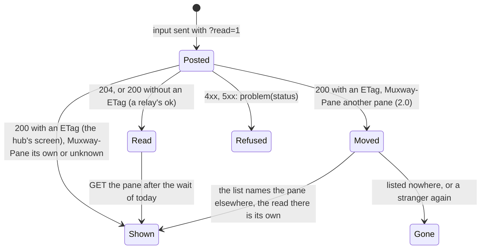

# Feature: a key's echo rides on the input's answer

> Status: proposed 2026-11-09, implemented and reviewed with the pull request. Parity
> with the core's *reading* row (`docs/ui-guideline.md` §1.4): the core
> answers an input with the pane's screen when asked (`?read=1`), in
> JSON since muxway#327 and in text mode with core PR muxway#329, which
> this client needs (issue #59).

## 1. Goal

The phone sends a reply, Enter or a key and then shows the result at
its next read: today a fixed half-second wait (300 ms for a key) and a
second request, each a round trip over GPRS, or the auto refresh ten
seconds away. The hub can now answer the input itself with the pane's
screen, taken 30 ms after the keys landed, in the shape a text read
gives it and with a read's headers (`ETag`, `Muxway-Pane`). After this
change both builds ask for the screen with every input that is the last
of its job (a key, a typed text, the Enter after a sent text) and draw
the answer's rows at once, through the same path a read's rows take, so
a key costs one round trip instead of two. A hub or a host older than
this answers `204`, and the phone reads as before; a relay that cannot
pass an empty answer and stands `200 ok` in for a `204` (the relay
page's WAP rule) is told apart from the hub's screen and the phone reads
as before too. The refresh timer goes on unchanged.

Out of scope, and why:

- the text of a *sent* reply (text then Enter) is posted without the
  screen: its answer would be a screen the phone never shows, since the
  Enter's answer follows at once, and over GPRS a screen is seconds of
  bytes. The issue says the second answer is the one to show; this is
  how the phone gets only that one;
- `ansi=1`: JSON only, and the phone reads text;
- the auto refresh's cadence: unchanged, as the issue asks;
- the mouse, which the phone does not send.

## 2. Design

### 2.1 One query for a read and an input

The read's query string (`lines=<Ui.LINES>&width=400`, and `charset=`
when the Text setting is not Unicode) moves into one helper, `query()`,
used by the read, by the second read after a follow (2.0) and by the
input. An input that asks for the screen posts to
`panes/{address}/input?read=1&<query()>`; one that does not (the text
of a sent reply) posts to `panes/{address}/input` as today.

### 2.2 What an input's answer is

| Answer | Meaning | The phone |
|---|---|---|
| `200` with an `ETag` | the hub's screen, as a text read's | the rows are set on the view as a read's are; no read follows |
| `200` without an `ETag` | a relay's stand-in for `204` (the WAP rule: *turn `204` into `200` with a short body such as `ok`*) | as `204` |
| `204` | an older hub or host, or a token with a write grant and no read grant for the pane | the input landed; the view is shown and read as today, after the same wait as today |
| anything else | refused | `problem(status)` as today: *Read only.*, *This pane is gone.* with the list, and so on |

The `ETag` is the mark because a hub's screen always carries one, in
text mode too, and a relay that makes a body up for a `204` has none to
give; the relay page says so from now on. The body of a `200` without
one is never drawn.

### 2.3 The rows take the read's path

`read()` is split: the request, then `shown(v, status)`, the part that
takes an answer carrying the screen or a `304`: the stranger check on
`Muxway-Pane` (2.0, see the [pane id plan](2026-11-07-pane-id.md)),
then `304` nothing, then any other status `problem()`, then the `ETag`
kept and `setText`. An input's `200` with an `ETag` goes through
`shown()` too, so the rows are filtered, traced, wrapped and checked
exactly as a read's are: a stranger answering the input (the host
renumbered between the view's last read and the key) draws nothing of
its rows, and `moved()` follows the view's own pane or ends it with
*This pane is gone.*; the key reached the stranger already, as it does
today, and the view says where the owner's pane is now.

The job thread's flow after an input that landed: the view is shown
(the Reply form or the Keys list was the screen), and when no screen
came the wait and the read of today follow; when it came, nothing. A
`moved()` that ended the view leaves nothing to show, so the view is
shown only while it is still there.

```mermaid
sequenceDiagram
    participant U as Owner
    participant M as Muxway
    participant R as Relay
    participant H as Hub
    U->>M: Send "make test"
    M->>R: POST /v1/panes/host/work/0.0/input {"text": "make test"}
    R->>H: the same
    H-->>R: 204
    R-->>M: 204 (or 200 ok through a WAP relay)
    M->>R: POST …/input?read=1&lines=120&width=400 {"key": "Enter"}
    R->>H: the same
    Note over H: the keys land; 30 ms; capture
    H-->>R: 200 text/plain, ETag, Muxway-Pane: %3, the rows
    R-->>M: the same
    M-->>U: the rows, at once
    Note over M: no read follows; the refresh timer goes on
```



### 2.4 The 1.0 build

The 1.0 JAR is 30710 bytes, 10 under its cap. The feature there is a
longer path string, one branch on the status and the `ETag`, and a flag
for *the screen came*; `query()` shared by the read and the input gives
some of it back. The plan expects the build to need a few more bytes
found elsewhere in code the 1.0 build carries; what is measured and
what gave way is recorded in the review. The 1.0 build takes the
feature: the issue asks for both builds, and the phone this build is for
is the one on GPRS.

### 2.5 The harness

The test relay forwards the query string as it does (a real relay
forwards it too; the relay page said so already). Two modes misbehave
on purpose:

- `old-hub`: the relay cuts `read=1` from an input's query before
  forwarding, so the hub answers `204` as an older hub would; `wap`
  does the same and, for the WAP rule, turns the `204` into `200 ok`
  with no `ETag`;
- `lie-input`: the relay forwards the input (the key lands), then
  answers it itself: first a megabyte of `x` with control characters
  under an `ETag`, then a screen marked `FORGED` under an `ETag` and a
  `Muxway-Pane` of `%999999`, then the hub's own answer.

## 3. Protocol and API changes

None to the protocol: the phone uses `?read=1` with `lines`, `width`
and `charset` on `POST /v1/panes/{address}/input` as core PR
muxway#329's `docs/protocol/v1.md` describes it (*with the screen*),
and pins the version it speaks already. The relay page adds the input's
`200` with a body to what a relay passes back, and that its stand-in
for a `204` carries no `ETag`.

## 4. Security analysis

- What an attacker gains: nothing new. The phone posts what it posted,
  to the same path with a query the hub checks (`400 bad_parameter`
  before anything is typed), and makes one request fewer. The screen
  comes back only to a token that may read the pane: the hub answers a
  write-only token `204`, and the phone reads as before, which that
  token is refused as before.
- Authentication and authorisation: unchanged, the token in
  `X-Muxway-Token`; a write needs the write grant and a pane marked for
  writing, the screen the read grant, both the hub's decision.
- Input crossing a trust boundary: the input's answer body is a screen
  from the hub through the relay, taken by the same code as a read's:
  32 KiB at most, control characters dropped, decoded by the
  `Content-Type` or the bytes, wrapped on the phone. `Muxway-Pane` is
  checked as on a read: a forged id costs one listing and one read and
  draws nothing of that answer; a header that is no id is unknown. A
  relay's `200` for a `204` is told by the missing `ETag`, so a short
  `ok` is never drawn as the pane's screen.
- Logged: the hub's audit log has the write as before (who, when,
  which pane, how many bytes); the phone's trace (test builds) has the
  rows as it has a read's, never the token.
- No new dependency.

## 5. Privacy check

Docs and tests use the suite's `alice-laptop`, synthetic titles and a
synthetic marker (`hi-42`, `FORGED`). No real host, person or secret;
screenshots from the emulator against the test hub.

## 6. Test plan

| # | Test | Kind | Expected |
|---|------|------|----------|
| 1 | S35: the relay answers the input itself (`lie-input`): a megabyte with control characters under an `ETag`; then a screen marked `FORGED` with a stranger's `Muxway-Pane`; then the hub's own | e2e-security (2.0) | the first is cut and filtered, drawn, the app stays up; the second draws nothing (`FORGED` never traced or on screen), the phone lists once, follows to the same address, reads once and draws its own rows; the third is drawn; every key reached the pane; the only writes are the three inputs |
| 2 | S04, S07, S11, S16, S24: read-only panes and tokens | e2e-security | unchanged: nothing is sent |
| 3 | S19: the paths the relay forwards | e2e-security (2.0) | unchanged: the relay's list takes the input's path with a query already |
| 4 | S33: a key after a renumber | e2e-security (2.0) | the Enter is posted to the pane's new address with `?read=1` and nothing else is asked of the hub after it |
| 5 | F08: Reply, text and Enter | e2e-ui (both) | the text is posted without `read`, the Enter with `?read=1&lines=…&width=400` (and `charset=latin1` on the 1.0 build); the rows with `hi-42` come from the input's answer: no pane read between the two posts or after the Enter's |
| 6 | F09: Keys, Ctrl-C | e2e-ui (both) | posted with `?read=1`; the screen comes with the answer, no read after it |
| 7 | F52: an older hub (`old-hub`): the relay cuts `read=1` and the hub answers `204`; then, the WAP way (`wap`), `200 ok` without an `ETag` | e2e-ui (both) | on both the phone reads the pane after the input and draws the hub's rows; `ok` is never drawn as the screen |
| 8 | F10, F50: the auto refresh | e2e, e2e-ui | unchanged: the timer's conditional reads go on, the echo takes nothing from them |
| 9 | F47: a pane gone, a key sent | e2e-ui (both) | unchanged: `404` to the input says *This pane is gone.* with the list |
| 10 | the whole suite on both builds | all | green; the 1.0 JAR under 30720 bytes |

Unit tests: none; the change is in the job flow, which the end-to-end
tests drive, and the bodies and the encodings it reuses are tested
already. UI tests take `typed`, `output` (F08), `keys`, `interrupted`
(F09), `old-hub`, `wap` (F52) and `big`, `forged`, `own` (S35) screenshots.

## 7. Documentation

- `docs/features/pane-view.md`: *The screen*: the echo on the input's
  answer, the fallbacks, the sequence diagram above; the state diagram
  gets the input's answer as a way into *Rows* and *Moved*; Security.
- `docs/features/relay.md`: the input's answer may be a `200` with a
  body and `ETag` and `Muxway-Pane`; a stand-in for `204` carries no
  `ETag`.
- `docs/ARCHITECTURE.md`: the job sequence diagram (no read after the
  Enter), *Protocol features used* (`read=1` and the read's parameters
  on the input).
- README: the *Reply* bullet.
- `version`: 0.12.0.

## 8. Implementation steps

1. `query()`; `shown(v, status)` split out of `read()`; `input(json,
   screen)` with the `ETag` rule; the job flow; both builds built, the
   1.0 JAR measured, bytes found where needed.
2. Harness: `old-hub`, `wap` and `lie-input`; F08 and F09 assert the
   echo and the query; S35, F52; S33 asserts the query and that no read
   follows the key.
3. Docs; version 0.12.0.
4. Review, the full run on both builds against the core checkout of
   `echo-text-mode`, recorded; the pull request, a draft until core PR
   muxway#329 is merged.

---

## Review (after implementation)

- [x] Diff matches the plan, deviations explained here
- [x] Security rules (AGENTS.md section 2) hold: the phone posts what
      it posted, to the same path with a query the hub checks, and one
      request fewer; the screen comes back only to a token that may
      read the pane; the input's body is taken by the read's code (32
      KiB, control characters dropped, `Muxway-Pane` checked), and a
      relay that answers a key itself gets no further than with a read
      (S35); a `200` without an `ETag` is never drawn (F52); only the
      listed paths are asked for (S19); no secret in any log (S99)
- [x] Privacy check passed: `scripts/prepush-check.sh` clean and diff read
- [x] Docs and diagrams updated

Deviations and measurements:

- **The 1.0 build** took the feature as planned, and needed the bytes
  the plan expected: with the feature alone it was 30909 bytes, 189
  over the cap. The room came from the ten accessor methods javac wrote
  for the spin thread's reach into the MIDlet's private fields and
  methods (`display`, `view`, `frames`, `waitBar`, `busy`, `auto`,
  `pollSerial`, `interval()`, `start()`, `giveUp()`): package-private
  now, with no accessor, the same code otherwise. The 1.0 JAR is 30680
  bytes, 40 under the cap.
- **S19** is unchanged: the relay's list takes the input's path with a
  query already, so nothing there had to move; the query is asserted
  by F08, F09, S33, S35 and F52 instead.
- **The harness relay** flushes its answer line as it writes it: it
  never closed its log, so the last answer of a test was not on disk
  while the test read the log, which the first run of F08 found.
- **A fixture mode** of the relay (`claude` and its kin, `big`,
  `garbage`) answers pane *reads* with its screen and leaves an input's
  answer the hub's own; the tests that type into such a pane do not
  look at the rows that come back, so none changed.

## Test run

Run 20261109-190113-1df282b, recorded as
[issue #60](https://github.com/notmarkopadjen/muxway-midp/issues/60):
282 tests passed on both builds, none failed, against the core checkout
of `echo-text-mode` at 7239d54 (core PR muxway#329). The full run
before it, 20261109-182536-1df282b, failed in S03 (2.0), F11 (1.0) and
F17 (both) while another repository's suite ran on the same machine:
in each the pick from a soft-key menu landed an entry or two off (on
Desk, on Keys), the menu slip the pane id plan recorded under load;
the six passed alone, and in this run. In F17 the slip opened Keys and
sent Enter, and the pane's real screen came back with the key's answer
where a fixture read used to hide the slip, which is the feature at
work, not a fault of it. The 1.0 JAR is 30680 bytes, 40 under the cap.

The pull request's CI run, against the core's `main` before muxway#329
was merged, failed F08, F09, S33 and S35 as the plan says an older hub
must: the hub answered `204` and the phone read after each input, which
those four assert it need not. Rerun after the merge (core `main` at
e5cffb3, 2026-11-10): 282 tests passed, none failed.
