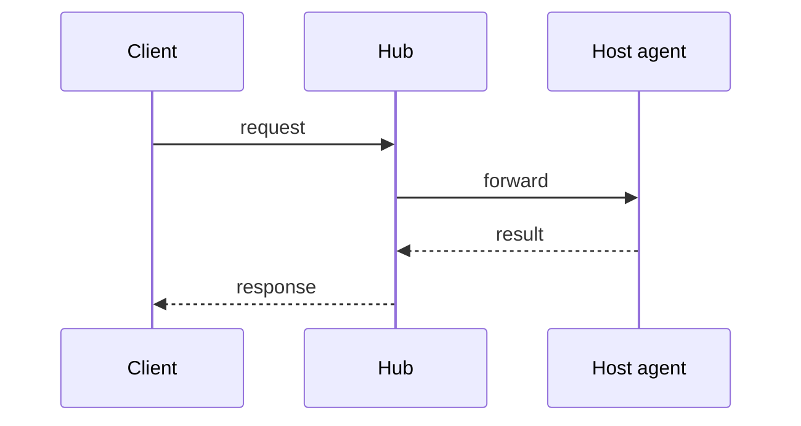

# Feature: <name>

> Copy this file to `docs/plans/<yyyy-mm-dd>-<slug>.md` and fill it in.
> The plan is presented in the console and approved by the owner before
> any code is written. Sections that do not apply say "none" and why.

## 1. Goal

What problem this solves and for whom, in a few sentences. What is out of
scope.

## 2. Design

How it works. Components touched, new components, data that is stored.

Add state, class or component diagrams where they help.

## 3. Protocol and API changes

New or changed messages and endpoints, with example requests and responses.
Version impact: compatible, or a new protocol version.

## 4. Security analysis

- What an attacker gains if this feature is abused.
- Authentication and authorisation: which grant it needs.
- Input that crosses a trust boundary and how it is validated.
- What is logged, and confirmation that no secret or pane content is.
- New dependencies and why they are trustworthy.

## 5. Privacy check

Confirmation that the feature, its docs, fixtures and screenshots contain no
real host, person, service or secret.

## 6. Test plan

| # | Test | Kind (unit / e2e / e2e-security / UI) | Expected |
|---|------|---------------------------------------|----------|
| 1 |      |                                       |          |

Security tests are listed first. UI tests name the screenshots they take.

## 7. Documentation

Pages and diagrams to add or update.

## 8. Implementation steps

Ordered, each small enough to commit on its own.

---

## Review (after implementation)

- [ ] Diff matches the plan, deviations explained here
- [ ] Security rules (AGENTS.md section 2) hold
- [ ] Privacy check passed: `scripts/prepush-check.sh` clean and diff read
- [ ] Docs and diagrams updated

## Test run

Link to the recorded run: result, commit, logs, screenshots.
