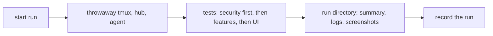
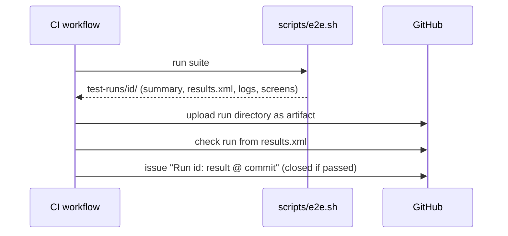
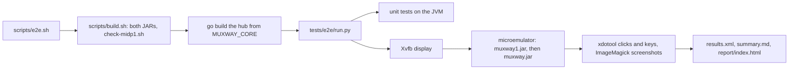

# Testing

End-to-end tests are the main line of defence, and security tests come
first. See AGENTS.md section 6 for the rules; this page describes the
mechanics.

## Test environment

Tests never touch a real machine. Each run starts its own tmux server on a
private socket, a test hub and a test host agent on loopback with throwaway
certificates and tokens, and synthetic panes. Nothing from a developer's own
environment is read.

## A run

Every run writes `test-runs/<timestamp>-<commit>/` (ignored by git):

| File | Content |
|---|---|
| `summary.md` | date, commit, environment, totals, result per test |
| `results.xml` | JUnit XML, for tools |
| `logs/<test>/<component>.log` | full log of hub, agent, relay and emulator per test |
| `screens/<test>/<build>/<step>.png` | UI tests: a screenshot per step and on failure |
| `report/index.html` | HTML report of the run |

UI tests drive the app itself in the microemulator on a headless X display
(Xvfb), with clicks and key presses sent by xdotool and screenshots taken by
ImageMagick; the app's own trace of what reaches the screen is what the
tests read. There is no browser and no Playwright here.

## Recording runs

Every run on `main`, and each feature's final run, is recorded as a **test
run**: a GitHub issue labelled `test-run`.

- Title: `Run <run id>: <passed|failed> @ <commit>`, labels `test-run` and
  `run:passed` or `run:failed`.
- Body: result, commit, totals, a link to the workflow run whose artifacts
  hold the logs and screenshots, then the run's `summary.md`.
- A green run is closed at once; a red one stays open until the fix lands
  and links back to it. The issue list filtered by `label:test-run` is the
  run history.

`scripts/record-run.sh <run directory>` creates the entry. CI calls it after
every run outside pull requests; a local run can be recorded by hand.

In CI each run also gets a **check run** with a per-test table and failure
annotations on the commit (the test-reporter action reading
`results.xml`), and its run directory is kept as a workflow artifact for 90
days.

## This repository

`scripts/e2e.sh` builds both apps with `scripts/build.sh`, builds the hub
and agent from the core checkout (`MUXWAY_CORE`, default `../muxway`),
fetches the microemulator once into `lib/` (verified by SHA-256), and runs
`tests/e2e/run.py`, which runs every test on both builds: `midp1`
(MIDP 1.0 on a 96x65 monochrome skin, `tests/device/n96x65`) and `midp2`
(MIDP 2.0 on the emulator's default screen). `scripts/e2e.sh S04 F08` runs
chosen tests.

| Suite | Where | What |
|---|---|---|
| build check | shell | `scripts/check-midp1.sh`: every Java ME member the MIDP 1.0 JAR references exists in MIDP 1.0, and the JAR is under 30 KiB; the result goes to `build-check.txt` |
| unit (`U`) | JVM | `tests/unit/UnitTest.java`, plain Java SE: text filters, wrapping, labels, the Claude Code lens, JSON bodies, encodings, URL and address grammar |
| security (`S`) | emulator | first in the order: a revoked token, the token in headers only and never on screen, read-only panes, a hostile hub (1 MiB answers, bad UTF-8, control characters, forged titles, a lying charset or program), and last a search of every log for the tokens and keys of the run |
| features (`F`, `J`) | emulator | list, open, reply, keys, auto refresh, outages, the keypad, lenses, per-pane views, the Text setting, pane names, and the install file |

Each emulator test starts its own hub, agent and tmux server on loopback
with throwaway tokens, and a relay (`tests/e2e/harness.py`) that records
every request and can misbehave on purpose: forge titles, lie about the
charset or the mode, answer with a megabyte. The phone is the real JAR in
the microemulator with `Muxway-Trace: 1` in its JAD, so the test reads what
the app puts on screen from the emulator's standard output.

The run directory holds `logs/<test>/` with `hub.log`, `agent.log`,
`relay.log` and `emulator-<build>.log` per test, `screens/<test>/<build>/`
with a screenshot per step, `build-check.txt`, `environment.txt`, and the
log search as the last test (`S99`) in `results.xml`.

### The suite's contract

Each repository provides `scripts/e2e.sh`. It builds the throwaway test
environment, runs the suite, writes one run directory under `test-runs/`
with at least `summary.md` and `results.xml` (JUnit), and exits non-zero if
any test failed.

Considered and not used: an Allure report on GitHub Pages (may be added
for trends), and committing runs to
the repository (logs and screenshots would risk leaking private data into
permanent history).
