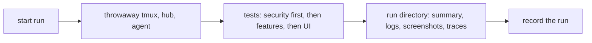

# Testing

End-to-end tests are the main line of defence, and security tests come
first. See AGENTS.md section 6 for the rules; this page describes the
mechanics.

## Test environment

Tests never touch a real machine. Each run starts its own tmux server on a
private socket, a test hub and a test host agent on loopback with throwaway
certificates and tokens, and synthetic panes. Nothing from a developer's own
environment is read.

## A run

Every run writes `test-runs/<timestamp>-<commit>/` (ignored by git):

| File | Content |
|---|---|
| `summary.md` | date, commit, environment, totals, result per test |
| `results.xml` | JUnit XML, for tools |
| `logs/<component>.log` | full log of hub, agent, tmux and test runner |
| `screens/<test>/<step>.png` | UI tests: a screenshot per step and on failure |
| `traces/<test>.zip` | UI tests: Playwright trace, opened with `npx playwright show-trace` |
| `report/index.html` | HTML report of the run |

UI tests drive the clients with Playwright. Where a test needs a page of its
own, it is a plain `.html` file under `tests/e2e/pages/` that can be opened
and replayed by hand.

## Recording runs

Every run that matters (each feature's final run, each run on `main`) is
recorded as a **test run** entry: one item per run with its id, date,
commit, environment, pass/fail per test, and links to logs and screenshots,
kept as a history that can be searched and compared.

The recording mechanism is chosen by the owner from these options:

| Option | What a run becomes | History | Notes |
|---|---|---|---|
| **A. GitHub Issue per run** (proposed) | An issue labelled `test-run`, title `Run <id>: <result> @ <commit>`, body = summary table, links to artifacts; closed when green | Issue list, filters by label, result, branch | Closest to a test run work item: id, state, discussion, links to fixes. Needs the Issues permission on the token. Logs and screenshots live as workflow artifacts (kept 90 days) |
| **B. Allure report on GitHub Pages** | A report page per run with trends across runs | Built-in trend graphs | Pages on a private repository needs a paid plan; fits once public |
| **C. Check run per commit** (test-reporter action) | A check with a per-test table and failure annotations on the commit | Per commit only, no trend | Good addition to A, not a replacement |
| **D. Runs committed to the repo** | Markdown files under `docs/test-runs/` | Git history | Rejected: logs and screenshots risk leaking private data into permanent history |

The proposal is A for the entity, with C added in CI and B once the
repository is public.
